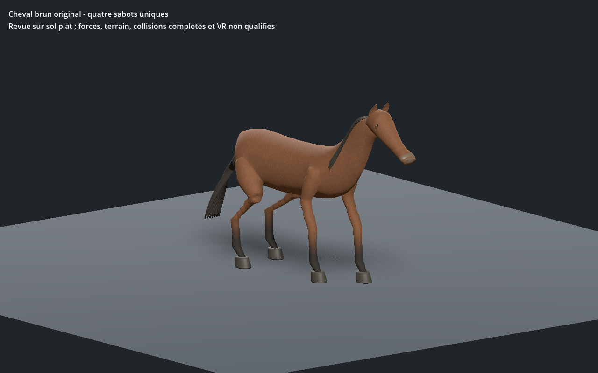
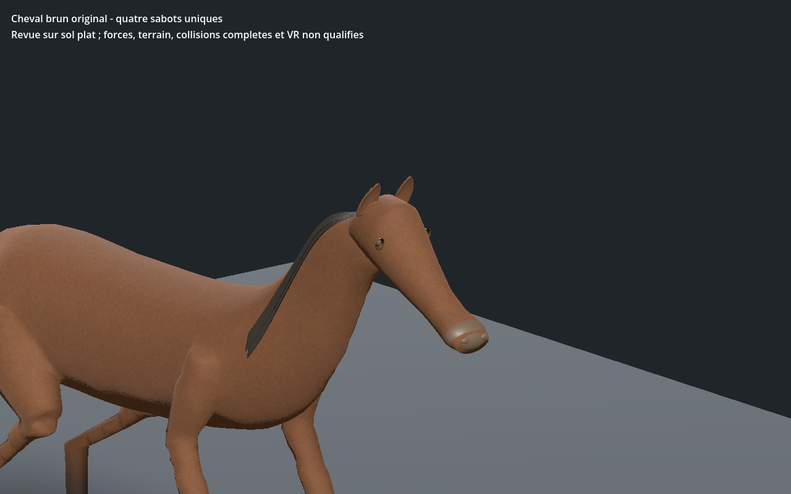
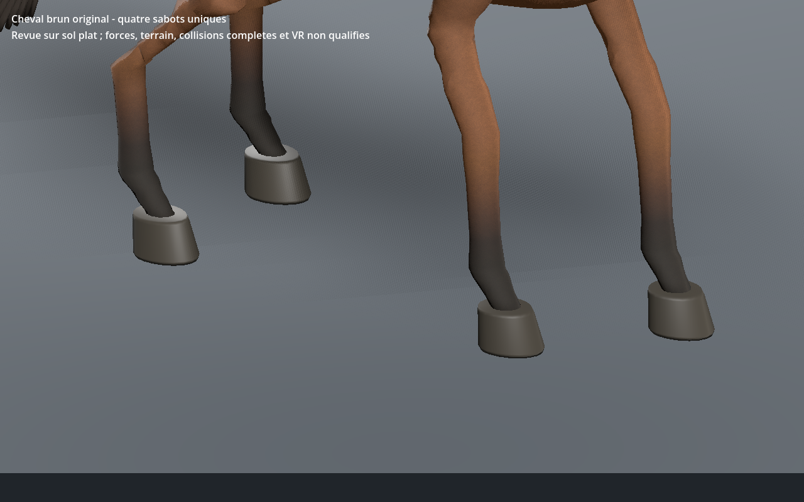

# Cheval brun — première revue de silhouette et marche, recette 0.1.0

[Recette JSON](recipe.json) · [Profil anatomique](anatomy-profile.json) · [Validation](validation.json) · [Sections des membres](shaft-sections.json) · [UV](uv-measurements.json) · [Coût borné](cost-measurements.json) · [Provenance](provenance.json) · [Galerie](../../GALERIE.md)

Nouvelle famille équine pour l’identité du cheval brun : corps original avec peau continue, quatre sabots uniques, cou relevé, tête inclinée, oreilles attachées au crâne, crinière latérale et longue queue. Les pièces originales de tête, oreilles, crinière et queue de l’éditeur sont réutilisées, adaptées et réduites en trois LOD. Les sources de tête et de crinière restent en attente de décision artistique ; leur statut n’a pas été modifié. Les naseaux restent des formes de surface simplifiées, et le dessin de la tête, des yeux, des poils et des sabots doit encore progresser.

Le premier assemblage avait des oreilles flottantes et des parties basses de membres très aplaties, alors que ses tests de contact passaient. Les oreilles ont maintenant leur ancre environ **14 mm à l’intérieur du crâne exporté**, vérifiée sur chaque LOD. La crinière est ajustée à la surface du cou. Les bas des membres sont reconstruits avec des anneaux raccordés aux quatre ouvertures de la peau ; aucun cylindre indépendant ne masque le défaut. Les poids empêchent les articulations distales d’entraîner la peau au-dessus de leur bande anatomique.

Les **60 sections réelles** des membres conservent au moins **83 mm de diamètre** et un rapport de largeur inférieur à **1,079**, contre environ 10 mm et un rapport supérieur à 4 dans le premier candidat. Ce contrôle de la silhouette au repos complète les mesures d’appui et de déformation ; il ne remplace pas une inspection de toutes les intersections.

Les trois LOD comptent **12 988 / 7 024 / 3 668 triangles**, avec **37 os** et quatre influences maximum. Les sommets aux attributs identiques sont fusionnés : le fichier sélectionné passe de **3 915 936 à 2 372 688 octets**, sans changement des attributs rendus de chaque triangle, de ses poids ou des images. Trois images partagées seulement : **512 / 256 / 256** pixels, estimation RGBA8 avec mipmaps **2 097 148 octets**, hors mémoire totale du pilote. Les UV métriques de toutes les surfaces texturées sont mesurés : zéro triangle UV écrasé, anisotropie inférieure à **1,718** en pose de repos ; les transitions entre projections et le flux du poil restent en revue.

La marche lente de revue est contrôlée sur **601 instants par LOD au CPU**, puis **241 dans l’éditeur et Godot**. Au moins trois appuis ; dérive CPU inférieure à **0,084 mm**, dérive native inférieure à **0,30 mm**. Aux phases proches du sommet de levée, la garde minimale mesurée dépasse **106 mm au CPU** et **109 mm dans Godot**. Les arêtes restent entre 0,647 et 1,196 fois leur longueur de repos sur la recette reconstruite ; aucun seuil de déformation n’a été assoupli. Ce n’est pas un calcul de forces ou d’équilibre dynamique.

La version sélectionnée passe Godot Forward+ et Compatibility. Le vrai lien central de l’éditeur, les trois LOD, lecture/pause/reprise/fin/relecture, relief, topologie, tête seule et sauvegarde JSON sont contrôlés. La recette téléchargée modifie le pas de **0,27 à 0,28 m** ; elle est reconstruite puis contrôlée dans Godot Forward+. Les trois images montrent cette reconstruction.

## Coût observé dans une scène isolée

La scène de coût utilise la version sélectionnée (pas 0,27 m) ; les images montrent la recette reconstruite (0,28 m). GPU observé dans le journal du moteur : NVIDIA GeForce RTX 5060 Ti, Vulkan Forward+.

**64 instances animées**, 1280 × 800, sans ombres, cache chaud et VSync demandée désactivée. Après 30 trames de chauffe, 120 mesures par LOD ; les trois images sont réellement partagées.

| LOD | Triangles dessinés | Appels de dessin | Intervalle médian jusqu’à `frame_post_draw` |
| --- | ---: | ---: | ---: |
| 0 | 831 232 | 320 | 2,962 ms |
| 1 | 449 536 | 320 | 2,870 ms |
| 2 | 234 752 | 320 | 2,683 ms |

Ces intervalles muraux incluent l’ordonnancement du moteur ; ce ne sont ni des timestamps GPU ni une attente de fin GPU. Le nombre d’appels reste constant : le regroupement des matériaux est un prochain axe à mesurer. Monde, ombres, IA, physique, réseau et VR sont absents ; ces données ne garantissent aucun FPS en jeu.

SHA-256 du modèle capturé : `5a8c0ef700e77094ccce03d499b46717f2cd9a4d614ef3dba3cefe123ea51e80`.
SHA-256 de la recette : `0d7d7fa0312106b42ca5a3e4b4b9b9a6d36007bb3e1bb76a253cbdce9ddca1aa`.

Générateurs, caches, GLB et adaptateurs privés restent locaux ; le JSON documentaire seul ne permet pas une reconstruction autonome. Les autres identités équines ne sont pas assimilées à cette forme. Première revue équine encore stylisée sur sol plat, dans l’éditeur et Godot isolés. Tête, naseaux, crinière et queue restent à affiner. Aucun photoréalisme final, terrain, virage, force, collision exhaustive, monde principal, réseau ou VR qualifié.
