# Kraken — huit bras, ventouses et ondulation aquatique

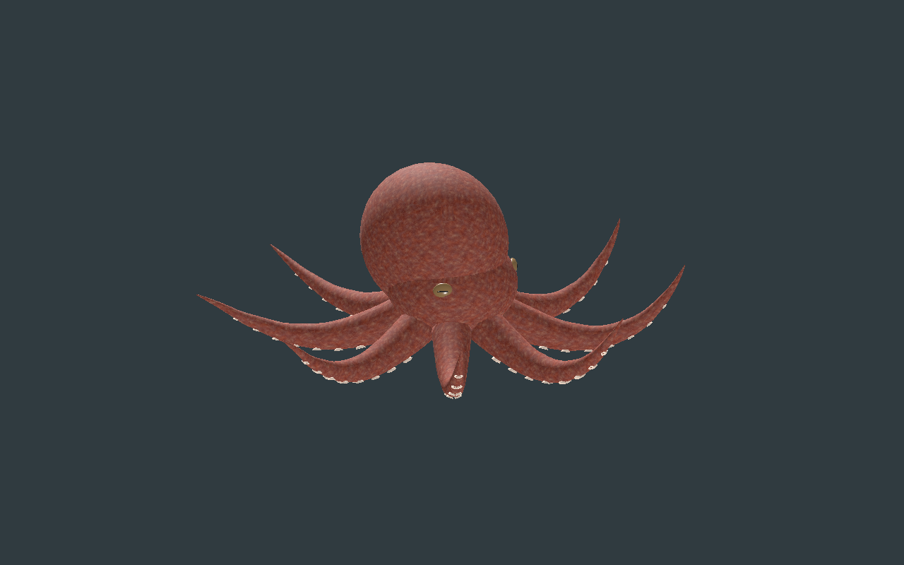

[Recette optimisée](recipe.json) · [Implantation native de revue](native-layout.review.json) · [Conception](design-profile.json) · [Mesures](deformation-measurements.json) · [Validation](validation.json) · [Provenance](provenance.json) · [Galerie](../../GALERIE.md)

Version **0.1.0**, première adaptation originale encore stylisée. Le kraken prend ici une forme octopoïde : **huit bras**, deux rangées de ventouses, deux yeux à pupille horizontale, un manteau, un bec simplifié et un siphon. Le [Smithsonian](https://ocean.si.edu/ocean-life/invertebrates/octopuses-squids-and-relatives) distingue les huit bras des poulpes des deux tentacules supplémentaires des calmars ; l’[Oregon Coast Aquarium](https://aquarium.org/animals/giant-pacific-octopus/) décrit les deux rangées de ventouses. Cette créature de jeu ne reproduit pas une espèce mesurée. Aucun pixel ni modèle de référence n’est copié.

La composition a été créée, lue, modifiée avec contrôle de révision puis exportée dans l’outil natif Créatures. Le [génome de revue](native-layout.review.json) conserve huit composants `tentacle_01`, leurs positions, rotations et échelles. **Le catalogue natif ne rend pas cette nouvelle géométrie optimisée** : ses champs d’implantation alimentent un adaptateur original à bras courbes et rig. Le prefab statique inspecté possède1916triangles ; huit copies seules en totaliseraient15328 avant le corps. Sa géométrie et ses bitmaps ne sont pas recopiés dans cet adaptateur. Le fichier natif n’est pas un génome de production et ne prouve aucun chargement serveur.

| Dessous | Ventouses |
| --- | --- |
| 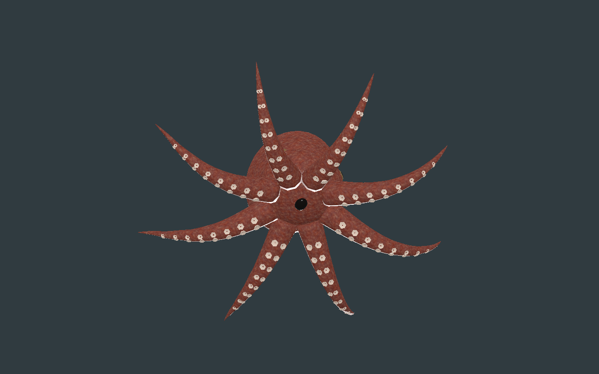 | 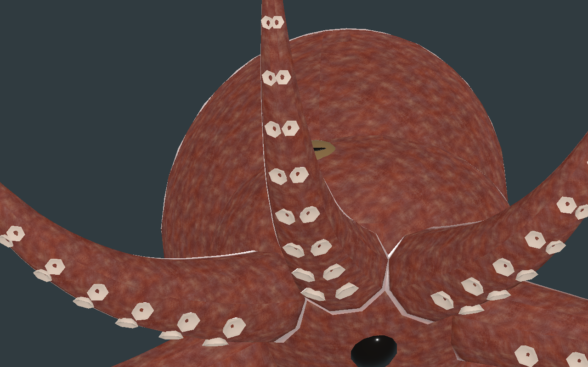 |

Les ventouses sont de vraies cuvettes fermées, avec rebord et fond intérieur ;128/80/48selon le LOD. Leur profondeur minimale, mesurée sur les sommets exportés, est **7.753mm**. Un premier contrôle a détecté des centres jusqu’à3,708mm hors du bras au LOD lointain : le rayon analytique a été remplacé par une intersection avec les triangles du LOD. Après correction, les centres de base restent à l’intérieur sur17poses/LOD, avec une marge minimale **3.981mm** pour la reconstruction. Ce contrôle ne couvre pas toute la surface ni l’adhésion. Chaque œil est inséré de8mm dans la vraie tête exportée ; globe et pupille restent séparés.

Budget : **12012 /6240 /2916triangles**, **49os**, **quatre lots parLOD**, trois images **256/128/128**, estimation RGBA8 avec mipmaps **524284octets**. GLB reconstruit : **2158248octets**. La peau originale ImageGen est réduite et cuite avec l’outil partagé du projet ; normal et rugosité restent des approximations de microrelief. Contraste et vernis sont modérés pour limiter les reflets sur les petites pièces. Les coutures de projection et les raccords de composants restent visibles et non approuvés artistiquement.

| LOD1 | LOD2 |
| --- | --- |
| 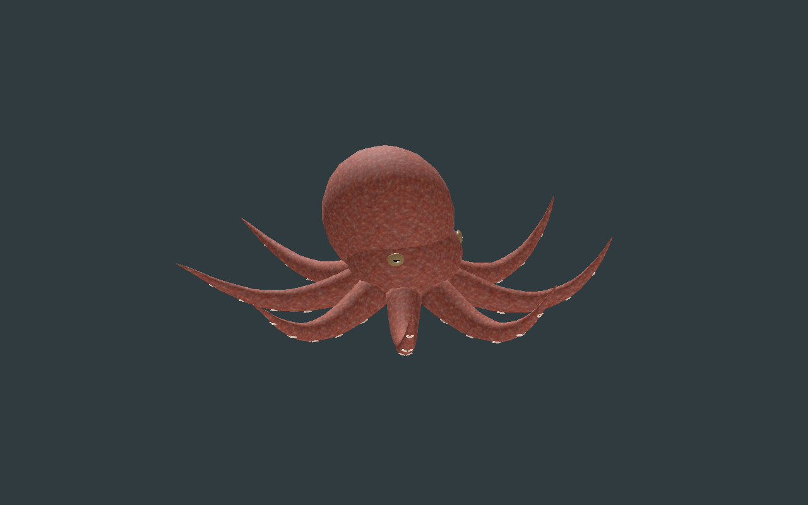 | 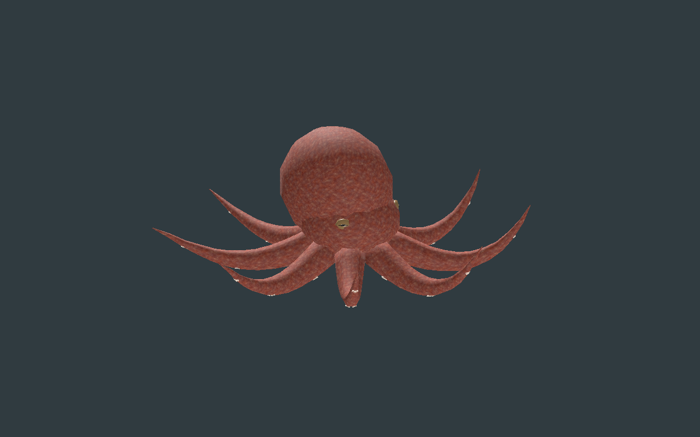 |

Chaque bras possède six os et une onde progressive. Il s’agit d’une ondulation locale, sans déplacement autoritaire ni simulation de propulsion. La recette téléchargée depuis le vrai éditeur change l’amplitude verticale de9 à **10°**, puis est reconstruite. Les attributs de liaison, matériaux et pixels restent exacts ; **40pistes de rotation changent**. L’éditeur vérifie trois LOD,129poses/LOD, les huit extrémités réelles, lecture/pause/reprise, six vues, topologie/squelette/microrelief avec changements de pixels, téléchargements JSON/GLB/génome natif et largeurs736/320.

CPU : **385poses/LOD**, rapports d’arête **0.8989–1.1019**, aires **0.8900–1.1214**, alignement normal minimal **0.3595**, anisotropie UV animée maximale **1.8242**. Les huit extrémités se déplacent chacune de **0.256 à0.407m** au maximum par rapport à leur pose initiale. Godot **Compatibility et Forward+** contrôlent sélection et reconstruction sur129poses/LOD ;17poses de repères comparées aux binds importés donnent une erreur maximale **0.02465mm**. Les instances partagent les images avec des poses indépendantes ; transform de l’entité préservé. Aucun gain FPS n’est déduit.

| Début du cycle | Quart du cycle |
| --- | --- |
| 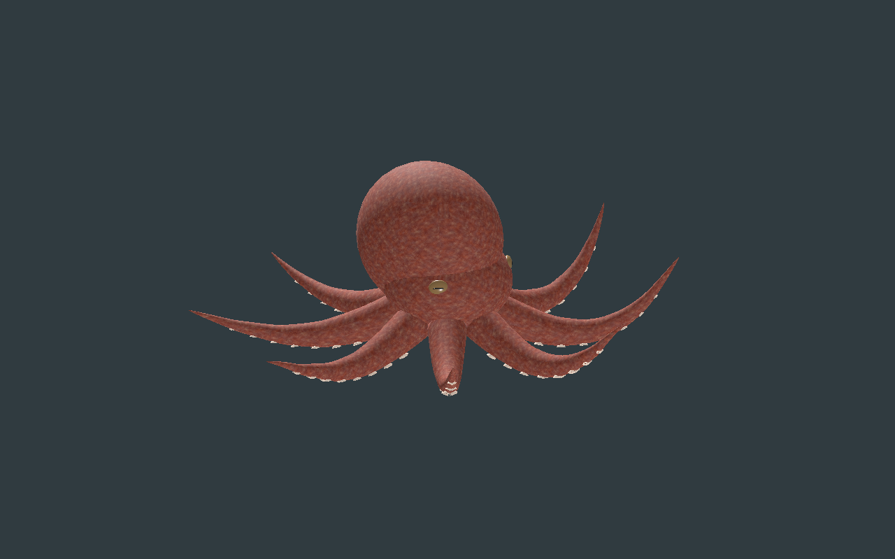 | 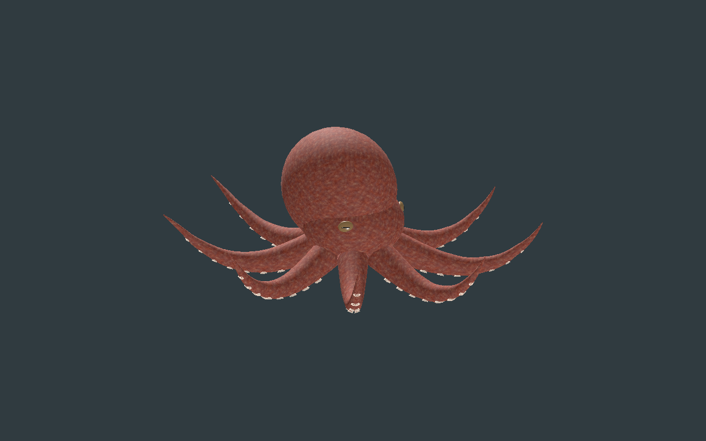 |
| 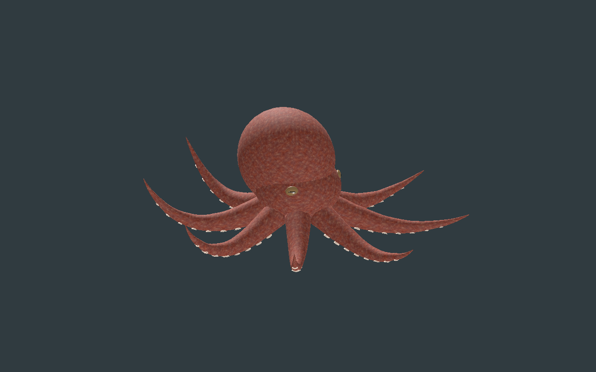 | 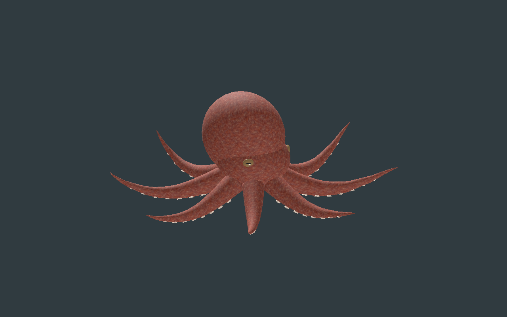 |

| Face | Yeux |
| --- | --- |
| 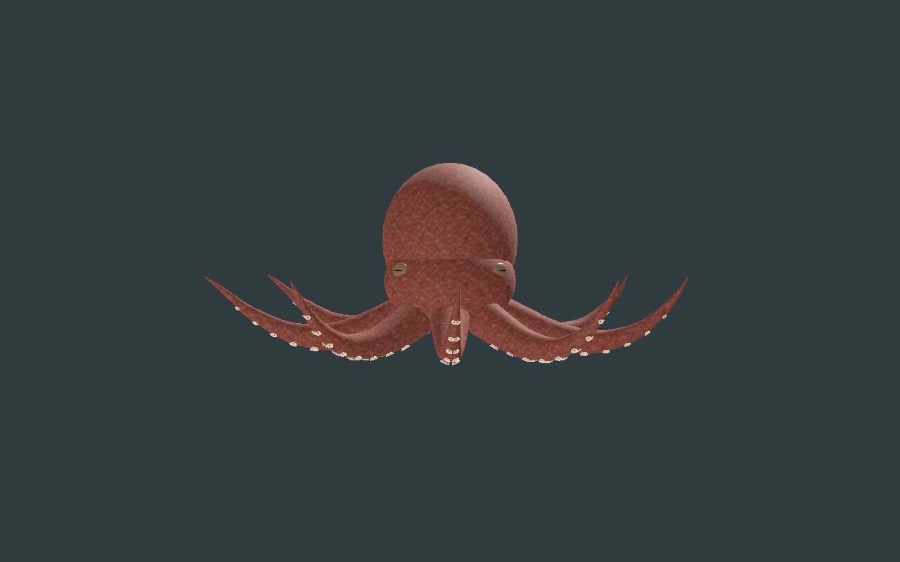 | 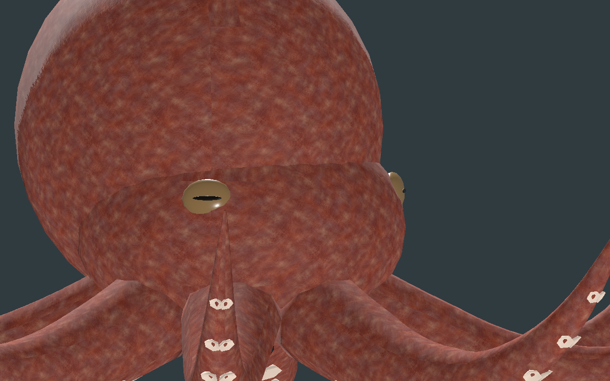 |

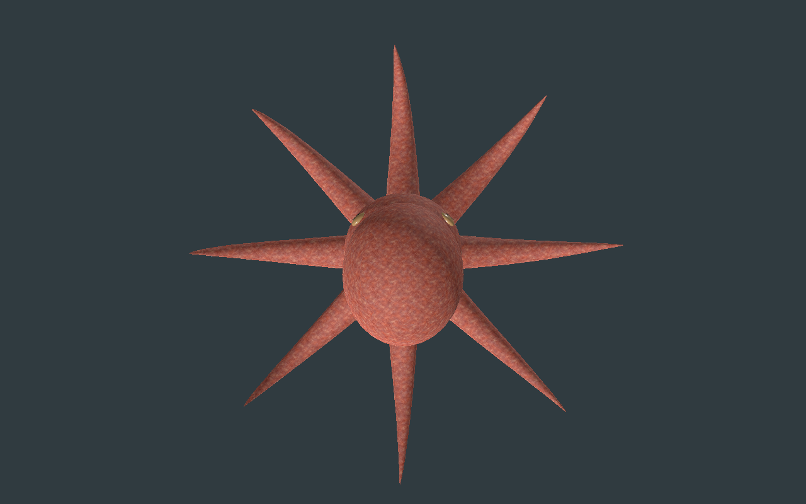

Douze captures natives sans retouche. Modèle reconstruit : `df7fc11d4e4dea8b9a222f00edd8c6838d2579df2d94f1b2a206af798e17d06e`. Générateurs, GLB, bitmap privé et génomes de production exclus ; le génome natif présent ici est uniquement la composition de revue explicitement créée pour cette famille.

Première adaptation originale octopoïde encore stylisée : huit bras, ventouses creuses et ondulation locale. Raccords tête/manteau/bras, coutures UV visibles, ventouses anguleuses et bec simplifié restent à améliorer. Pas de photoréalisme final, collisions exhaustives, adhésion, tissu/forces, hydrodynamique, vitesse autoritaire, monde principal, serveur/réseau/VR ou FPS qualifiés.
