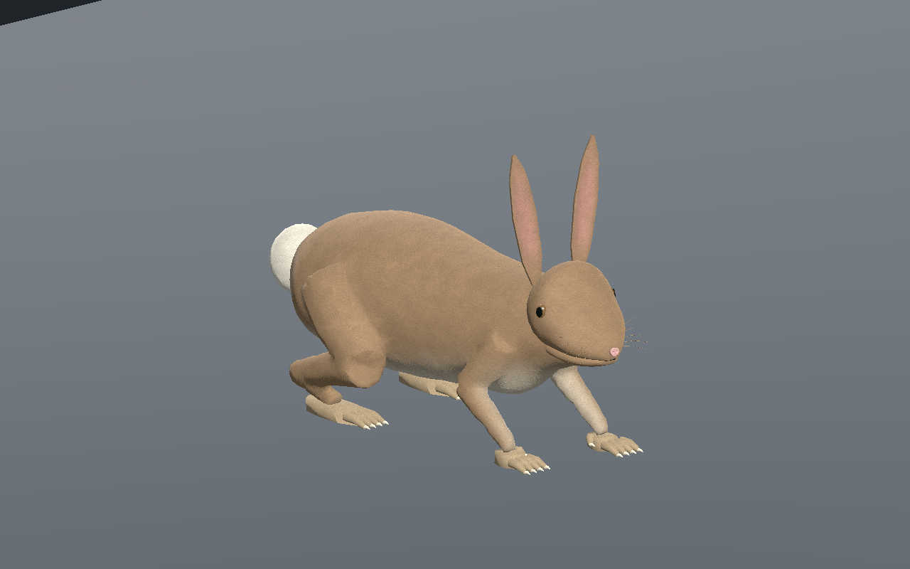
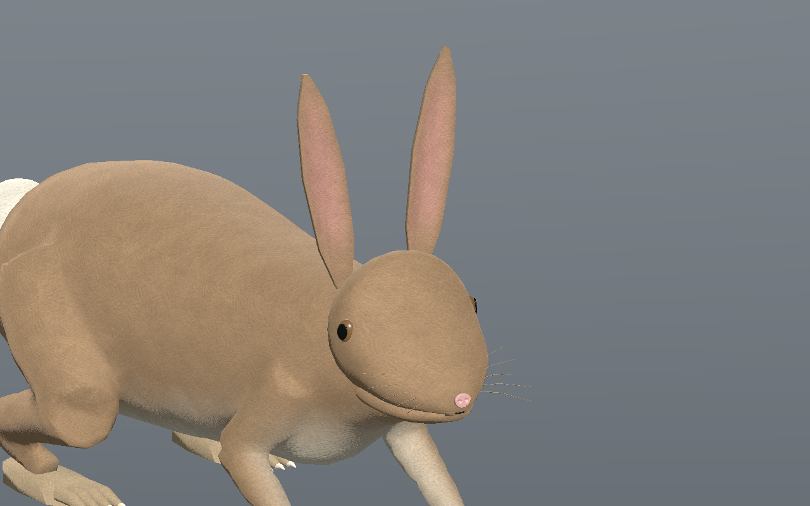
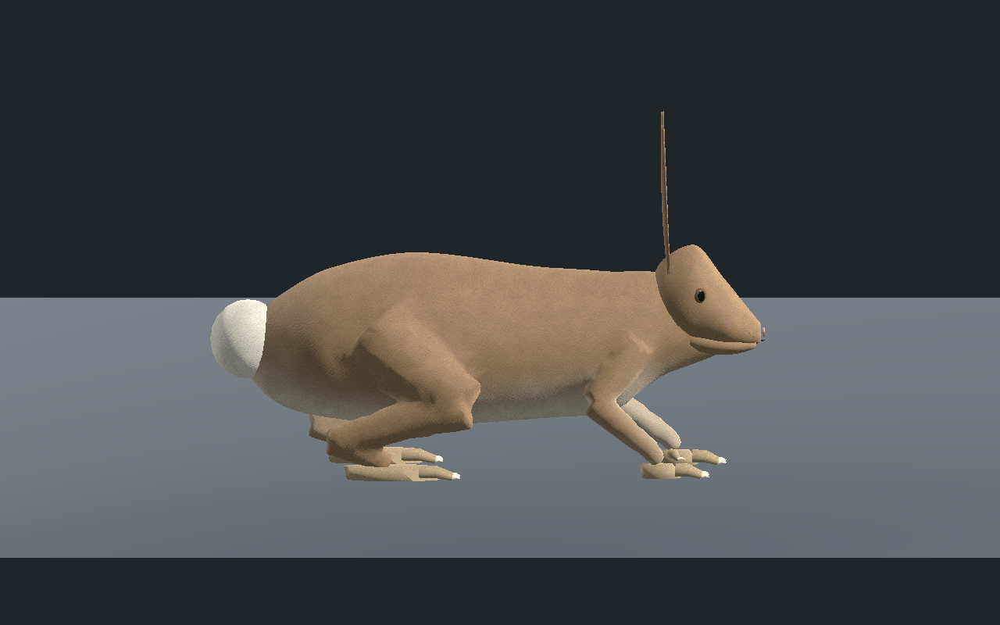
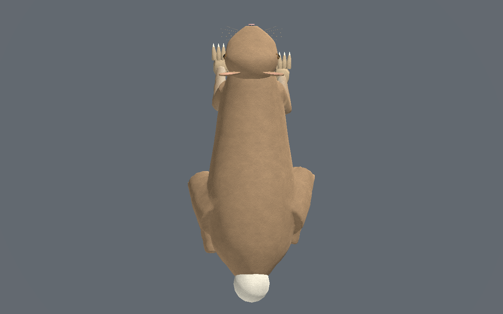
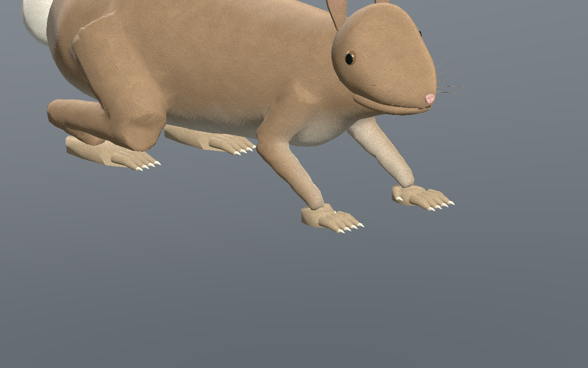
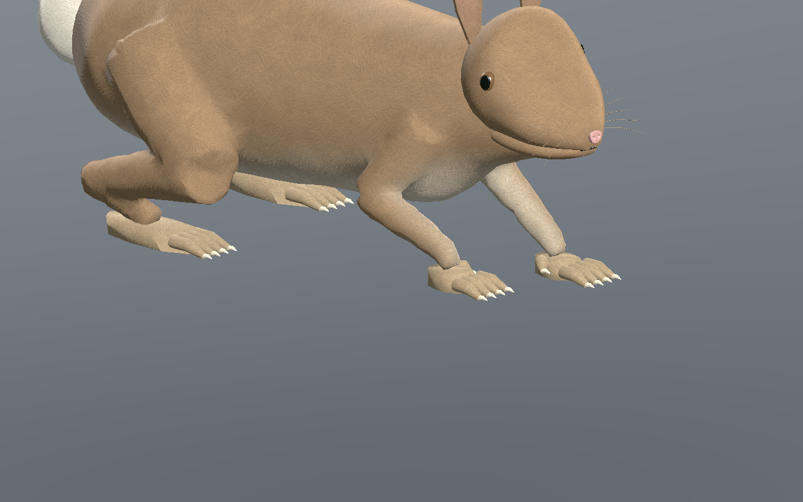
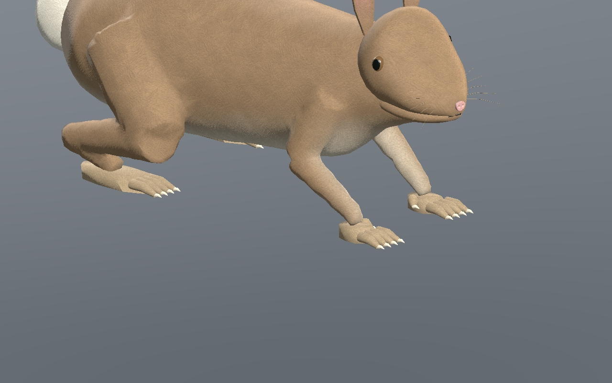
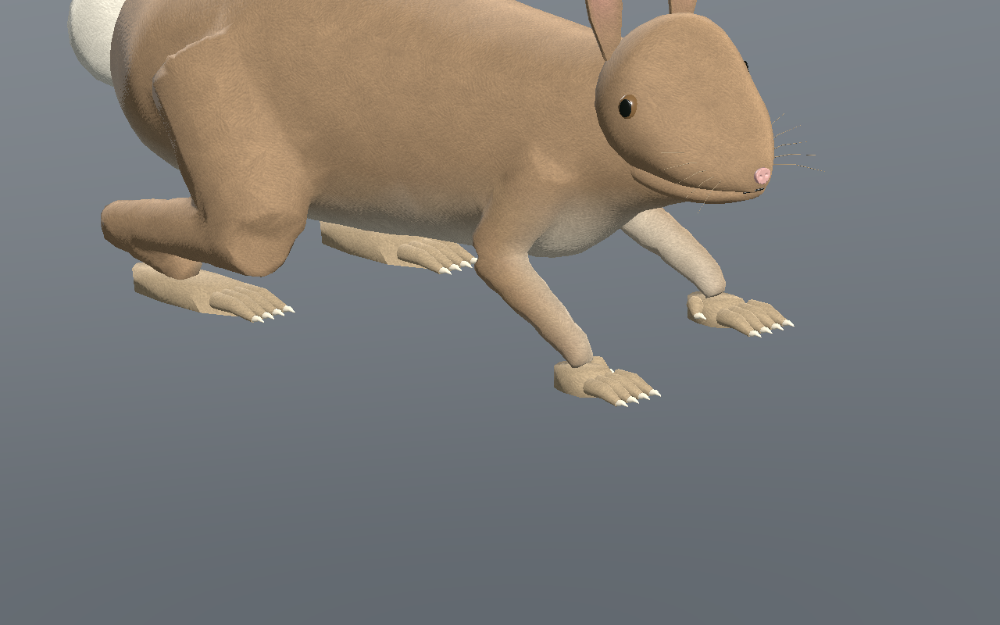
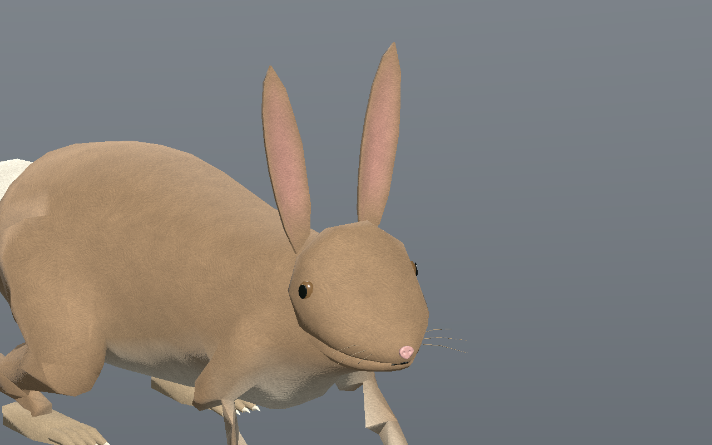

# Lapin original — première revue de silhouette et marche lente

**Version 0.1.0, encore stylisée.** Le photoréalisme final et l’intégration en jeu restent ouverts.

[Recette JSON](recipe.json) · [Profil de conception](design-profile.json) · [Mesures UV](uv-measurements.json) · [Validation](validation.json) · [Provenance](provenance.json) · [Galerie](../../GALERIE.md)

La tête est un composant original indépendant, sans torse ni pattes : deux oreilles en creux, deux yeux latéraux, deux poches nasales réelles et des moustaches. Son museau a été raccourci et le cou prolongé pour retirer le plan de coupe du premier essai. Les trois détails du composant ont des positions, normales, UV et couleurs identiques à ceux de la tête dans le corps entier.

Le corps possède quatre pattes, avec cinq doigts à chaque pied avant et quatre à chaque pied arrière, des semelles couvertes de fourrure et une courte queue claire. Le torse, le cou et les segments des membres forment une surface fermée et connectée ; la tête, les oreilles, les pieds et la queue restent des composants séparés qui se recouvrent.

| Profil | Dessus |
| --- | --- |
|  |  |

Budget mesuré : **10 904 / 6 284 / 3 536 triangles**, plafonds **12 000 / 7 000 / 4 000**, **26 os** et **quatre influences maximum**. Les trois images originales communes aux mammifères font **512 / 256 / 256 pixels** ; estimation RGBA8 avec mipmaps complètes : **2 097 148 octets**. Il ne s’agit ni de la VRAM totale du pilote ni d’une mesure de FPS.

La diffusion des poids sur le vrai maillage réduit l’expansion maximale d’arête du premier essai de **1,640** à environ **1.359** pour la reconstruction. Un triangle trop aplati a été retriangulé sans déplacer les sommets ni ajouter de polygones ; les normales trop obliques sont corrigées dans les attributs de rendu. Sur **601 poses par niveau de détail**, aire relative minimale **0.470**, alignement minimal des normales **0.283** et aucun triangle retourné selon ce contrôle.

La marche lente conserve au moins **trois appuis**, avec une dérive CPU maximale de **0.137 mm**, une hauteur absolue d’appui de **0.336 mm** et une levée minimale de **44.94 mm**. L’éditeur contrôle les trois détails, la lecture/pause/reprise, la tête seule et l’effet réel de la topologie, du squelette et du microrelief. La recette téléchargée porte le pas de 0,085 à **0,09 m** ; sa reconstruction et la sélection passent Godot Forward+ et Compatibility sur **241 poses par niveau de détail**.

| Phase 15 % | Phase 40 % |
| --- | --- |
|  |  |
|  |  |

Les neuf images sont des captures natives sans retouche de la recette reconstruite. SHA-256 du modèle capturé : `300383ac2e980714890d69526859a56d77c86f324f324b139082296343b28eea`. SHA-256 de la recette : `c2e9d56064dc6a4ab0977c3aa8cb0ebd6415143be268b1edf2d845e42a11874d`.

Le JSON seul nécessite le générateur et les ressources originales locales ; aucun GLB, code de générateur privé, cache ou bitmap source n’est publié. L’identité historique de lapin reste une candidate non associée et ses données serveur sont conservées. Première revue locale encore stylisée : marche lente rectiligne sur sol plat dans l’éditeur et Godot isolés. Sculpture du museau et des orbites, épaisseur des oreilles, queue, silhouette du pelage et détails du LOD2 restent ouverts. Bonds, forces/masse, terrain, collisions exhaustives, monde principal, serveur, réseau, VR et photoréalisme final non qualifiés.
