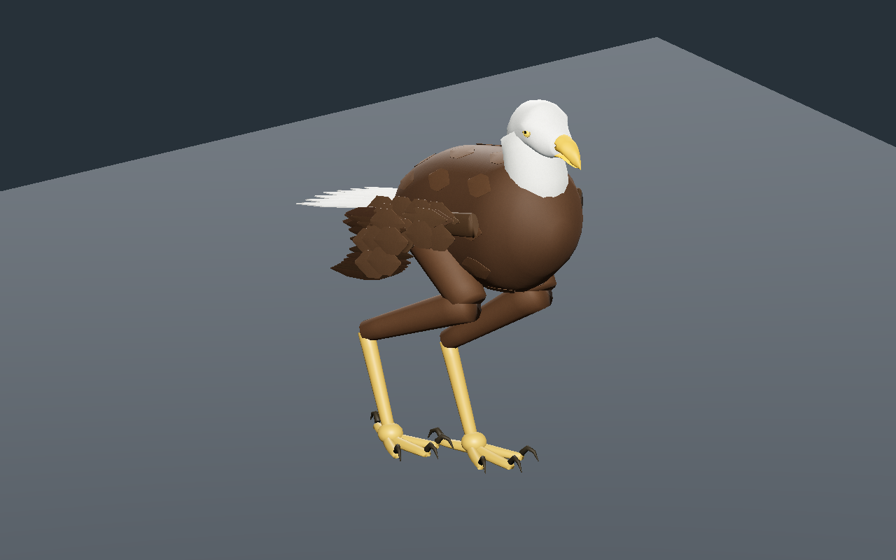
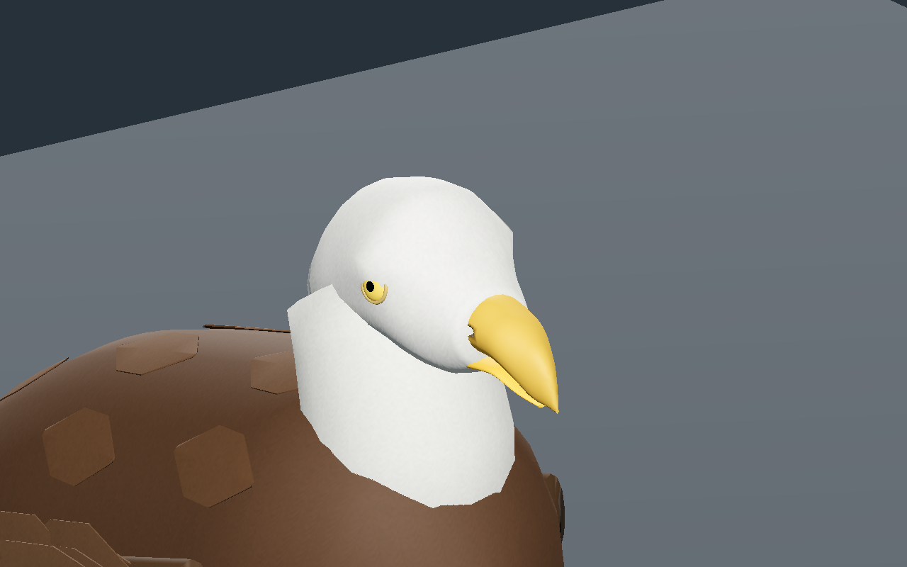
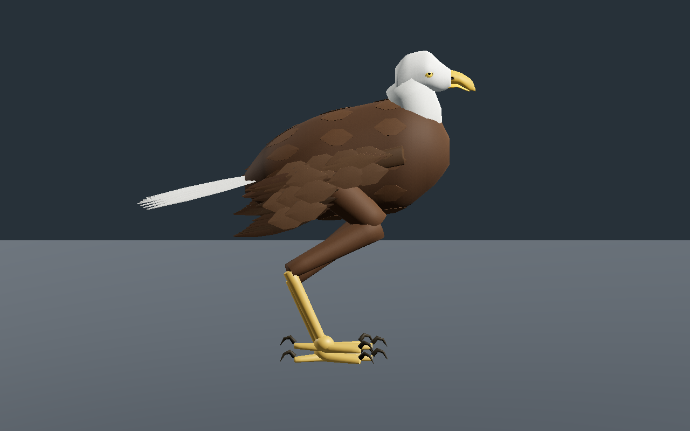
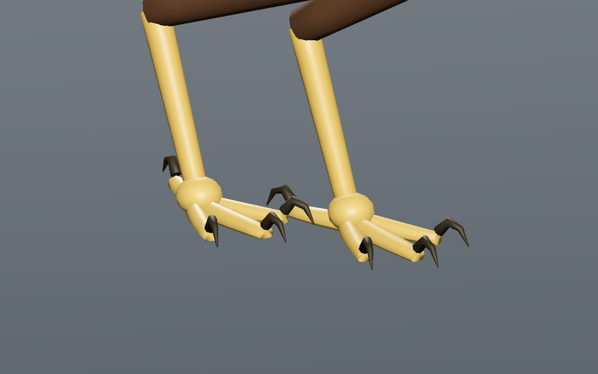
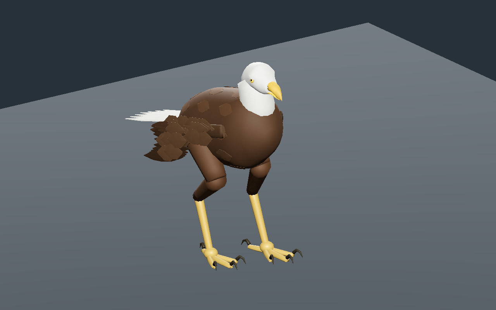
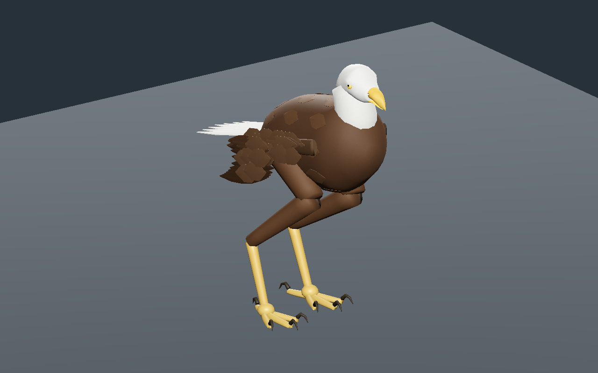

# Rapace original — ailes repliées et marche bipède

Recette documentaire **0.1.0**, `review_only`. Formes et rendu encore stylisés ; aucune validation artistique finale ni promotion au registre de production.

La tête vivante est une pièce crânienne originale sans torse : bec crochu, mandibule et deux cavités nasales creusées, yeux attachés au crâne de chaque détail. Elle remplace pour cette revue l’ancien composant en forme de crâne à long bec. L’ancien fichier d’aile qui contenait un assemblage entier n’est pas utilisé.

Chaque aile reprend une aile unitaire originale. Les plumes solides sont orientées vers l’arrière pour la pose repliée ; une première transformation les faisait pendre vers le sol et a été corrigée après captures natives. Les couvertures du dos sont rapprochées de la surface du torse. Les raccords entre tarses et doigts sont complétés par la base du pied. Le modèle contient encore des volumes fermés qui se recouvrent : ce n’est pas une peau continue qualifiée.

Deux pattes distinctes portent chacune **trois doigts avant et un hallux arrière**, avec huit griffes géométriques au total. Le genou et l’articulation de la cheville restent distincts. Ce choix anatomique s’appuie sur le [glossaire du Cornell Lab](https://academy.allaboutbirds.org/bird-academys-a-to-z-glossary-of-bird-terms/) et la [description du squelette aviaire de l’Université du Kentucky](https://poultry.extension.org/articles/poultry-anatomy/avian-skeletal-system/), sans copie de leurs illustrations. Ce rapace fictif n’est pas associé automatiquement aux identités d’aigle, aux poules ou aux autres oiseaux.

Les trois détails comptent **15 444 / 9 000 / 4 540 triangles**, **29 os** et trois images communes **256 / 256 / 128 px**. Estimation RGBA8 avec mipmaps complets : **786,428 octets** ; GLB reconstruit : **3,198,904 octets**. Ces tailles ne mesurent pas la mémoire totale du pilote ou le coût du jeu complet. Aucun FPS n’est garanti.

La marche de quatre cycles passe sur **601 instants par détail au CPU**, puis **241 dans l’éditeur et Godot**. Elle alterne **un et deux pieds en appui**, avec une dérive CPU maximale de **0.087 mm** et une levée minimale proche du sommet du pas de **59.52 mm**. La projection du bassin reste dans le polygone des appuis échantillonnés ; elle est un repère cinématique, pas un calcul de masse, de forces ou d’équilibre dynamique.

L’entrée centrale de l’éditeur ouvre la bibliothèque de composants, puis le rapace entier. Lecture, pause, relecture après la fin, trois détails, vues, relief, topologie et téléchargements sont vérifiés. Les limites des meshes skinnés sont mises à jour à chaque pose. La sélection passe Godot **Forward+ et Compatibility**. La recette effectivement téléchargée change le pas de **0,14 à 0,13 m** ; elle est consommée par le générateur, reconstruite et contrôlée de nouveau au CPU et dans Godot Forward+. Les six captures correspondent exactement à cette reconstruction.

Tous les triangles texturés exportés ont des UV non écrasés et une anisotropie de repos inférieure à **1,735**. Le passage de l’aile étendue à l’aile repliée est une transformation de géométrie d’auteur ; aucune animation de déploiement ni de vol n’est créée.

SHA-256 du modèle capturé : `d7c2c3b590ba0ccc2e1037fca32bfb92b8ebbff7b883cf2845be6cffea5cf45b`.
SHA-256 de la recette : `1029c740342bd281f7042b4d1849dc8d89cd0e4de7f7814fc6c91d0037952f7b`.

Générateurs, GLB, caches, adaptateurs et images sources privés restent locaux. La recette JSON documentaire seule ne reconstruit pas le modèle sans ses dépendances locales. Première revue encore stylisée : CPU, éditeur réel et Godot isolé, marche bipède rectiligne sur plan plat. Sculpture, plumes, peau continue et écailles restent à affiner. Masse réelle, forces, équilibre dynamique, terrain, virages, intersections exhaustives, vol, monde principal, réseau et VR non qualifiés.
