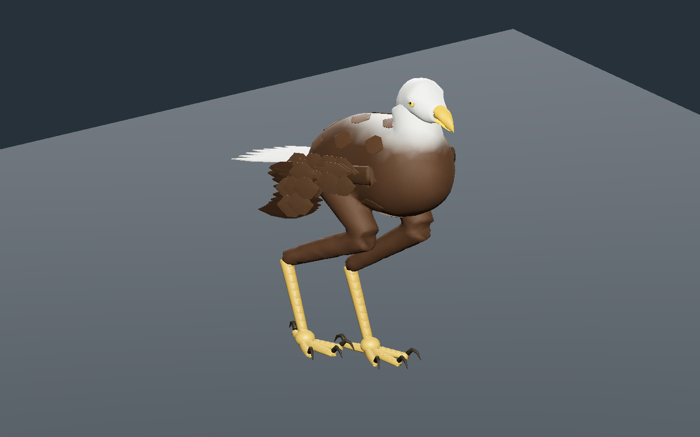
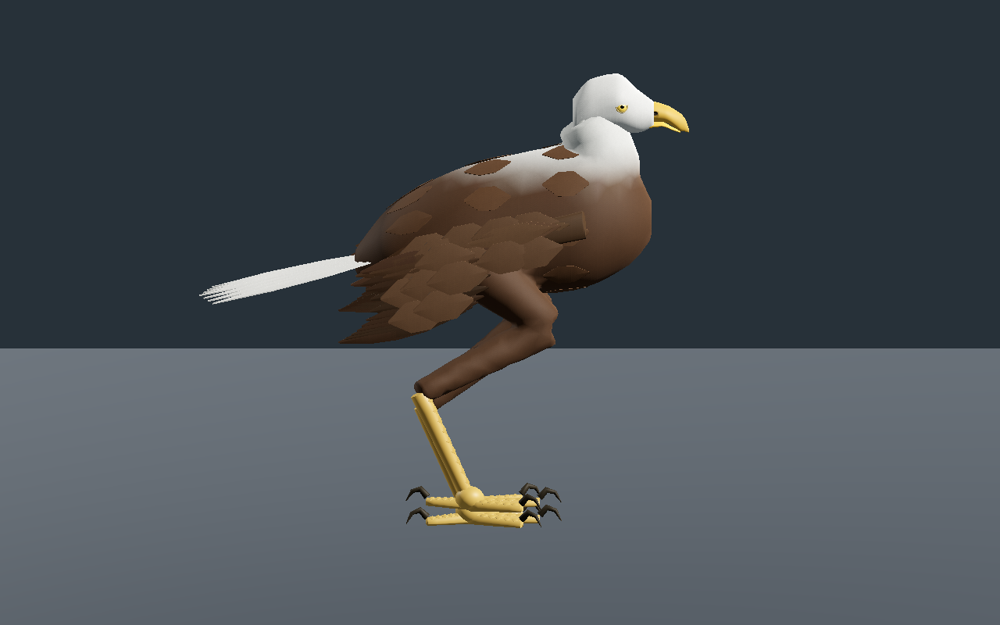
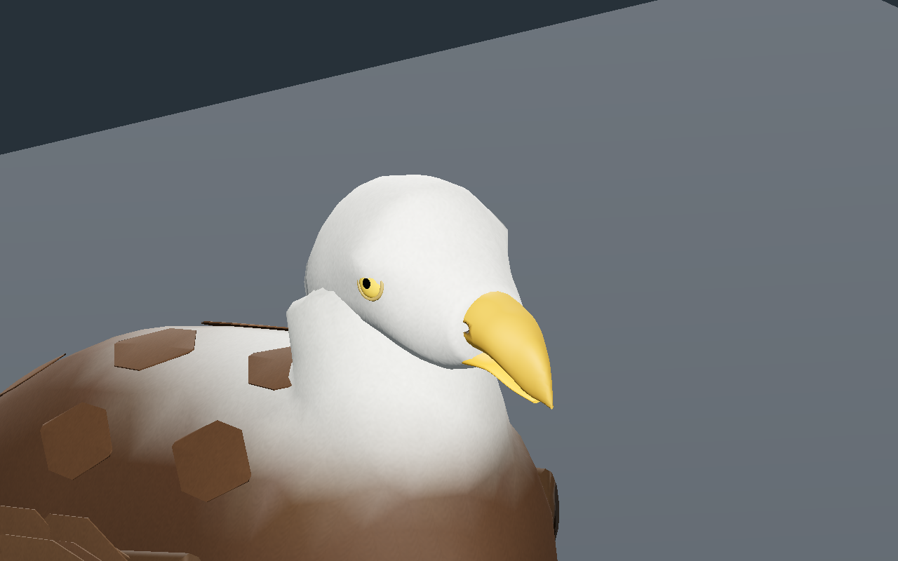
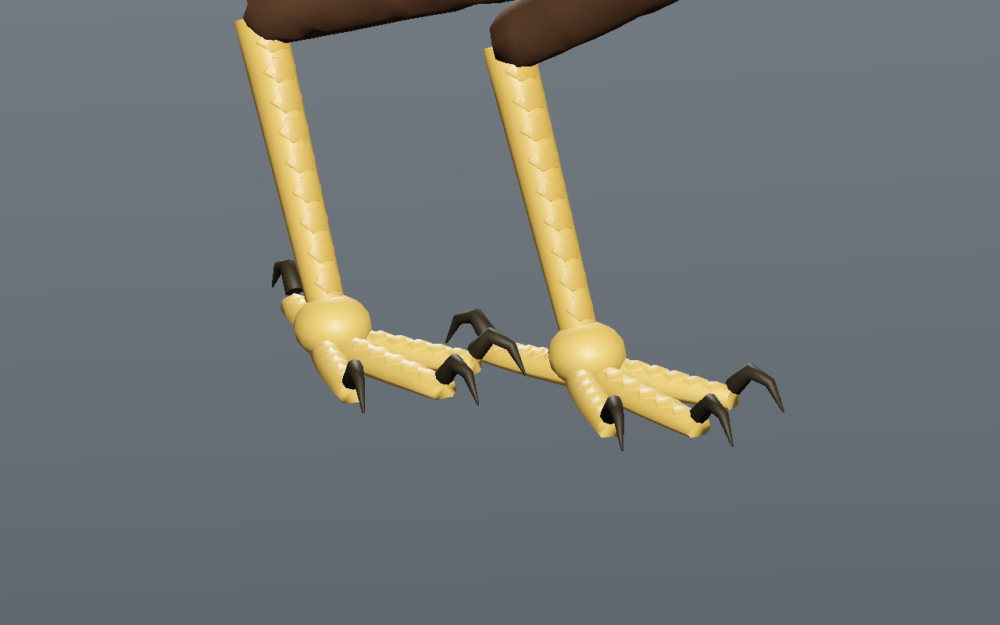
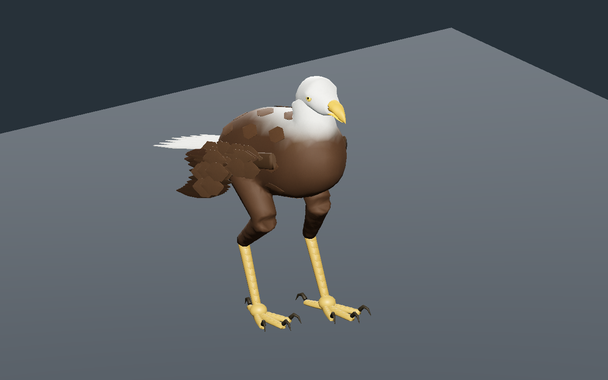
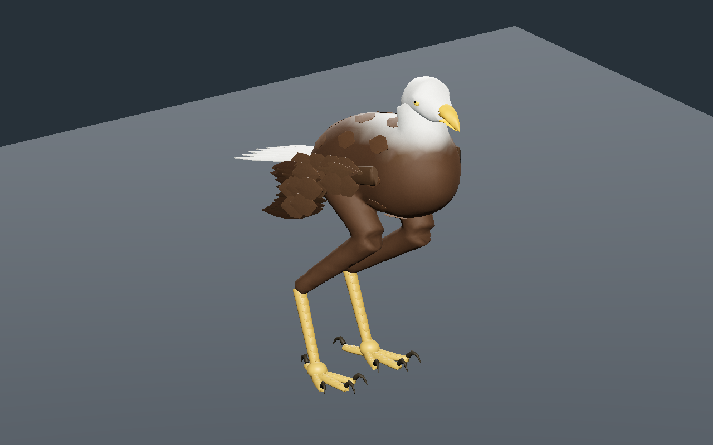

# Rapace original — peau du cou et des pattes, écailles

Recette documentaire **0.2.0**, `review_only`. Le torse, le cou et le haut des deux pattes sont réunis en une seule surface fermée dans chaque détail. Le rendu reste stylisé et les autres pièces restent séparées.

Le raccord du cou a été fondu dans le torse et sa couleur évolue progressivement vers le blanc. Le dessous du ventre est dégagé des genoux pour éviter un second raccord de peau à cet endroit. La peau des jambes ne se compose plus de cylindres fermés qui se recouvrent. La tête et les ailes restent les pièces originales séparées de la [version 0.1.0](../v0.1.0/README.md).

Des plaques originales suivent la courbure du devant des tarses et du dessus des doigts : **68 / 44 / 32 écailles** selon le détail, sans nouvelle image. Les surfaces plantaires et les griffes sont conservées. Le choix de rangées transversales sur le tarse s’appuie sur le [glossaire anatomique de l’Université de Puget Sound](https://www.pugetsound.edu/puget-sound-museum-natural-history/biodiversity-resources/birds/glossary-avian-external-anatomy), sans copie de son contenu visuel. Ce modèle fictif n’est pas une certification anatomique de toutes les espèces de rapaces.

Les premiers essais de peau continue dépassaient le seuil d’étirement près du genou. Le volume du ventre, les attaches et leur lissage ont été corrigés. Le calcul utilise l’assignation automatique décrite dans le [manuel Blender 5.0](https://docs.blender.org/manual/en/5.0/animation/armatures/skinning/parenting.html), suivie d’un lissage sur la surface. Les seuils de déformation restent **étirement inférieur à 1,35**, **rapport d’arête supérieur à 0,5** et **aire supérieure à 0,2**. La reconstruction passe **601 poses par détail** : étirement maximal **1.3217**, rapport d’arête minimal **0.6715**, rapport d’aire minimal **0.6751**. Les UV, normales et connexions sont vérifiés sur le GLB réellement exporté.

Le budget mesuré est **17 356 / 9 852 / 5 000 triangles**, sous les plafonds inchangés **18 000 / 10 000 / 5 500** ; **29 os**, quatre influences maximum et trois images **256 / 256 / 128 px**. RGBA8 + mipmaps estimés à **786,428 octets** ; GLB reconstruit **3,584,104 octets**. Ce ne sont pas des mesures de VRAM totale ou de FPS en jeu.

La marche conserve un à deux pieds en appui. Dérive CPU maximale **0.087 mm**, levée minimale près du sommet du pas **59.52 mm**. Les **241 poses par détail** passent aussi dans l’éditeur et Godot. La projection du bassin dans les appuis est seulement un repère cinématique ; elle ne prouve pas un équilibre physique.

L’éditeur conserve les deux versions et exporte les recettes au format correspondant. La nouvelle recette effectivement téléchargée change le pas de **0,14 à 0,13 m**, puis est reconstruite et contrôlée de nouveau. La sélection passe Godot Forward+ et Compatibility ; la reconstruction, Forward+. Les six images montrent exactement cette reconstruction. L’ancienne recette v1 reconstruit son GLB **octet pour octet**, y compris les images, le rig et la marche.

SHA-256 du modèle capturé : `677318f284ae1c2aeb256df34f2e3476055235c11e246e7391295e817aa6d97c`.
SHA-256 de la recette : `04742ed4885ffd018ad5afd6ef670f390ba1436dc0beda0386d8814fa9800437`.

Générateurs, modèles, caches et sources bitmap restent locaux. Le JSON documentaire exige ses dépendances locales ; aucun génome de production ni statistique serveur n’est modifié. Revue locale encore stylisée : torse, cou et haut des pattes réunis en une surface fermée ; marche rectiligne sur plan plat contrôlée au CPU, dans l’éditeur et Godot isolés. Tête, ailes, bas des pattes, doigts et plumes restent des pièces séparées. Sculpture, plumage, intersections exhaustives, forces, terrain, vol, monde principal, réseau, VR et photoréalisme final non qualifiés.
