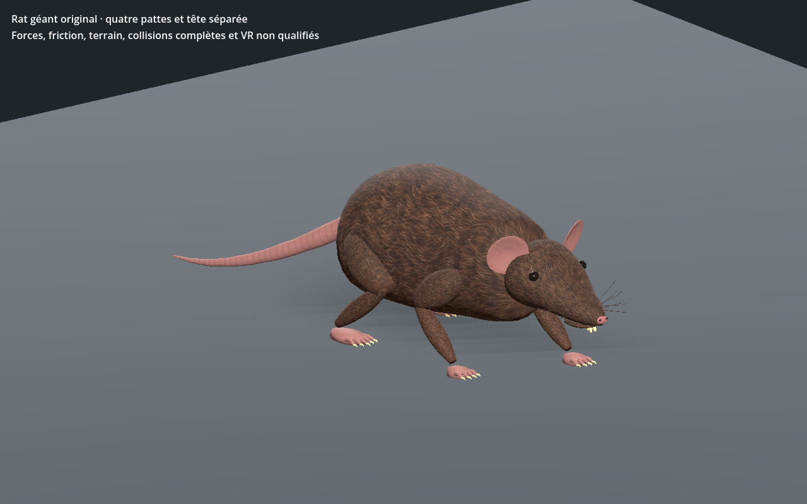

# Rat géant original — recette 0.1.0

[Recette JSON exportée](recipe.json) — version documentaire **0.1.0**, `review_only`.

La recette utilise `uo.rat-original/v1` et la source SHA-256 `6f610f61774cadbb6d5cea02bbc8da11d849092ed6f0f81a6fb181f63f4805d2`. Le générateur et le modèle source ne sont pas distribués ici : ce JSON seul ne suffit pas à reconstruire le modèle. Cette entrée n’est pas un génome Xeno natif ni une entrée strict-v1 du catalogue.

La capture provient du contrôle Godot de la variante reconstruite avec cette recette ; SHA-256 du GLB reconstruit : `69aa1ddd599276933ebe75911dcf1d85bdbba1a9d33c4e121e677072bb8a51fe`. Le contrôle historique `PASS_RAT_NATIVE_SKIN_AND_SOLE_ANCHORS` s’est terminé avec le code 0. La géométrie et les matières de ce lot sont documentées comme originales ou procédurales ; aucune référence historique EA/Origin n’est incluse.

La capture et la preuve locale ne valident pas les collisions complètes, l’intégration au serveur ou à la VR, ni la qualité artistique finale.

SHA-256 de la recette : `552912ce94f1fa54ee832be86087421a6681368b0bbe4df761d62c87ac68b52c` ; de la capture : `d64c6ed46067557fa8cf6a161339266b8edaddb4921c8e5ddb6e1f09e585df1b`.
