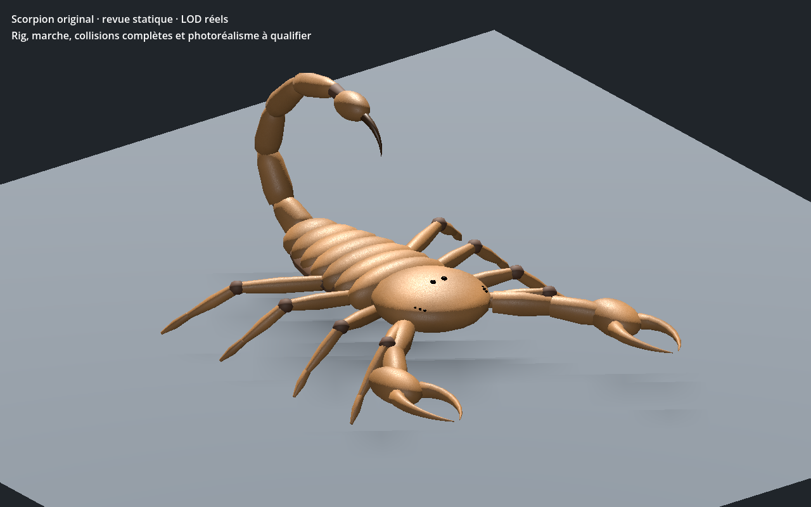

# Scorpion original — recette 0.1.0

[Recette JSON exportée](recipe.json) — instantané de revue, version documentaire **0.1.0**.

Cette recette utilise le générateur local `uo.scorpion-original/v1` et référence le modèle source SHA-256 `e37628750744edf514a9870353cf73f106621fc7657a1ba695c1114f3dd2c41a`. Le générateur et le modèle ne sont pas inclus ici : le JSON seul ne suffit pas à reproduire la géométrie sans ces dépendances. Ce format ne constitue pas un génome Xeno natif ni une entrée du catalogue strict du registre.

La capture montre la reconstruction Godot statique de la recette exportée (largeur du corps 1,05), dont le GLB obtenu avait pour SHA-256 `3cf0ee6c77aa9f51d533fece98eb91d205549b2d80515fc767fe185e9b0f2474`. La source documente une géométrie procédurale originale et des textures procédurales, sans pixels ou géométrie de référence tiers. La validation décrite est limitée aux LOD et à la hiérarchie statiques ; la marche, les collisions complètes, le serveur, la VR et la qualité artistique finale restent à qualifier.

SHA-256 du fichier image : `2f52b2f796fa29b5ff1d388d0a0ee1782072b92cc59a976af92b5b50f785b6ab`.
