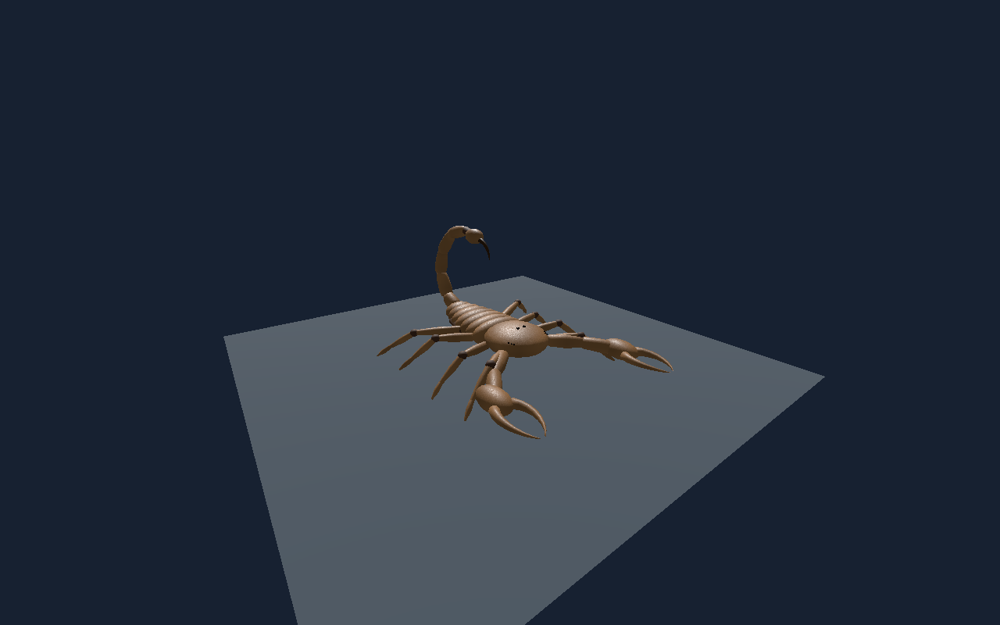

# Scorpion — marche articulée — recette 0.2.0

[Recette JSON](recipe.json) · [Provenance et empreintes](provenance.json) · [Galerie](../../GALERIE.md)

Nouvelle version documentaire animée, conservant la fiche statique 0.1.0. Recette réellement téléchargée puis reconstruite : pas de 0,08 m, levée de 0,04 m, cycle de 1,5 s, part d’appui de 0,74. Huit pattes locomotrices distinctes des deux pédipalpes ; trois actionneurs simplifiés par patte.

**Portée vérifiée :** Audit CPU de 673 instants par LOD, éditeur et Godot : au moins quatre appuis sur sol plat ; 8 992 / 4 470 / 1 998 triangles et deux images 256 × 256. Ce ne sont pas des preuves de forces, terrain, virages, gameplay, VR ou photoréalisme final.

Ce document conserve un instantané de travail original en `review_only`, sans autorité serveur ni approbation artistique finale. Les générateurs, pièces, modèles et adaptateurs locaux nécessaires ne sont pas distribués ici ; ce JSON seul ne reconstruit pas le modèle. Aucune compatibilité strict-v1 n'est revendiquée.

SHA-256 du modèle effectivement capturé : `c1cad49e78ba0382a0bdfb87adf97ceddb949768f7cbe418068518ab35fc14c5`.
SHA-256 de la recette : `266bb4c9055746da5acbc4bd14b323ac81c26670862296fda1f71fecd6bb61a0`.
SHA-256 de l'image : `689b9841e373139f7304333add8cfb44de517942829bd5d5d43032a6b5f4215d`.
