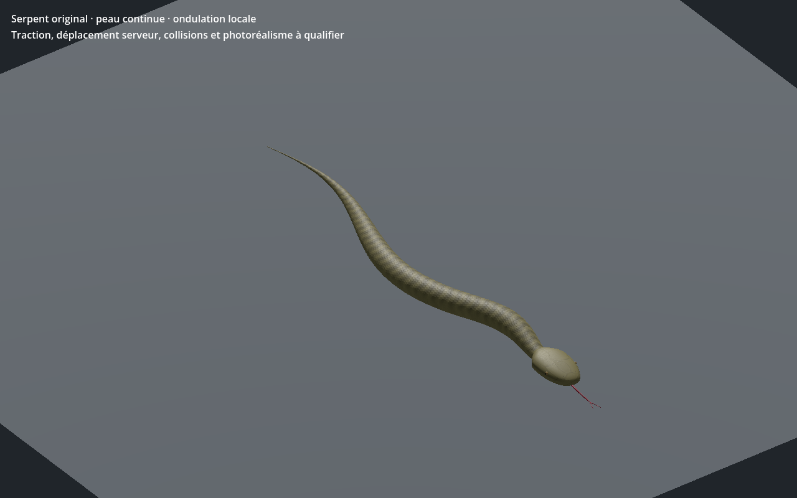

# Serpent original — recette 0.1.0

[Recette JSON exportée](recipe.json) — version documentaire **0.1.0**, `review_only`.

La recette utilise `uo.serpent-original/v1` et la source SHA-256 `19cf7fdde23df4cc3552dfd36918fef9f4c516ff45b9f0f91c69e8f196d4cfb8`. Le générateur et le modèle source ne sont pas distribués ici : ce JSON seul ne suffit pas à reconstruire le modèle. Cette entrée n’est pas un génome Xeno natif ni une entrée strict-v1 du catalogue.

La capture provient du contrôle Godot de la variante reconstruite avec cette recette ; SHA-256 du GLB reconstruit : `e59d7d6e89923f2216f9cf6d16c5cbeb2430578045d5ddfbec1d69d759b23c33`. Le contrôle historique `PASS_SERPENT_SKIN_LODS_AND_WAVE` s’est terminé avec le code 0. La géométrie et les matières de ce lot sont documentées comme originales ou procédurales ; aucune référence historique EA/Origin n’est incluse.

La capture et la preuve locale ne valident pas les collisions complètes, l’intégration au serveur ou à la VR, ni la qualité artistique finale.

SHA-256 de la recette : `6c858a188eed60ba8cc51725cca3b12853bf02dd22e376e83b17ab354615b8aa` ; de la capture : `cf7275f6a86c6f9a4e611028f253a1ee23291f732af3c37839dcdb548b2cbbef`.
