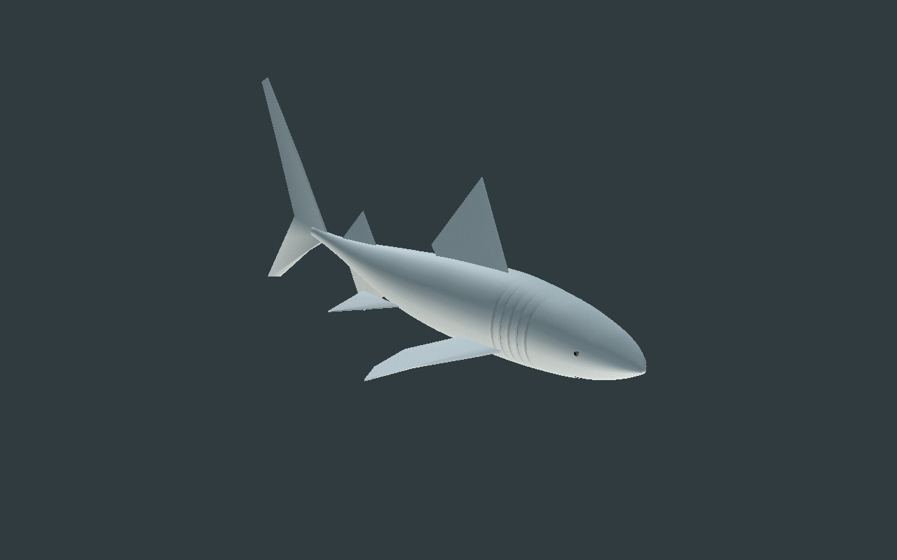
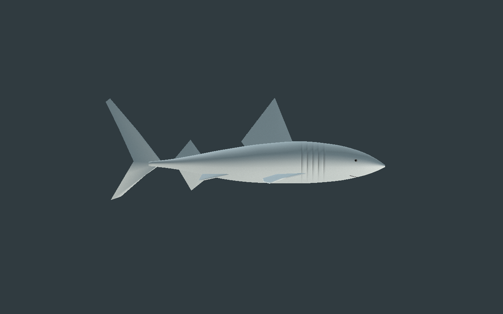
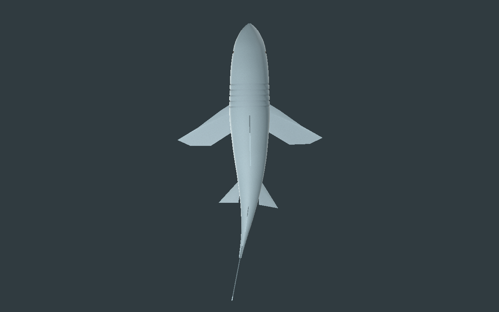
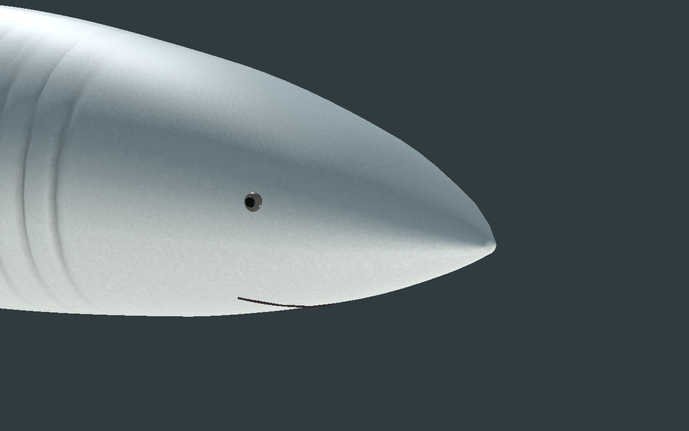
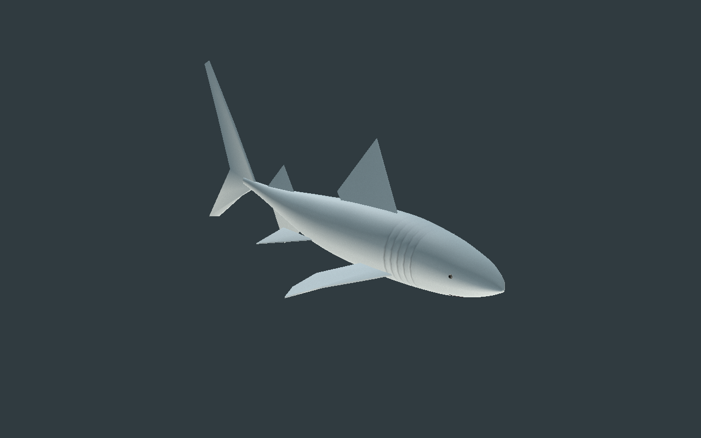
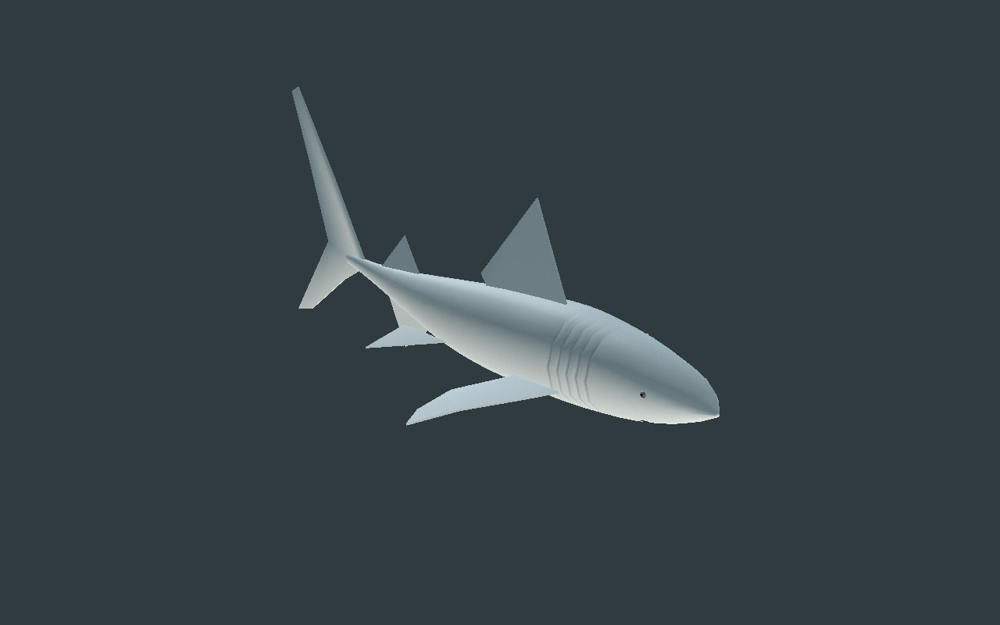
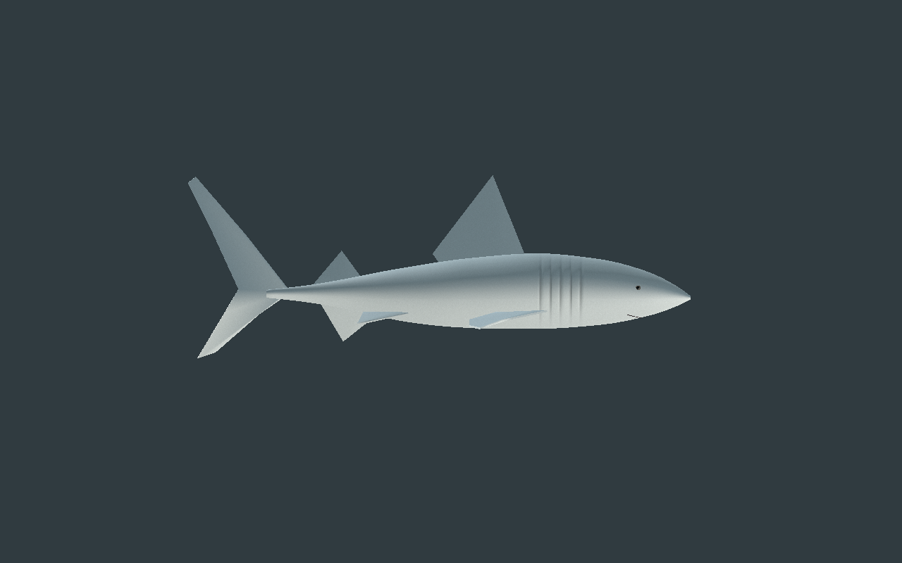
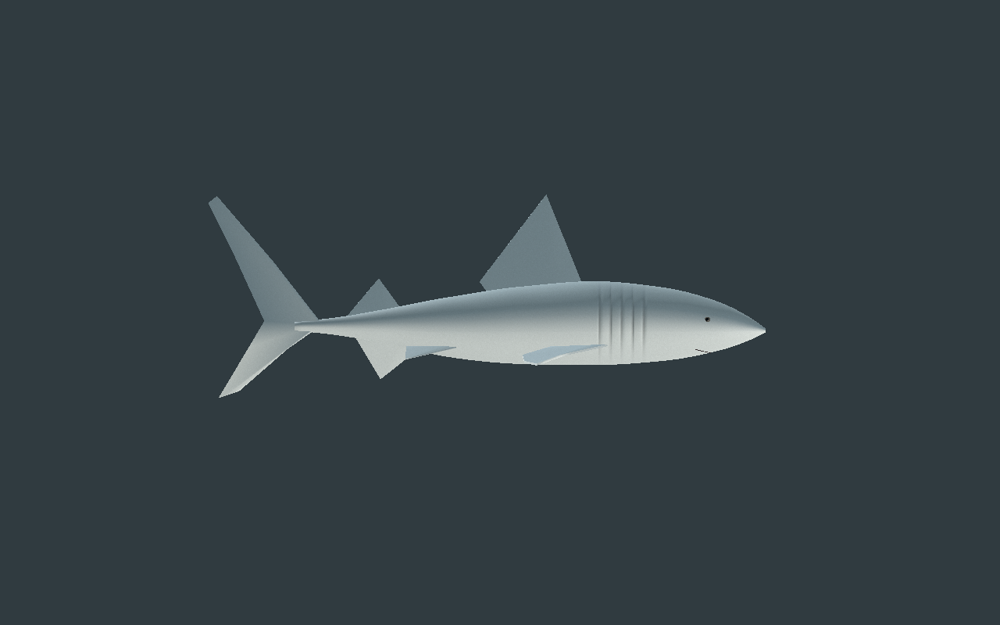
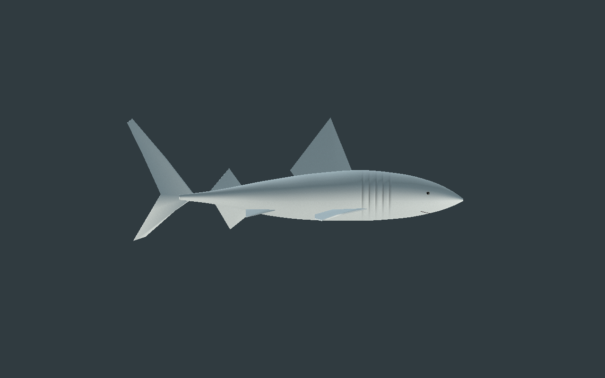

# Requin original — anatomie et nage de revue

[Recette JSON](recipe.json) · [Conception et budgets](design-profile.json) · [Déformations](deformation-measurements.json) · [Validation](validation.json) · [Provenance](provenance.json) · [Galerie](../../GALERIE.md)

Première base originale pour une famille aquatique. Corps fuselé fermé, cinq sillons branchiaux géométriques de9mm par côté, deux pectorales, deux pelviennes, deux dorsales, une anale et une caudale verticale au lobe supérieur plus grand. Les [références anatomiques du Florida Museum](https://www.floridamuseum.ufl.edu/discover-fish/sharks/anatomy/) et de [Hawaiʻi Sharks](https://dlnr.hawaii.gov/sharks/anatomy/fins-swimming/) guident cette adaptation de jeu ; ce n’est pas une espèce mesurée. Aucun modèle ou pixel de référence n’est copié.

| Profil | Dessus |
| --- | --- |
|  |  |

Les nageoires sont fermées avec une épaisseur finie et des contours effilés. Elles suivent rigidement leurs os : un premier essai qui les déformait sur toute leur longueur retournait leurs normales et étirait leurs UV. Les yeux sont aplatis et insérés dans le vrai crâne de chaque LOD. La bouche reste une couture fermée, sans cavité ni dents.

Budget : **5868 /2934 /1320 triangles**, **17 os**, quatorze maillages et quatre matériaux par LOD. Trois images originales de **128/128/64 pixels** partagées entre LOD et instances ; estimation RGBA8 avec mipmaps **196604 octets**. Le dos et le ventre sont nuancés par sommets, avec un micrograin procédural discret. Les coutures des projections UV et la finition des nageoires restent visibles en gros plan. Aucun FPS ni mémoire GPU totale mesuré.

| LOD1 | LOD2 |
| --- | --- |
|  |  |

La nage est une onde latérale locale, avec avant du corps relativement rigide. Les **601 poses/LOD** des GLB réellement décodés donnent pour la reconstruction : arêtes relatives **0.9725–1.0282**, aire minimale**0.9721**, alignement normal minimal**0.2907** et anisotropie UV maximale**1.6825**. Les seuils ne sont pas abaissés après les essais refusés. Ce mouvement ne simule aucune poussée de l’eau et ne déplace pas l’entité de jeu.

L’éditeur central contrôle trois LOD, lecture/pause/reprise, temps, rotation/zoom, vues, squelette, topologie et microrelief avec changement réel des pixels. Le téléchargement du GLB est vérifié par empreinte. La recette téléchargée porte l’amplitude de14 à**15 degrés**, puis sa reconstruction conserve exactement la géométrie, le skin, le rig, les matériaux et les trois images. Seules treize pistes de rotation changent.

Godot **Compatibility et Forward+** contrôlent les deux variantes : **129 poses/LOD**, dix-sept poses de points CPU comparées aux vrais binds importés, partage des images entre deux acteurs, poses indépendantes, reprise de lecture et conservation du transform de l’entité. Les captures suivantes montrent un cycle visuel, sans déplacement ni interaction aquatique autoritaire.

| Début | Quart de cycle |
| --- | --- |
|  |  |
|  |  |

Dix captures natives de la reconstruction, sans retouche. Modèle capturé : `af392619d93c82c6da1a0aacf622be976e3018a42d8df05e6aa1d465348f6894`. Le JSON dépend des ressources et du générateur originaux locaux. Aucune statistique serveur, entrée de production ou ressource historique n’est remplacée.

Première revue originale encore stylisée : nage latérale sur place, sans hydrodynamique ni vitesse autoritaire. Bouche ouverte/dents, respiration, raccords et collisions exhaustifs des nageoires, virages, finition photoréaliste, monde principal, serveur/réseau/VR et FPS restent non qualifiés.
