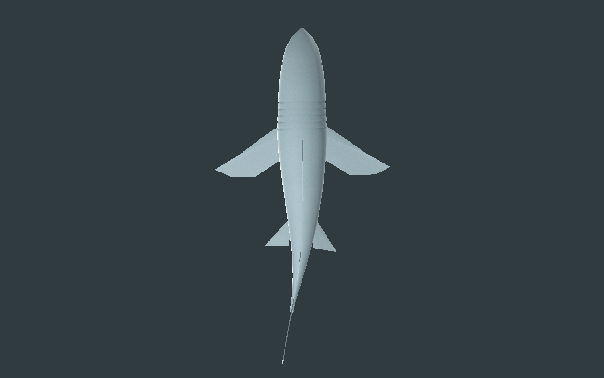
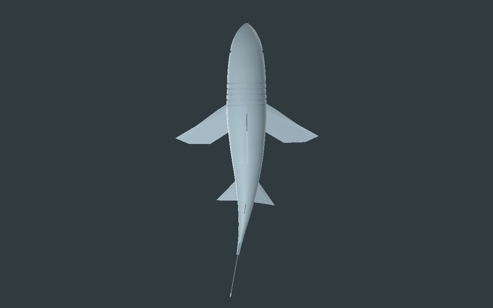
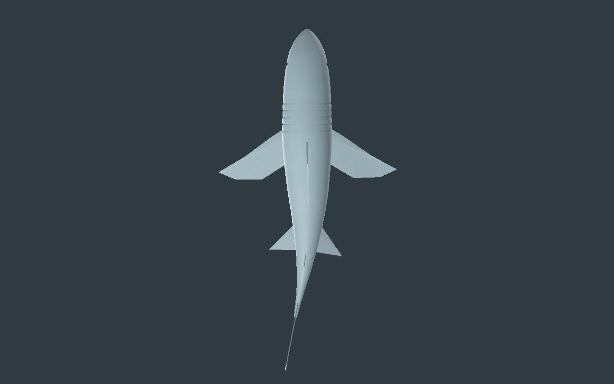
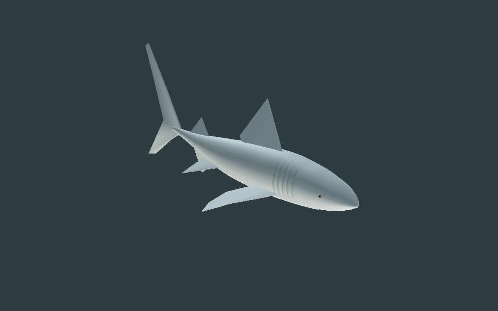
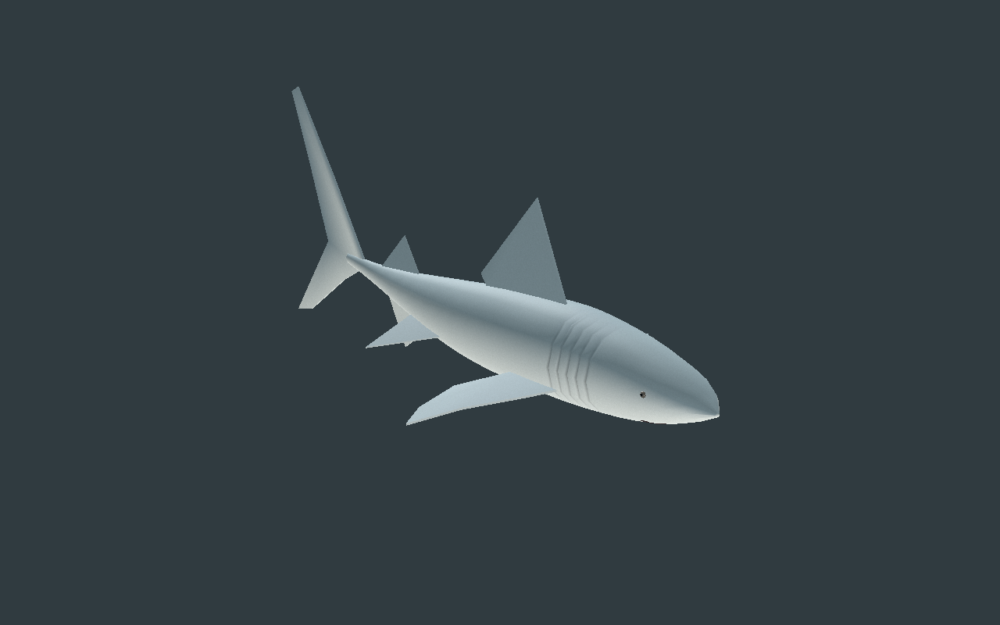
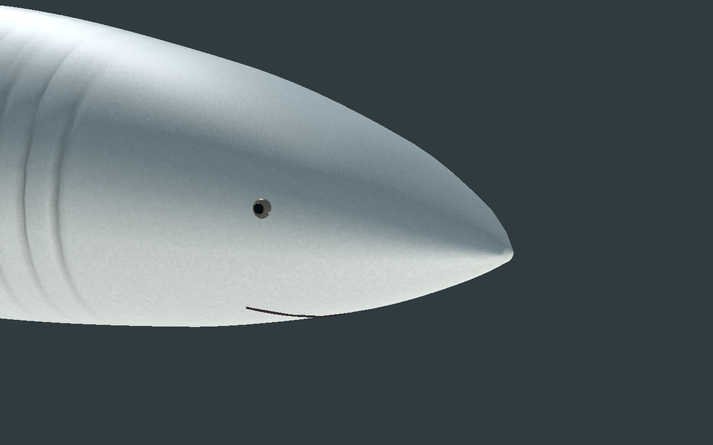
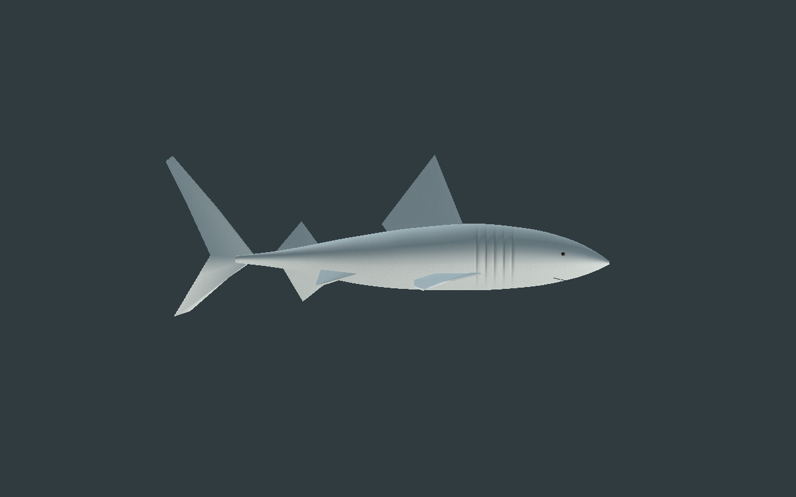
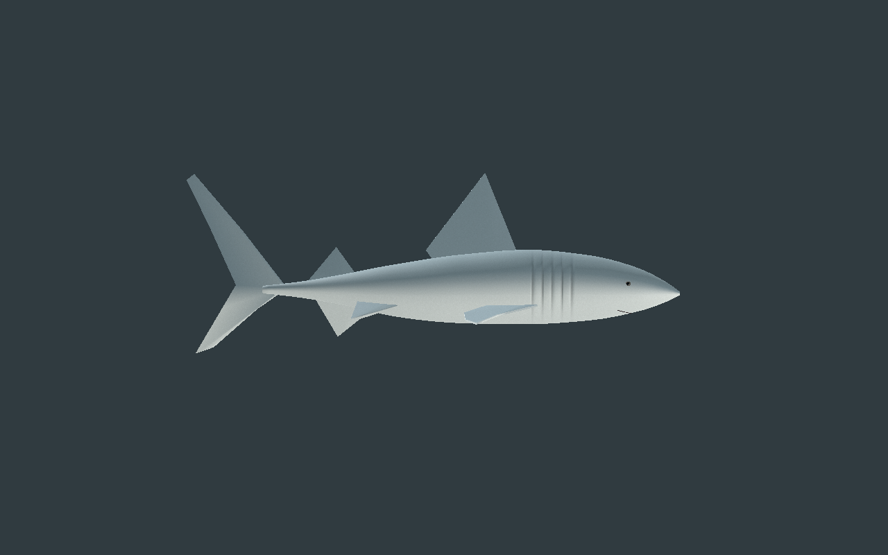
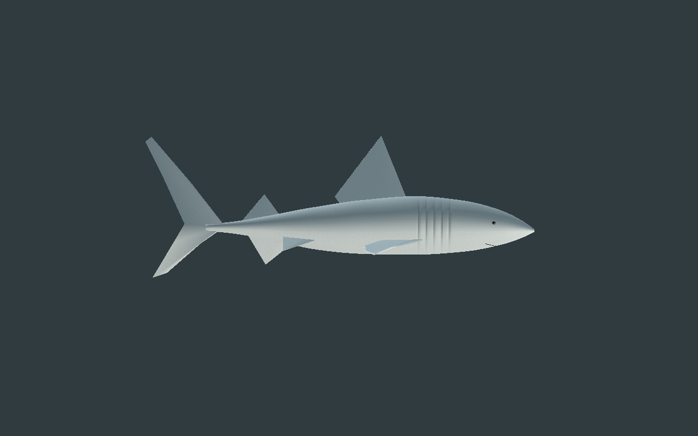
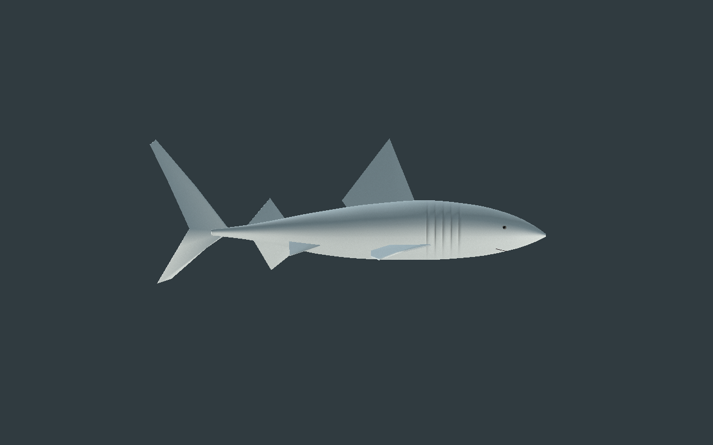

# Requin — attaches corrigées et quatre lots de matériau

[Recette JSON](recipe.json) · [Conception](design-profile.json) · [Mesures des attaches et déformations](deformation-measurements.json) · [Validation](validation.json) · [Provenance](provenance.json) · [Galerie](../../GALERIE.md)

La version**0.2.0** corrige les attaches des nageoires paires de la [première revue](../v0.1.0/README.md). Le contrôle de ses poses de début/fin a trouvé des sommets de la base pelvienne jusqu’à**63,76mm hors du corps** auLOD2. Les bases pelviennes et pectorales sont rentrées dans le corps, en conservant leurs pointes extérieures, leur nombre de triangles, leur pigment et leur skin. Les normales sont transformées et les UV métriques recalculés.

| Avant, amplitude14° | Bases corrigées, mêmes caméra/temps/lumière |
| --- | --- |
|  |  |

Les sommets exportés des huit bases sont comparés aux vrais triangles du corps animé : distance euclidienne minimale, signe intérieur/extérieur par parité de rayon avec intersections dédoublonnées. Sur**129poses parLOD**, ils restent à l’intérieur ; marge minimale**3.479mm** pour la recette reconstruite. Ce contrôle porte sur les sommets des bords de base ; il ne prouve ni une peau soudée ni toutes les collisions des surfaces.

Les quatorze pièces sont maintenant regroupées en**quatre maillages de matériau parLOD**, avec les plages de sommets/faces de chaque pièce conservées. Dix pièces, leurs attributs et les pistes d’animation sélectionnées restent identiques à la base originale. Seules les quatre nageoires paires changent de forme/normales/UV ; leurs couleurs et poids de skin sont conservés à chaque coin de triangle. Images, matériaux, os et inverse-binds sont inchangés. Le navigateur mesure réellement quatre appels de rendu pour le modèle seul, contre quatorze lots de maillage dans la précédente version ; aucun gain deFPS n’est déduit.

Budget inchangé : **5868 /2934 /1320triangles**, **17os**, trois images partagées**128/128/64**, estimation RGBA8+mipmaps**196604octets**. Le GLB reconstruit pèse**653828octets**. La géométrie reste composée de quatorze solides fermés, regroupés pour le rendu.

| Profil | Dessus |
| --- | --- |
|  |  |

La recette réellement téléchargée depuis le lien central de l’éditeur conserve ce profil de bases et modifie l’amplitude de14 à**15°**. Sa reconstruction garde tous les attributs de liaison identiques ; treize pistes de rotation changent. L’éditeur contrôle troisLOD,129poses, lecture/pause/reprise, squelette, topologie, microrelief avec changement des pixels et téléchargementsSHA. Seuls période et amplitude sont exposés ; échelle et pigment restent fixés pour cette géométrie immuable.

CPU :**601poses/LOD** pour les deux variantes, arêtes relatives**0.9725–1.0282**, aire minimale**0.9721**, alignement normal minimal**0.2907**, anisotropie UV maximale**1.6825**. Godot**Compatibility et Forward+** contrôlent les deux variantes sur129poses/LOD, avec dix-sept poses de repères CPU comparées aux vrais binds. Les instances partagent les images avec des poses indépendantes ; le transform de l’entité est conservé.

| LOD1 | LOD2 |
| --- | --- |
|  |  |

| Début | Quart du cycle |
| --- | --- |
|  |  |
|  |  |

Dix captures natives de la reconstruction et deux comparaisons de revue sont conservées sans retouche. Modèle reconstruit : `460ad7c2cec8f84f2f54da2751f55aeb20c1107711a1366d7837a651936671b1`. La recette dépend du générateur original local et de la base immuable ; aucun GLB, générateur, bitmap privé ou génome de production n’est publié.

Revue originale encore stylisée : nage latérale locale, quatre lots par LOD et sommets de base des nageoires contrôlés sur129poses/LOD. Composants séparés, sans peau soudée, collision exhaustive ni hydrodynamique. Bouche ouverte/dents, finition photoréaliste, variantes spécifiques, monde principal, serveur/réseau/VR et FPS restent non qualifiés.
