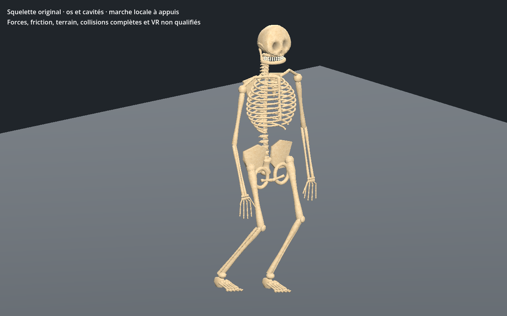
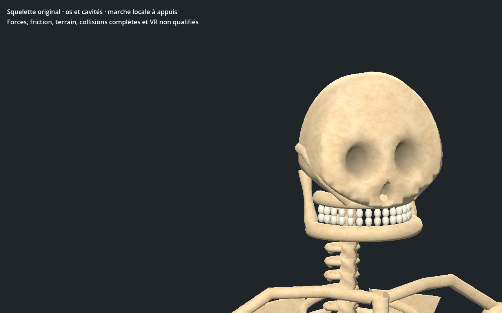
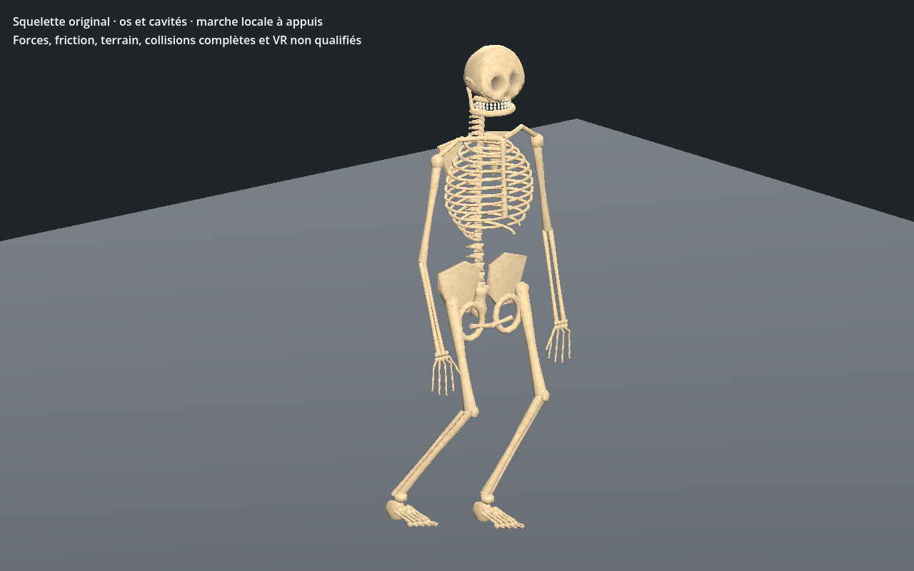
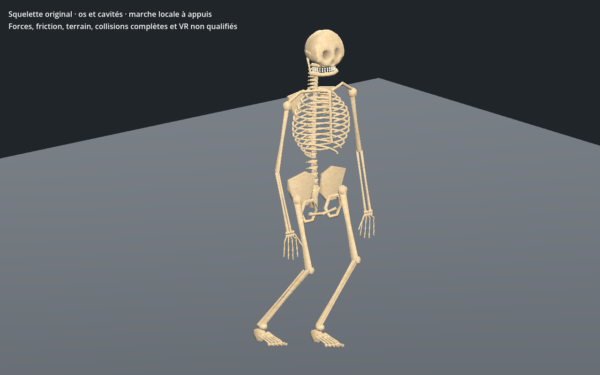
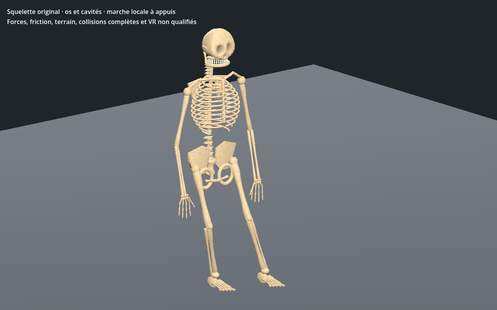
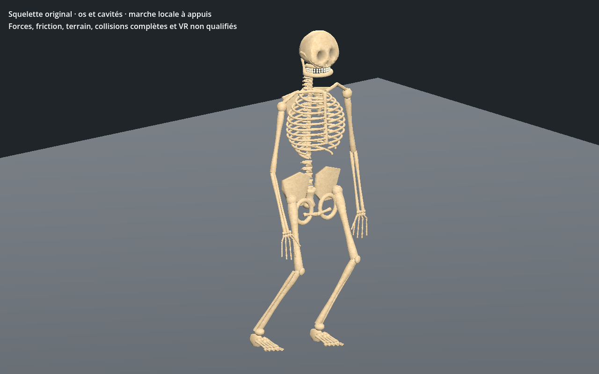
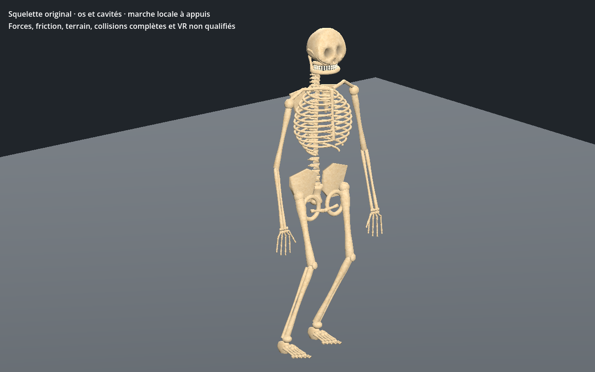
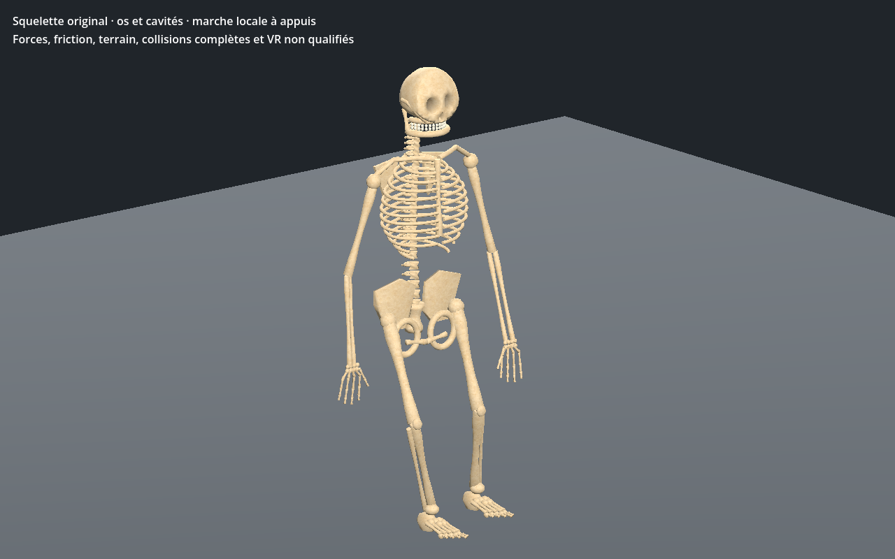
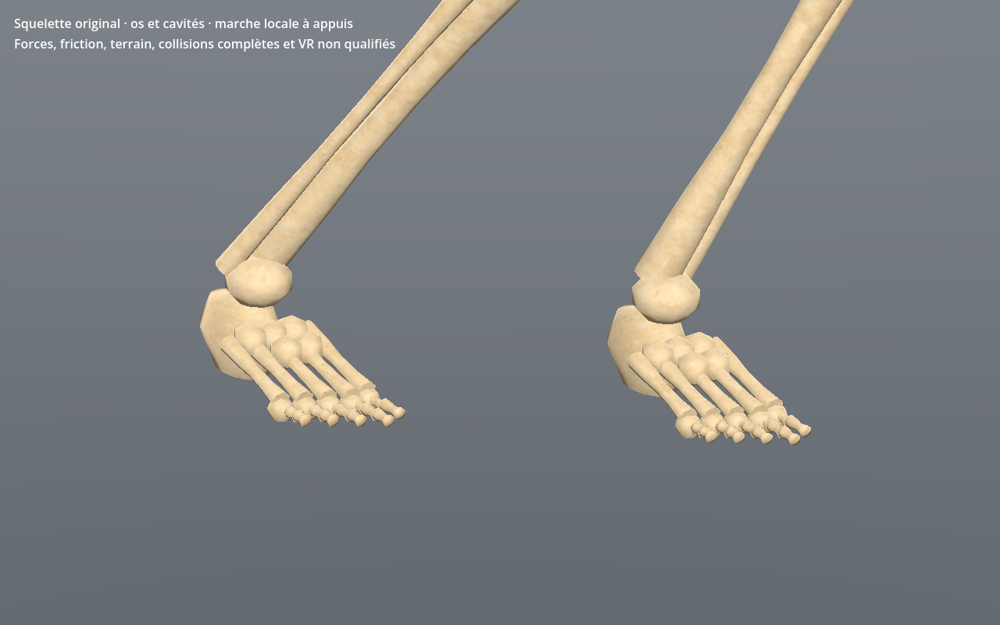

# Squelette — anatomie osseuse, cavités et marche bipède

[Recette JSON](recipe.json) · [Conception](design-profile.json) · [Mesures](measurements.json) · [Validation](validation.json) · [Provenance](provenance.json) · [Galerie](../../GALERIE.md)

Version **0.1.0**, première adaptation originale encore stylisée de l’identité serveur `skeleton`. La source serveur reste inchangée : statistiques, IA et butin ne sont pas remplacés par une recette visuelle. Les autres morts-vivants et variantes équipées ne sont pas déclarés recréés par ce seul travail.

La géométrie comprend **12paires de côtes**, sternum, clavicules, omoplates, bassin ajouré et **7vertèbres cervicales,12thoraciques,5lombaires**. Les mains ont cinq doigts et14phalanges chacune ; chaque pied comprend des pièces tarsiennes, cinq métatarsiens et14phalanges. Ces choix s’appuient sur les descriptions du [squelette axial](https://openstax.org/books/anatomy-and-physiology-2e/pages/7-1-divisions-of-the-skeletal-system) et de la [main](https://openstax.org/books/anatomy-and-physiology-2e/pages/8-2-bones-of-the-upper-limb) dans OpenStax. Les formes restent une adaptation de jeu, sans précision clinique revendiquée ni modèle de référence copié.

Les deux orbites et la cavité nasale sont de vraies poches fermées dans la surface du crâne. Sur les rayons centraux contrôlés aux trois LOD, leur profondeur réelle minimale est **30.47mm**. Les32dents sont géométriques. Quatre couronnes antérieures supérieures sont contrôlées contre l’occlusion par les os ; cela ne couvre pas toutes les intersections dentaires. Le premier prototype cachait les dents sous une face trop longue et avait des talons anguleux : partie inférieure du crâne, arcade maxillaire et talons ont été repris avant sélection.

Budget : **25374 /10864 /8692triangles**, **49articulations de rig**, **deux lots géométriques parLOD**, trois images **256/128/128**, estimation RGBA8 avec mipmaps **524284octets**. GLB reconstruit **4276424octets**. La surface d’os originale ImageGen est réduite avec bords de tuile concordants ; normal et rugosité sont des approximations. Chaque pièce reçoit un poids rigide unique : elle tourne sans étirement élastique. Anisotropie UV au repos maximale **1.705**, aucune face UV effondrée. Les coutures de projection restent à revoir. Aucun coût FPS ou mémoire totale du pilote n’est déduit de ces budgets.

| LOD1 | LOD2 |
| --- | --- |
|  |  |

L’éditeur central affiche les trois LOD et permet d’isoler les vrais triangles du crâne, de la cage thoracique, des mains et des pieds. Lecture/pause/reprise après fin, déplacement réel, rig, topologie, microrelief, trois images partagées et largeurs736/320 sont contrôlés. La recette téléchargée change le pas de0,23 à **0,25m**, puis est reconstruite. Les attributs de liaison, matériaux et pixels restent exacts ; **7pistes d’animation changent**.

CPU : **721poses/LOD** ; au moins **un pied en appui**, dérive maximale **0.099mm**, erreur de plan d’appui **0.099mm**, levée minimale près du sommet du pas **78.64mm**. Le centre du volume des pièces, recouvrements compris, garde une marge géométrique d’appui minimale **18.04mm**. Ce proxy ne représente ni masse réelle ni équilibre par forces.

Godot **Forward+ et Compatibility** vérifient sélection et reconstruction sur241poses/LOD, les vrais binds et sommets plantaires importés. La dérive native maximale reconstruite est **0.228mm**. La reprise après fin et la pause sont testées sur le vrai contrôleur. Les instances de cache partagent les images avec des poses indépendantes ; le transform de l’entité reste intact.

| Début | Quart du cycle |
| --- | --- |
|  |  |
|  |  |

Dix captures natives sans retouche. Modèle reconstruit : `6e02a792bc3f35c40e989a1faa162cd240bde639c6cd951e1b75c27282552841`. Aucun GLB, générateur, bitmap source privé ni génome de production distribué. Le catalogue natif consulté ne proposait pas de composant humain squelettique : cet atelier utilise un adaptateur original distinct.

Première adaptation originale encore stylisée. Crâne, bassin et proportions des os restent à affiner ; coutures de projection et intersections articulaires non exhaustivement qualifiées. Sol plat uniquement : pas de photoréalisme final, forces/friction, équilibre physique, terrain, attaque, mort, équipement, monde principal, serveur/réseau, VR ou FPS qualifiés.
