# Squelette — relief du crâne et mâchoire articulée

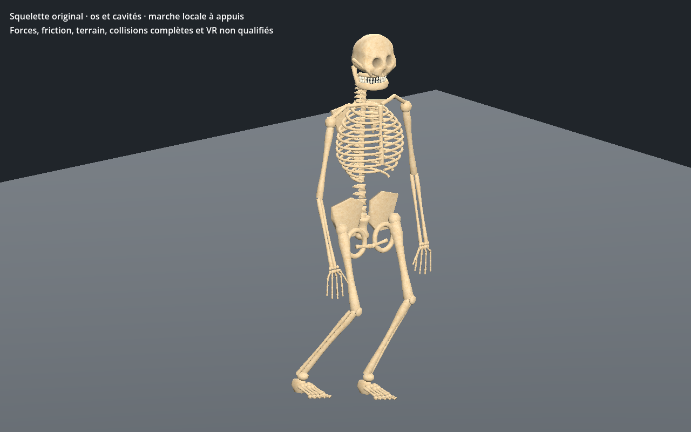

[Recette JSON](recipe.json) · [Profil du crâne](cranial-profile.json) · [Mesures](measurements.json) · [Validation](validation.json) · [Provenance](provenance.json) · [Galerie](../../GALERIE.md)

Version **0.2.0**. Le crâne ovale de la [version 0.1 conservée](../v0.1.0/README.md) est repris : orbites moins circulaires, arcades sourcilières et pommettes plus lisibles, tempes resserrées, corps mandibulaire aplati et couronnes dentaires différenciées. Le profil explicite `facial-bones-v2` est partagé dans l’outil d’auteur ; une ancienne recette sans ce champ garde son résultat d’origine, vérifié octet par octet. Ces repères suivent les descriptions du [crâne dans OpenStax](https://openstax.org/books/anatomy-and-physiology-2e/pages/7-2-the-skull), sans revendication de précision clinique ni copie de géométrie.

| Version 0.1 | Version 0.2 |
| --- | --- |
| 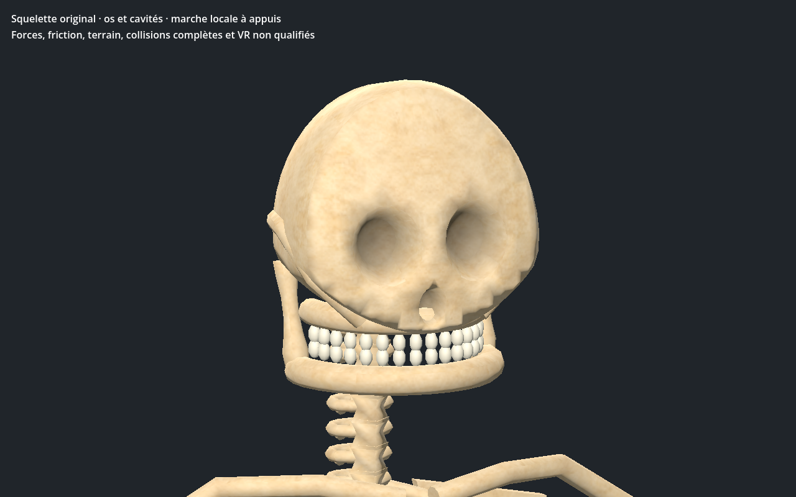 |  |

Comparaison native avec la même caméra relative à l’os de tête, le même temps et le même pas. Des facettes apparues dans un premier relief ont motivé une subdivision locale conforme et un remappage à dérivée finie. Les textures et les matériaux sont conservés ; la forme reste encore stylisée.

| Mâchoire fermée | Ouverture de 12° |
| --- | --- |
| 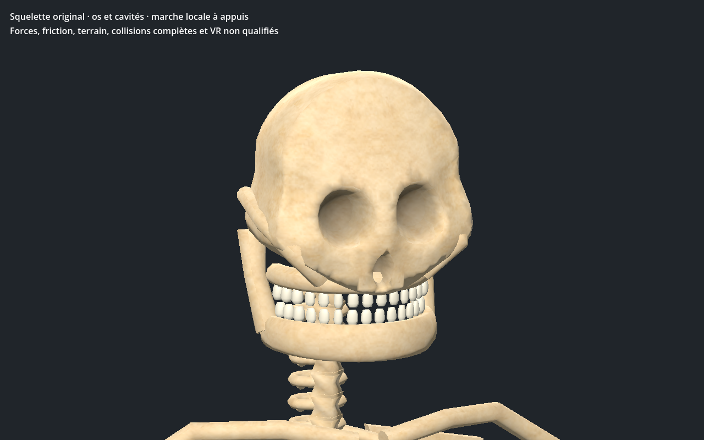 | 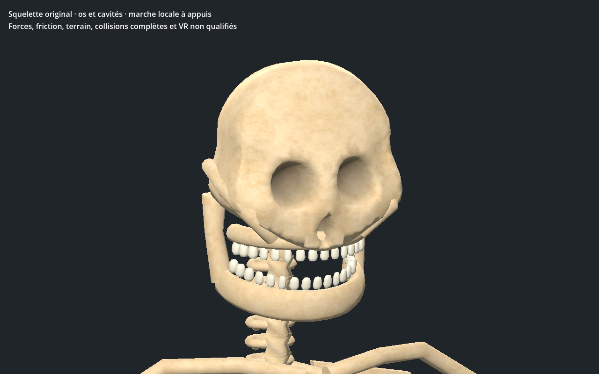 |

Le pivot de la mâchoire est replacé à hauteur des articulations temporales. L’éditeur et le contrôleur Godot proposent une inspection bornée de **0 à 12°**, combinable avec la marche. Aux **13 ouvertures testées par LOD**, les dents supérieures restent fixes, le pivot ne se translate pas et les dents inférieures se déplacent réellement. La séparation verticale minimale entre les deux arcades est **2.667 mm**. Cette propriété couvre les deux arcades sur les poses échantillonnées ; elle ne prouve pas toutes les intersections des dents voisines, de leurs racines ou du crâne.

Le relief ajoute seulement **88 triangles au LOD0 et 168 au LOD1** après réduction des couronnes et des branches mandibulaires ; le LOD2 est inchangé. **49 articulations**, **deux lots géométriques**, trois images **256/128/128** et estimation RGBA8 avec mipmaps **524284 octets** sont conservés. Aucun gain FPS ou coût total du pilote n’est déduit de ces nombres.

| LOD | Triangles 0.1 | Triangles 0.2 | Écart |
| --- | --- | --- | --- |
| 0 | 25374 | 25462 | +88 |
| 1 | 10864 | 11032 | +168 |
| 2 | 8692 | 8692 | +0 |

| LOD1 | LOD2 |
| --- | --- |
| 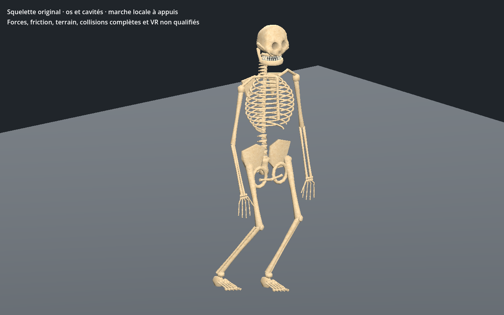 | 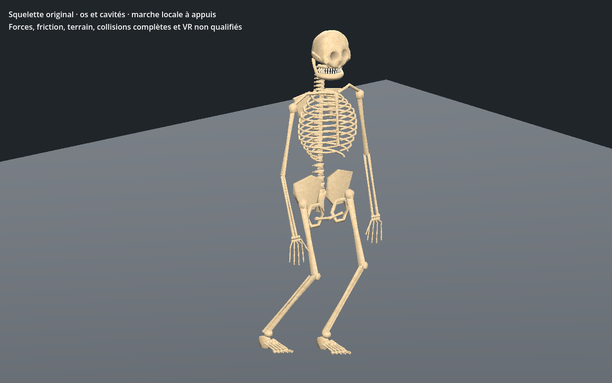 |

Les attributs non crâniens, les pixels, les matériaux et **48 matrices de liaison** restent exacts. Seul le pivot de liaison mandibulaire change. La forme et le volume de la tête affectent le proxy géométrique d’appui : les clips sont donc requalifiés, sans prétendre qu’ils restent identiques.

L’éditeur central vérifie les trois LOD, les quatre régions anatomiques, lecture/pause/reprise après fin, commande de mâchoire, vrais repères dentaires, largeurs 736/320 et téléchargements JSON/GLB. La recette téléchargée change le pas de **0,23 à 0,25 m**, puis est reconstruite.

CPU : **721 poses/LOD**, au moins un pied en appui, dérive maximale **0.099 mm**. Godot **Forward+ et Compatibility** contrôle sélection et reconstruction sur **241 poses/LOD**, puis les 13 ouvertures. Dérive native reconstruite **0.228 mm**. Les instances partagent les images avec des poses indépendantes ; reprise/pause et transform d’entité restent contrôlés. Le proxy de volume et la marche sur plan ne remplacent pas une simulation de forces.

| Début | Quart du cycle |
| --- | --- |
| 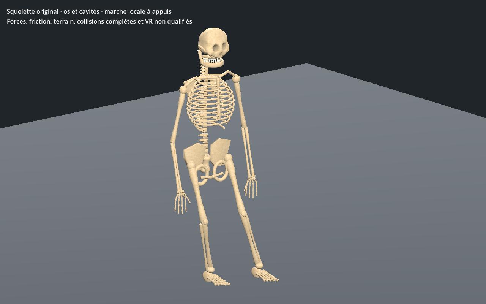 | 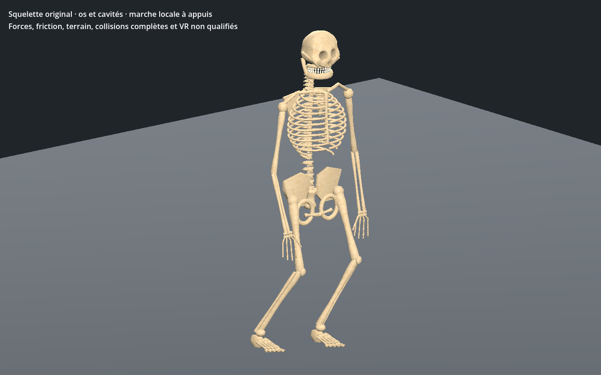 |
| 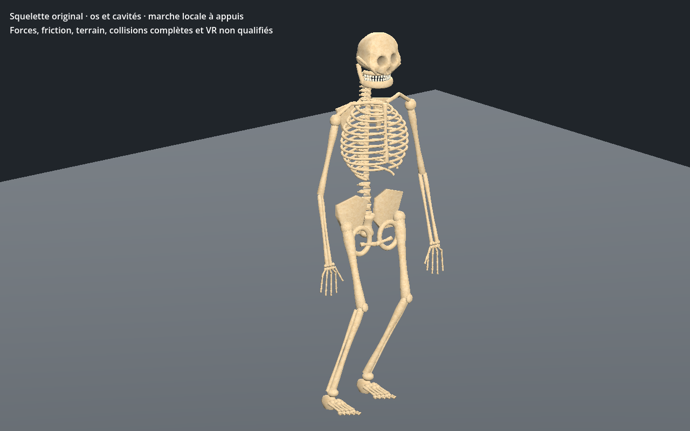 | 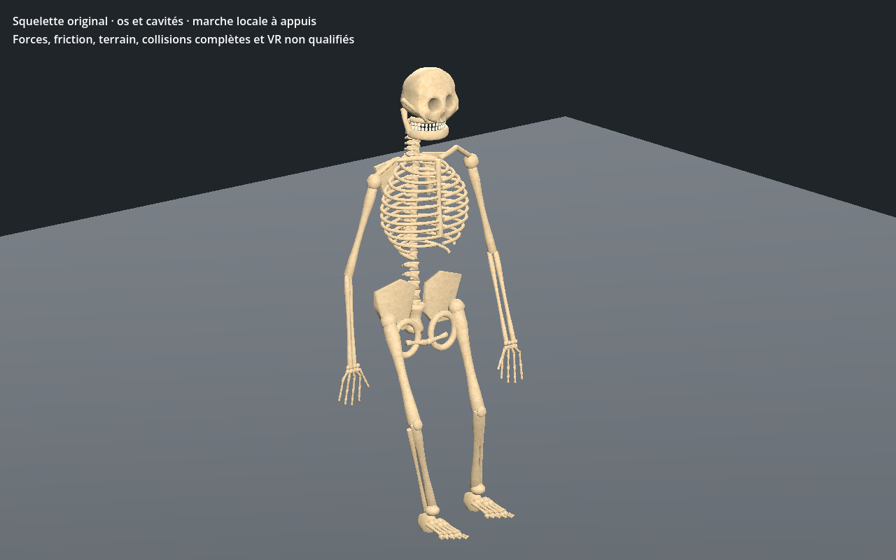 |

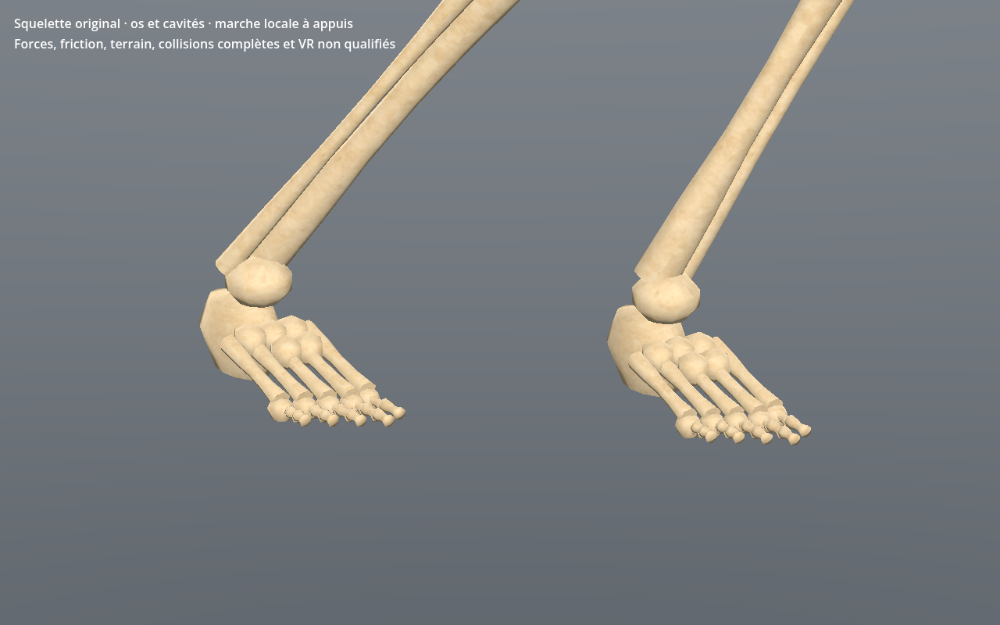

Douze captures natives sans retouche. Modèle reconstruit : `e8fdb8c6a116bc72c79de37c2e10d9d180d5ccbbf8d78a6dbfc0f8f972637d5f`. Les générateurs, GLB et bitmaps sources privés ne sont pas distribués. Aucune donnée de statistiques, IA ou butin serveur n’est modifiée ; aucune promotion en production.

Revue locale encore stylisée. Crâne, bassin et proportions restent à affiner avant approbation photoréaliste. Contrôles de marche sur sol plat et séparation verticale des deux arcades sur les ouvertures échantillonnées ; pas de collisions dentaires/craniales exhaustives, forces, terrain, attaque, équipement, monde principal, serveur/réseau, VR ou FPS qualifiés.
