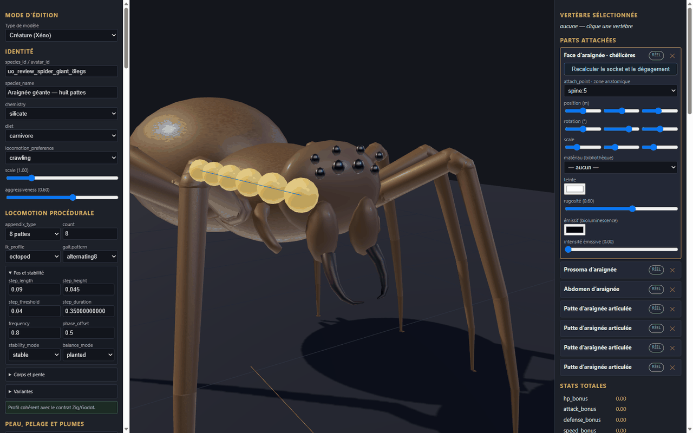
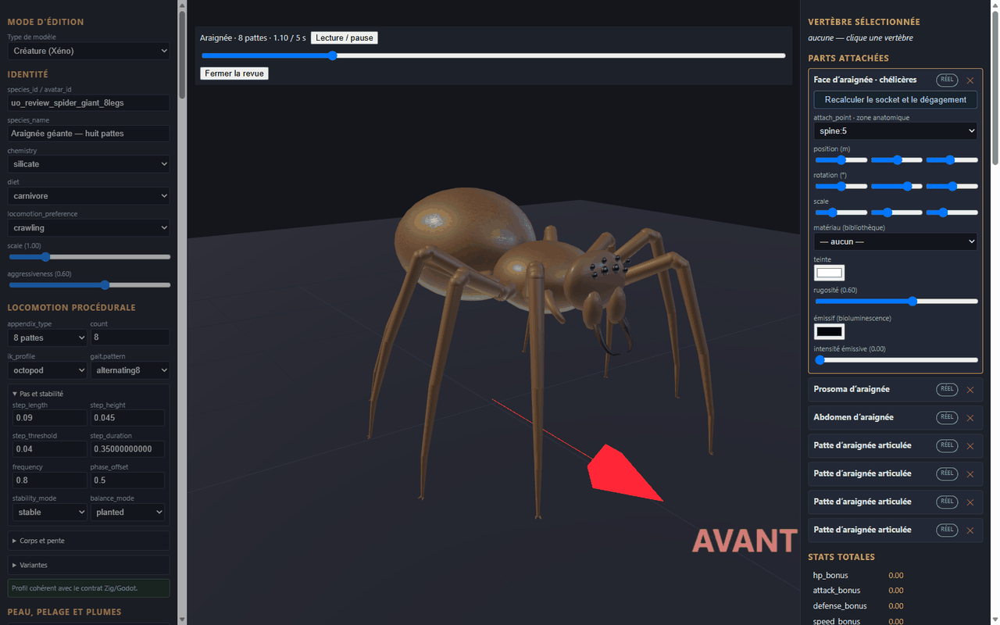
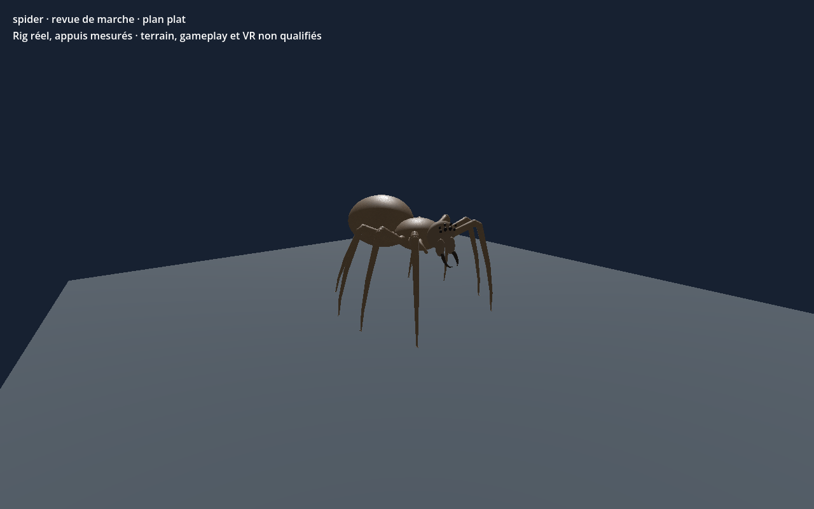

# Araignée géante — vérification du 7 novembre 2026

[Recette JSON de revue](recipe.json) · [Mesures et empreintes](validation.json) · [Fiche précédente](../v0.1.0/README.md) · [Galerie](../../GALERIE.md)

La recette de cette vérification est identique à celle de la fiche précédente. La tête dédiée `arth_head_spider_01` est montée à 90° autour de Y : le contrôle de l’éditeur confirme que son avant est orienté vers l’avant de la créature. Huit pattes sont présentes, avec deux os par patte.

Sur le même GLB animé, 601 poses décodées au CPU et 121 poses dans chacun des deux modes de rendu Godot donnent au moins quatre appuis ; la revue de marche de l’éditeur est également contrôlée sur 121 poses. L’erreur maximale mesurée des ancres au sol est d’environ 0,076 mm. Les mesures concernent quatre cycles rectilignes sur sol plat.

Ce prototype de revue compte 7 560 triangles et trois images 256 × 256. La silhouette et les matières restent schématiques ; intersections complètes, forces, virages, terrain, monde principal, réseau, VR, performances et approbation artistique ne sont pas validés. Les générateurs, pièces, images sources et modèles locaux ne sont pas distribués ici ; le JSON seul ne reconstruit pas le modèle.
