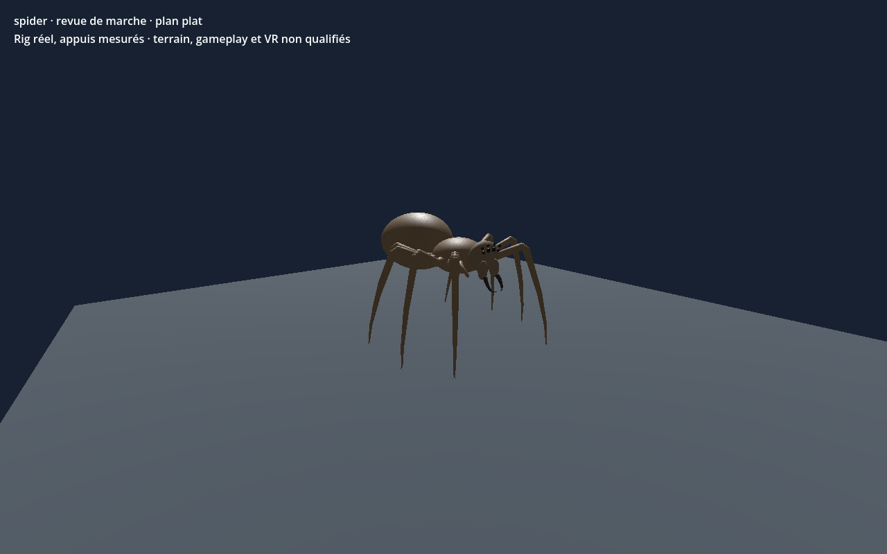

# Araignée géante — huit pattes — recette 0.1.0

[Recette JSON](recipe.json) · [Provenance et empreintes](provenance.json) · [Galerie](../../GALERIE.md)

Génome natif de revue : 8 pattes locomotrices et tête crânienne dédiée, sans torse dupliqué. Orientation locale du composant de tête : 90° autour de Y. Le lien de marche référence un clip précalculé lié au SHA du modèle ; les modifications de forme demandent une nouvelle revue.

**Portée vérifiée :** CPU, éditeur central et Godot Compatibility/Forward+ : quatre cycles rectilignes sur sol plat, au moins 4 appuis. Terrain, virages, forces, collisions complètes, gameplay, VR et finition artistique non qualifiés.

Ce document conserve un instantané de travail original en `review_only`, sans autorité serveur ni approbation artistique finale. Les générateurs, pièces, modèles et adaptateurs locaux nécessaires ne sont pas distribués ici ; ce JSON seul ne reconstruit pas le modèle. Aucune compatibilité strict-v1 n'est revendiquée.

SHA-256 du modèle effectivement capturé : `b715d1b8db99f391fd74edd7057b53ffb2b7e8285bafe15fc08c88a0a85b594c`.
SHA-256 de la recette : `30711ab3d2a1531c2cb763f96dc38819cc1da3ddc984930a4dfac1b6c3649184`.
SHA-256 de l'image : `49ac57c0043c0c733cfa29a7c74fbf17c88095efe509de6ae6089502afd84579`.
