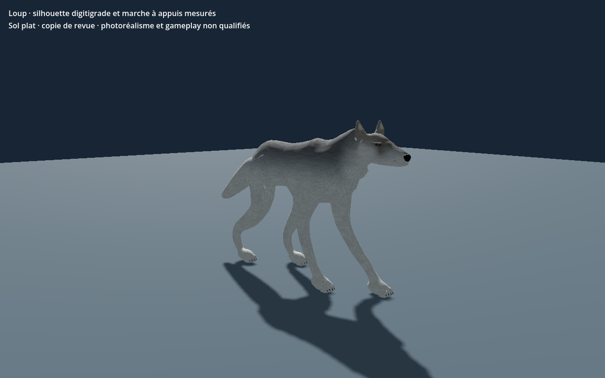

# Loup — oreilles et marche — recette 0.1.0

[Recette JSON](recipe.json) · [Provenance et empreintes](provenance.json) · [Galerie](../../GALERIE.md)

Variante reconstruite de la recette exportée : oreilles affinées, pointes relevées de 15 mm, profondeur de 3 mm et détail de fourrure partagé. La révision locale sélectionnée conserve une profondeur de 4 mm ; cette image montre bien la variante de preuve à 3 mm.

**Portée vérifiée :** Reconstruction de la recette téléchargée et revue Godot sur sol plat ; trois LOD de 15 978 / 5 074 / 1 400 triangles. Aucune preuve de terrain, monde réseau, VR, collisions exhaustives ou photoréalisme final.

Ce document conserve un instantané de travail original en `review_only`, sans autorité serveur ni approbation artistique finale. Les générateurs, pièces, modèles et adaptateurs locaux nécessaires ne sont pas distribués ici ; ce JSON seul ne reconstruit pas le modèle. Aucune compatibilité strict-v1 n'est revendiquée.

SHA-256 du modèle effectivement capturé : `e1382a9336fb2c2b64b780b884889a98056b10ebaf07a56f167c6f5957c86ba7`.
SHA-256 de la recette : `efda6f88ca575cb89a29d7b40387621742591be1da25863ca6415659e2346c7f`.
SHA-256 de l'image : `81b1fd87c6798c6044f182ade8804c6ca930778547854c9dad7b300d153820c4`.
