# Galerie des architectures — Old School 90s MMORPG Like

**24 architectures** · Dernière version publiée de chaque modèle. Cliquer sur une image pour l’agrandir, ou sur le nom pour ouvrir la fiche.

[Toutes les versions et leurs recettes](README.md) · [Accueil du dépôt](../../README.md)

Aperçus des modèles de revue. Les fiches précisent les contrôles réalisés ; ces images ne certifient pas la compatibilité avec le serveur actif ni le photoréalisme global.

| Architecture | Architecture | Architecture |
|---|---|---|
| [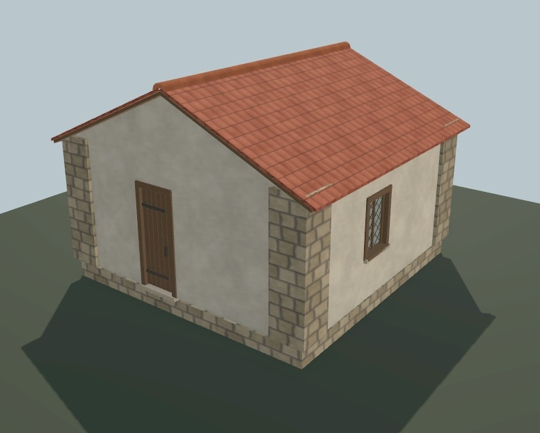](../../assets/architecture-editor/uo-0100/v1.1.0/preview.jpg) **[Maison UO 0100 — chaux, pierre et tuiles](uo-0100/v1.1.0/README.md)** v1.1.0 · [Plan JSON](../../assets/architecture-editor/uo-0100/v1.1.0/blueprint.json) | [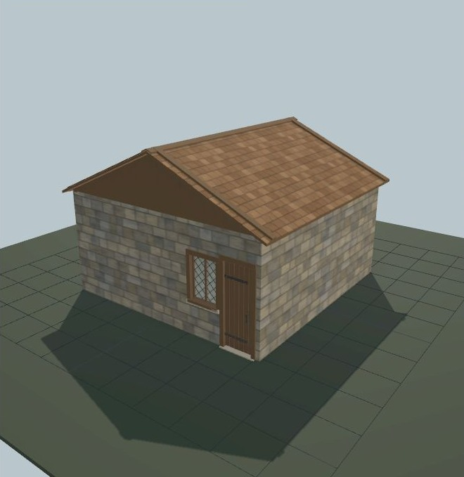](../../assets/architecture-editor/uo-0102/v1.1.0/preview.jpg) **[Maison UO 0102 — pierre et bardeaux de bois](uo-0102/v1.1.0/README.md)** v1.1.0 · [Plan JSON](../../assets/architecture-editor/uo-0102/v1.1.0/blueprint.json) | [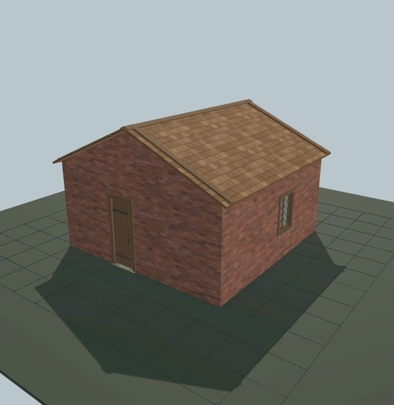](../../assets/architecture-editor/uo-0104/v1.0.0/preview.jpg) **[Maison UO 0104 — brique et bardeaux de bois](uo-0104/v1.0.0/README.md)** v1.0.0 · [Plan JSON](../../assets/architecture-editor/uo-0104/v1.0.0/blueprint.json) |
| [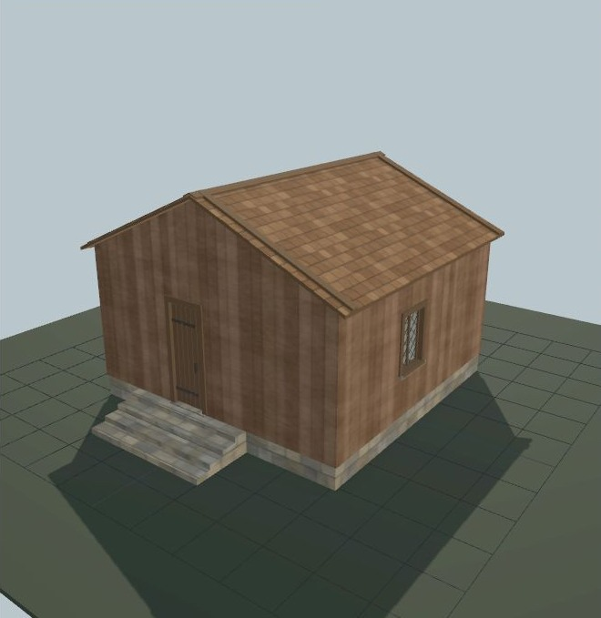](../../assets/architecture-editor/uo-0106/v1.0.0/preview.jpg) **[Maison UO 0106/0107 — planches et bardeaux de bois](uo-0106/v1.0.0/README.md)** v1.0.0 · [Plan JSON](../../assets/architecture-editor/uo-0106/v1.0.0/blueprint.json) | [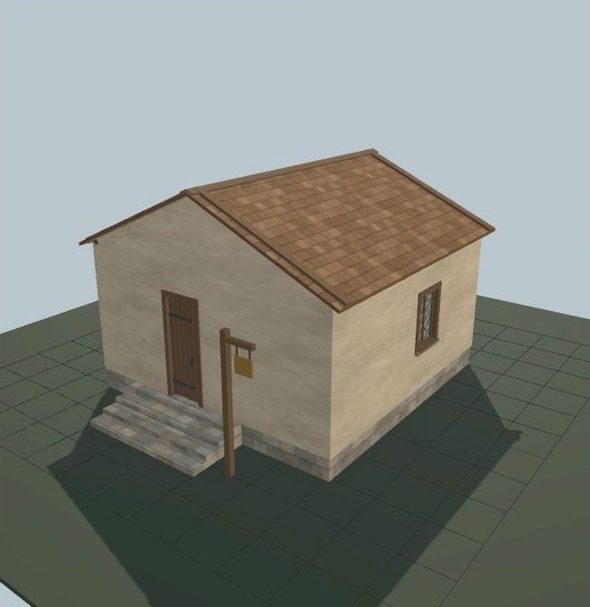](../../assets/architecture-editor/uo-0108/v1.0.0/preview.jpg) **[Maison UO 0108/0109 — enduit à la chaux et bardeaux](uo-0108/v1.0.0/README.md)** v1.0.0 · [Plan JSON](../../assets/architecture-editor/uo-0108/v1.0.0/blueprint.json) | [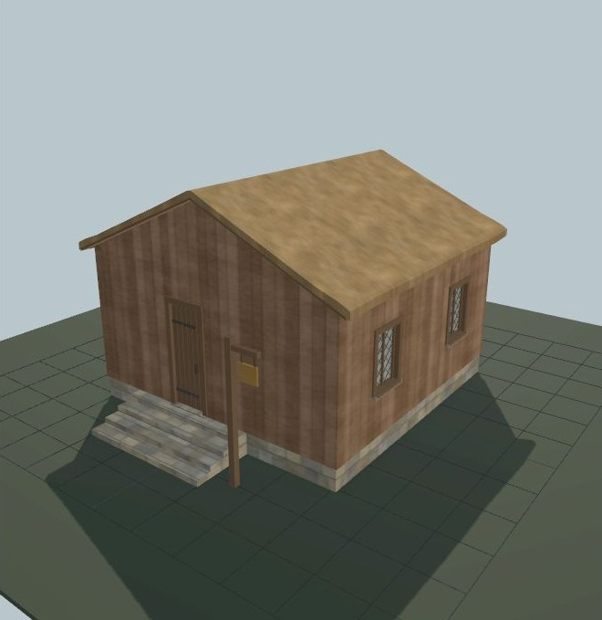](../../assets/architecture-editor/uo-0110/v1.0.0/preview.jpg) **[Maison UO 0110/0111 — planches et chaume](uo-0110/v1.0.0/README.md)** v1.0.0 · [Plan JSON](../../assets/architecture-editor/uo-0110/v1.0.0/blueprint.json) |
| [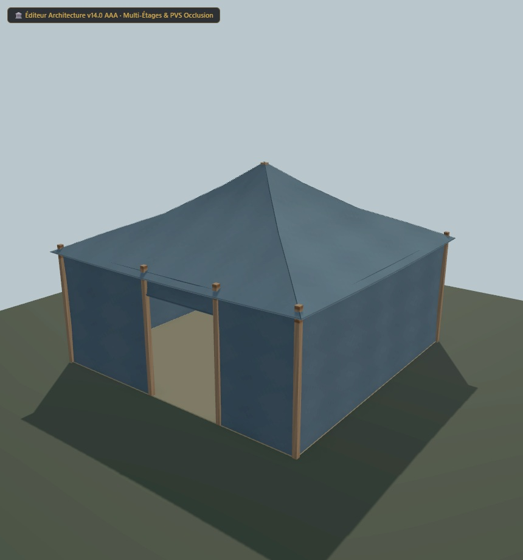](../../assets/architecture-editor/uo-0112/v1.3.0/preview.jpg) **[Tente UO 0112/0113 — toile de revue](uo-0112/v1.3.0/README.md)** v1.3.0 · [Plan JSON](../../assets/architecture-editor/uo-0112/v1.3.0/blueprint.json) | [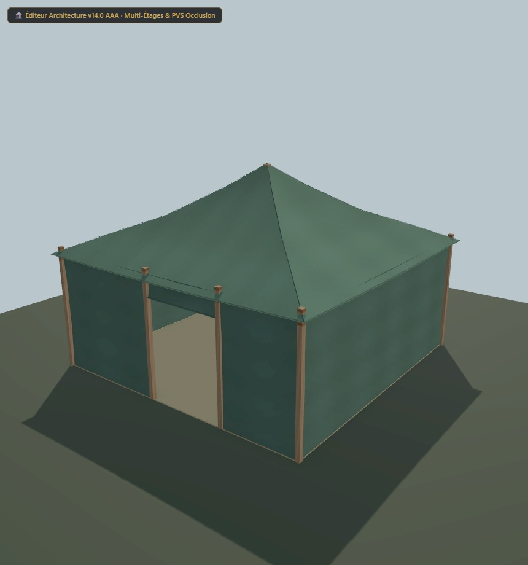](../../assets/architecture-editor/uo-0114/v1.3.0/preview.jpg) **[Tente UO 0114/0115 — toile de revue](uo-0114/v1.3.0/README.md)** v1.3.0 · [Plan JSON](../../assets/architecture-editor/uo-0114/v1.3.0/blueprint.json) | [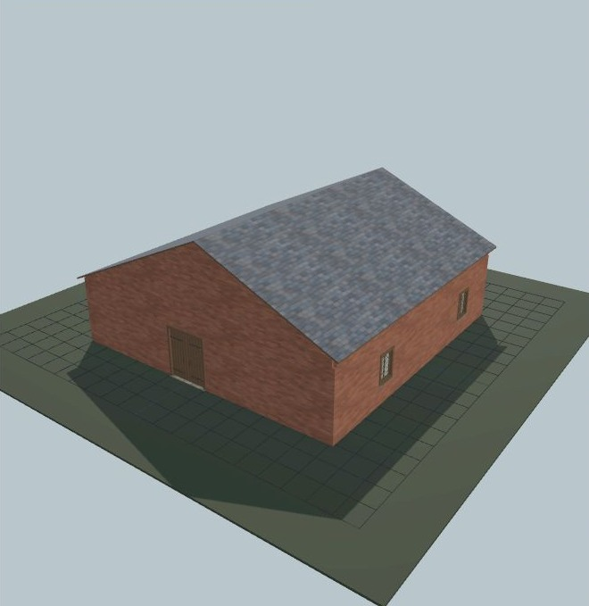](../../assets/architecture-editor/uo-0116/v1.1.0/preview.jpg) **[Maison UO 0116 — grande maison en brique et ardoise](uo-0116/v1.1.0/README.md)** v1.1.0 · [Plan JSON](../../assets/architecture-editor/uo-0116/v1.1.0/blueprint.json) |
| [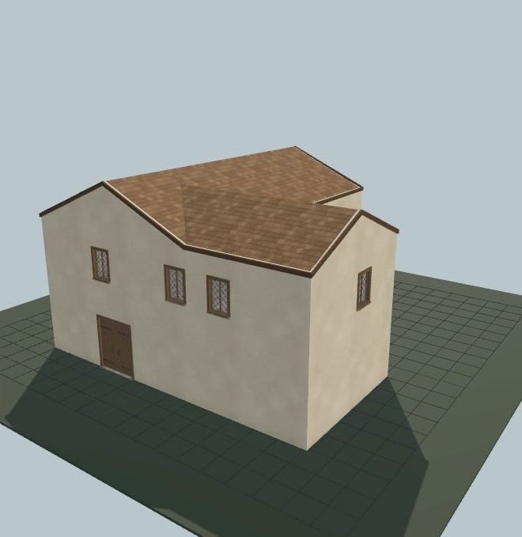](../../assets/architecture-editor/uo-0118/v1.0.0/preview.jpg) **[Maison UO 0118 — étage, galerie et toit en L](uo-0118/v1.0.0/README.md)** v1.0.0 · [Plan JSON](../../assets/architecture-editor/uo-0118/v1.0.0/blueprint.json) | [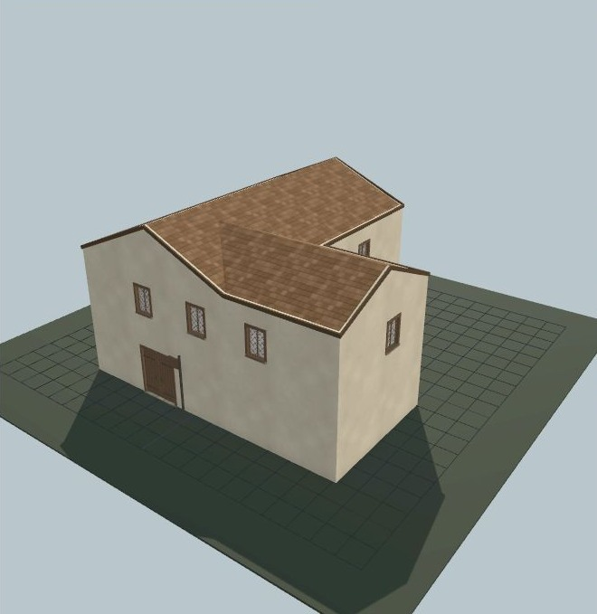](../../assets/architecture-editor/uo-0120/v1.0.0/preview.jpg) **[Maison UO 0120 — double entrée et escalier de grès](uo-0120/v1.0.0/README.md)** v1.0.0 · [Plan JSON](../../assets/architecture-editor/uo-0120/v1.0.0/blueprint.json) | [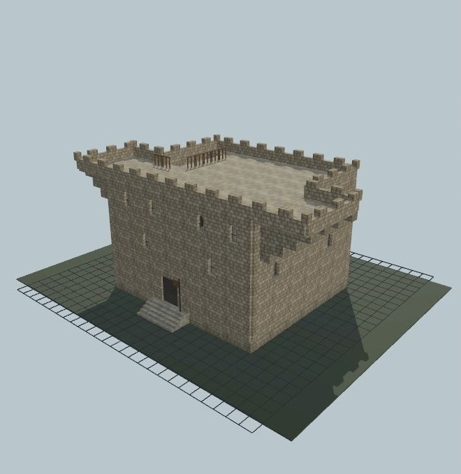](../../assets/architecture-editor/uo-0122/v1.1.0/preview.jpg) **[Tour UO 0122 — pierre, galeries et terrasse crénelée](uo-0122/v1.1.0/README.md)** v1.1.0 · [Plan JSON](../../assets/architecture-editor/uo-0122/v1.1.0/blueprint.json) |
| [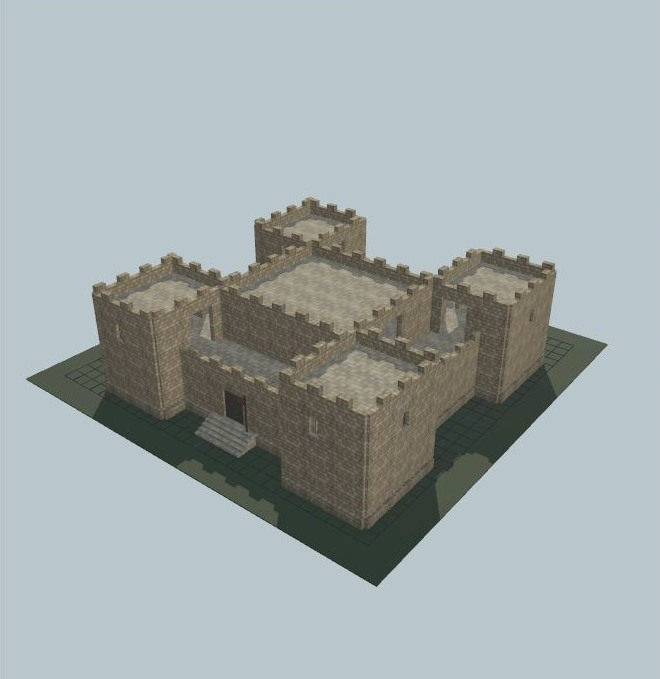](../../assets/architecture-editor/uo-0124/v1.1.0/preview.jpg) **[Fortification UO 0124 — tours et coursives](uo-0124/v1.1.0/README.md)** v1.1.0 · [Plan JSON](../../assets/architecture-editor/uo-0124/v1.1.0/blueprint.json) | [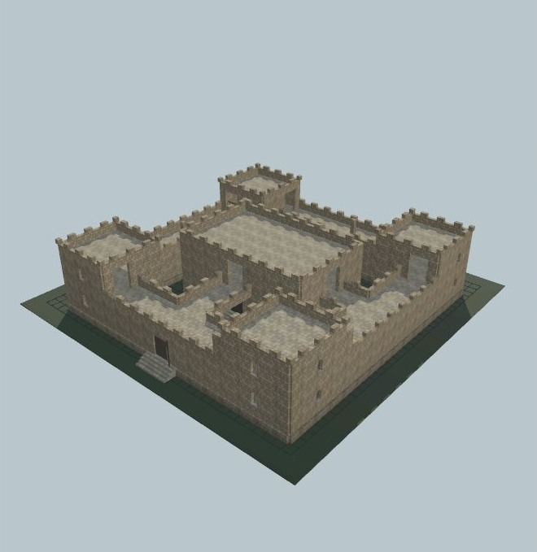](../../assets/architecture-editor/uo-0126/v1.1.0/preview.jpg) **[Forteresse UO 0126 — quatre tours et cour](uo-0126/v1.1.0/README.md)** v1.1.0 · [Plan JSON](../../assets/architecture-editor/uo-0126/v1.1.0/blueprint.json) | [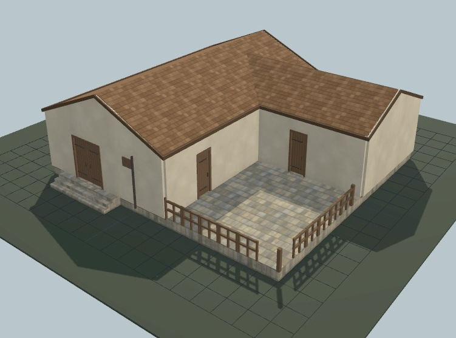](../../assets/architecture-editor/uo-0135/v1.0.0/preview.jpg) **[Bâtiment UO 0135 — comptoir et cour dallée](uo-0135/v1.0.0/README.md)** v1.0.0 · [Plan JSON](../../assets/architecture-editor/uo-0135/v1.0.0/blueprint.json) |
| [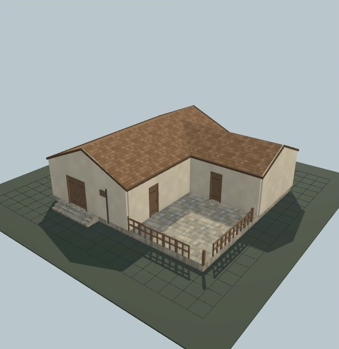](../../assets/architecture-editor/uo-0140/v1.1.0/preview.jpg) **[Bâtiment UO 0140 — comptoir et cour dallée](uo-0140/v1.1.0/README.md)** v1.1.0 · [Plan JSON](../../assets/architecture-editor/uo-0140/v1.1.0/blueprint.json) | [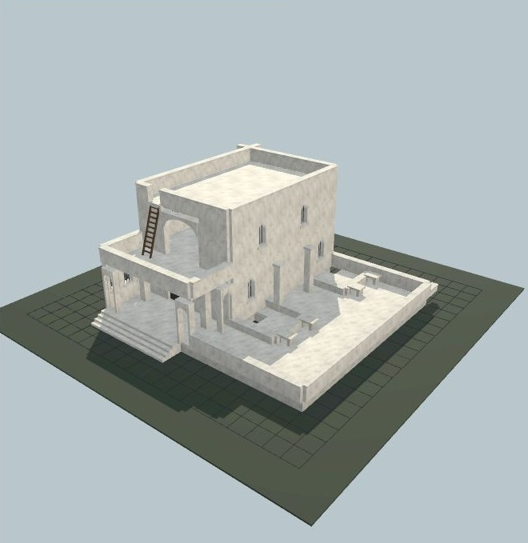](../../assets/architecture-editor/uo-0150/v1.1.0/preview.jpg) **[Pavillon UO 0150 — marbre et terrasses](uo-0150/v1.1.0/README.md)** v1.1.0 · [Plan JSON](../../assets/architecture-editor/uo-0150/v1.1.0/blueprint.json) | [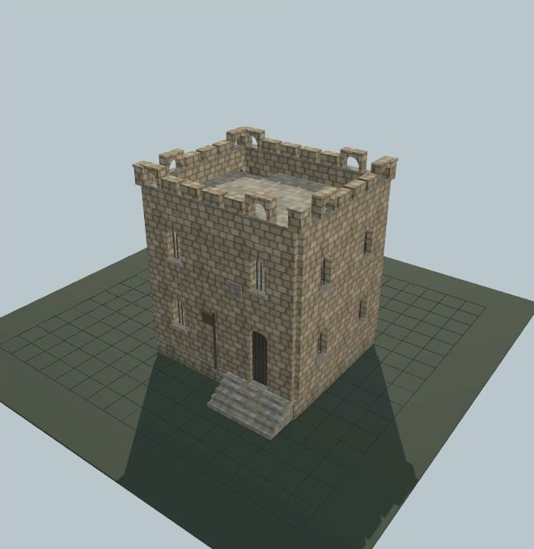](../../assets/architecture-editor/uo-0152/v1.1.0/preview.jpg) **[Tour UO 0152 — pierre et couronnement à arcades](uo-0152/v1.1.0/README.md)** v1.1.0 · [Plan JSON](../../assets/architecture-editor/uo-0152/v1.1.0/blueprint.json) |
| [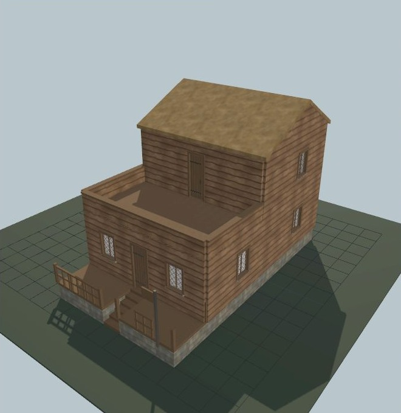](../../assets/architecture-editor/uo-0154/v1.1.0/preview.jpg) **[Chalet UO 0154 — rondins, chaume et balcon](uo-0154/v1.1.0/README.md)** v1.1.0 · [Plan JSON](../../assets/architecture-editor/uo-0154/v1.1.0/blueprint.json) | [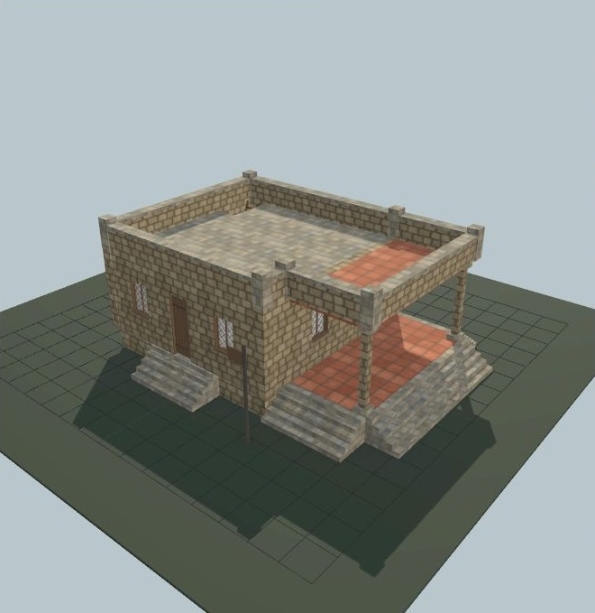](../../assets/architecture-editor/uo-0156/v1.1.0/preview.jpg) **[Maison UO 0156 — grès et terrasses dallées](uo-0156/v1.1.0/README.md)** v1.1.0 · [Plan JSON](../../assets/architecture-editor/uo-0156/v1.1.0/blueprint.json) | [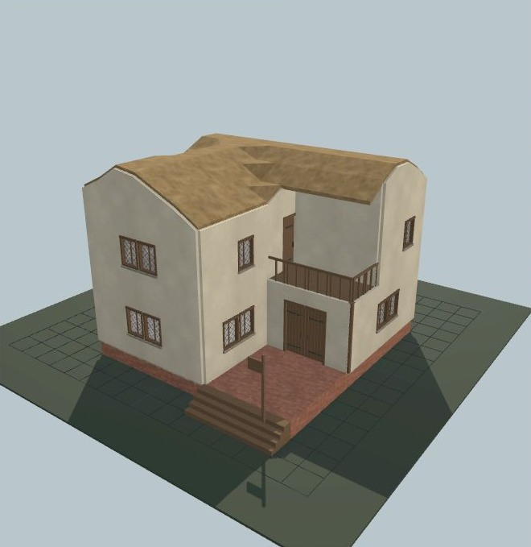](../../assets/architecture-editor/uo-0158/v1.1.0/preview.jpg) **[Maison UO 0158 — cour de brique et chaume](uo-0158/v1.1.0/README.md)** v1.1.0 · [Plan JSON](../../assets/architecture-editor/uo-0158/v1.1.0/blueprint.json) |
| [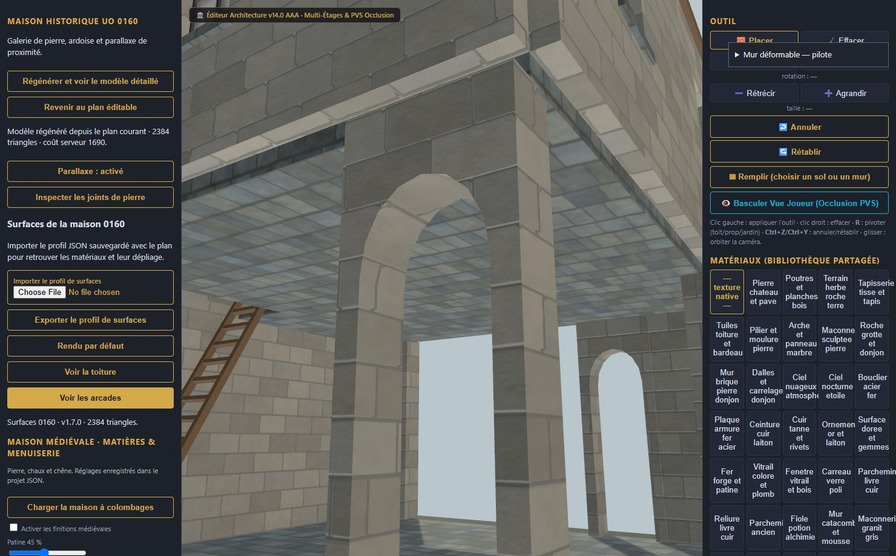](../../assets/architecture-editor/uo-0160/v1.7.0/preview.jpg) **[Maison UO 0160 — galerie de pierre et ardoise](uo-0160/v1.7.0/README.md)** v1.7.0 · [Plan JSON](../../assets/architecture-editor/uo-0160/v1.7.0/blueprint.json) · [Profil de surfaces](../../assets/architecture-editor/uo-0160/v1.7.0/surface-recipe.json) | [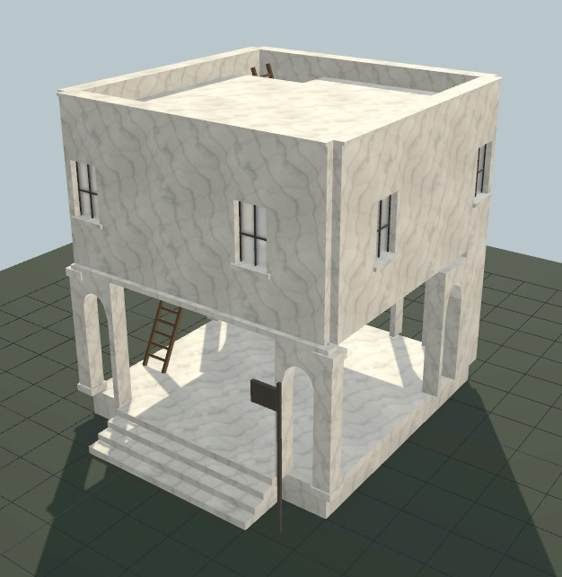](../../assets/architecture-editor/uo-0162/v1.0.0/preview.jpg) **[Maison UO 0162 — galerie de marbre et terrasse](uo-0162/v1.0.0/README.md)** v1.0.0 · [Plan JSON](../../assets/architecture-editor/uo-0162/v1.0.0/blueprint.json) | [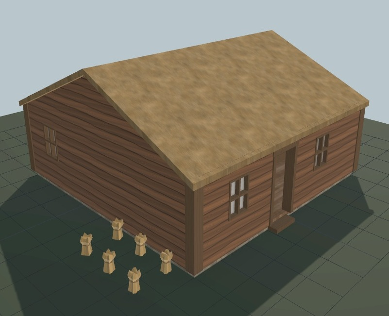](../../assets/architecture-editor/uo-3000/v1.0.0/preview.jpg) **[Maison UO 3000 — logis en rondins et chaume](uo-3000/v1.0.0/README.md)** v1.0.0 · [Plan JSON](../../assets/architecture-editor/uo-3000/v1.0.0/blueprint.json) |

## Maison UO 0160 — galerie de pierre et ardoise — vues dans Trammel privé, v1.7.0

Captures complémentaires du client privé. La vue intérieure utilise un profil temporaire de lumière de revue. [Détails des vérifications](uo-0160/v1.7.0/README.md).

| Parallax de proximité | Intérieur sous éclairage de revue |
| --- | --- |
| [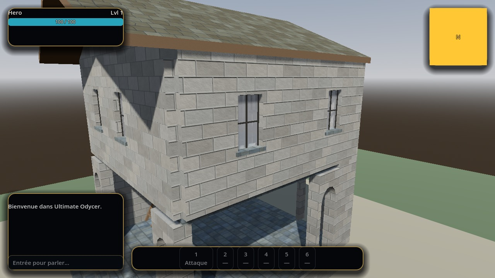](../../assets/architecture-editor/uo-0160/v1.7.0/native-near-parallax.jpg) Parallax de proximité | [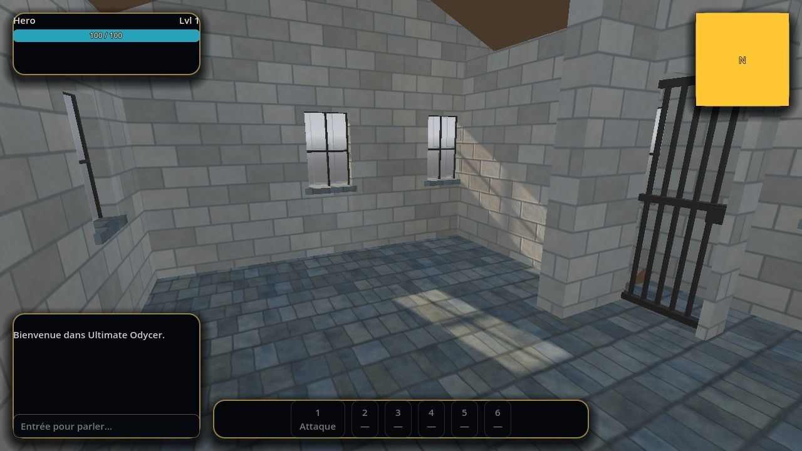](../../assets/architecture-editor/uo-0160/v1.7.0/native-interior-daylight.jpg) Intérieur sous éclairage de revue |
