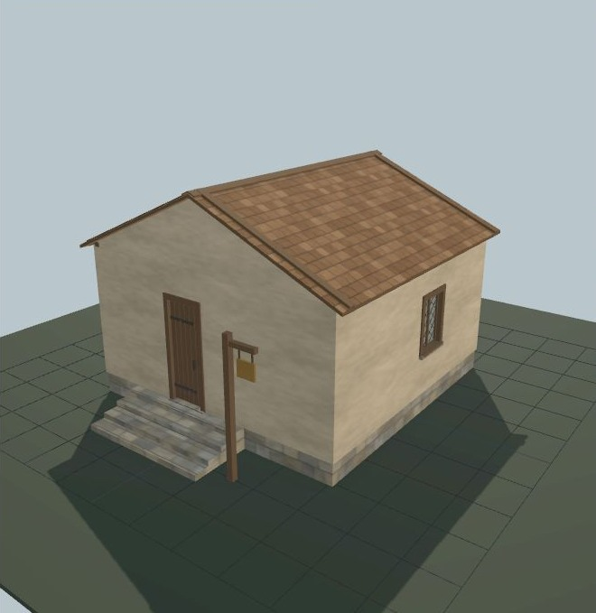

# Maison UO 0108/0109 — enduit à la chaux et bardeaux — v1.0.0

Statut expérimental. Consommateur : éditeur d’architecture. Plan vérifié par Zig en local et capture du modèle de revue. Aucune compatibilité avec le serveur de jeu actif n’est certifiée.

[Importer le JSON](../../../../assets/architecture-editor/uo-0108/v1.0.0/blueprint.json)

