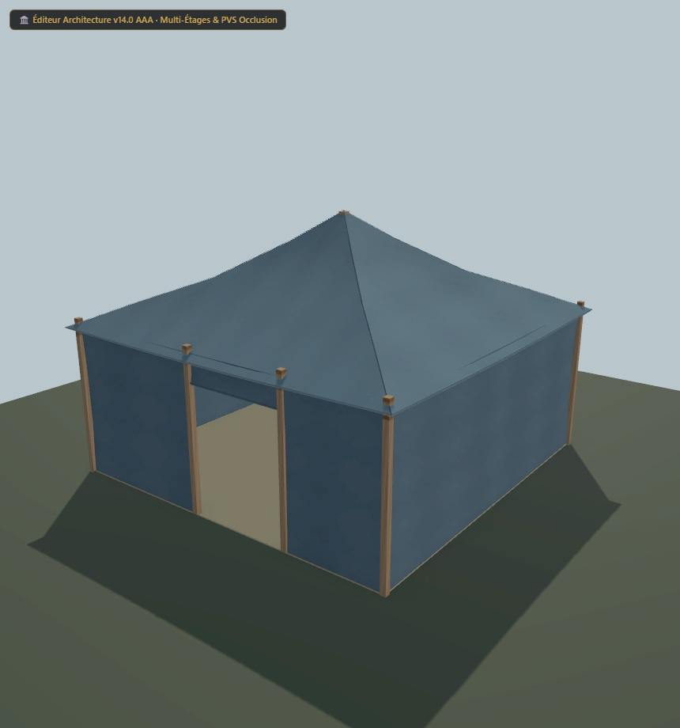

# Tente UO 0112/0113 — toile de revue — v1.3.0

Statut expérimental. Consommateur : éditeur d’architecture. Plan vérifié par Zig en local et capture du modèle de revue. Aucune compatibilité avec le serveur de jeu actif n’est certifiée.

[Importer le JSON](../../../../assets/architecture-editor/uo-0112/v1.3.0/blueprint.json)

La recette est identique à celle de la version 1.2.0. Le modèle de revue
présente des ligatures texturées et des pans de toile légèrement creusés
entre leurs ancrages, avec les mêmes 1 020 triangles.
Les GLB et le paquet Godot restent hors du registre.
