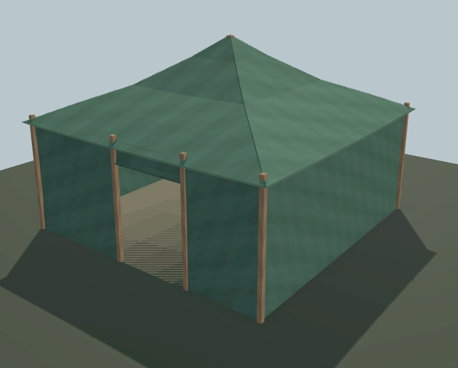

# Tente UO 0114/0115 — toile de revue — v1.1.0

Statut expérimental. Consommateur : éditeur d’architecture. Plan vérifié par Zig en local et capture du modèle de revue. Aucune compatibilité avec le serveur de jeu actif n’est certifiée.

[Importer le JSON](../../../../assets/architecture-editor/uo-0114/v1.1.0/blueprint.json)

Cette version met à jour la capture et l’empreinte du modèle de revue. Le
HouseBlueprint reste identique à la v1.0.0. Le GLB et le paquet de test ne
sont pas distribués dans le registre.
