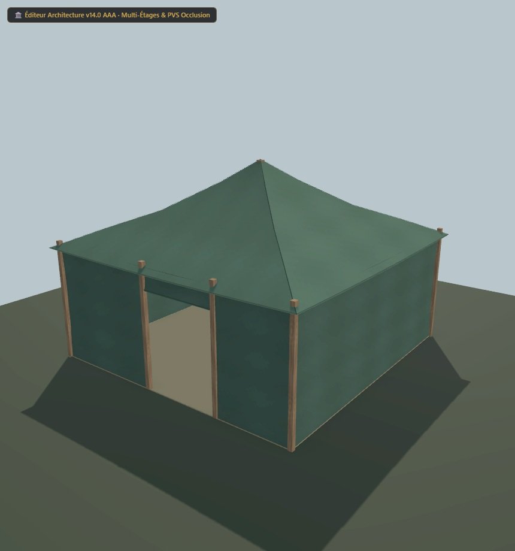

# Tente UO 0114/0115 — toile de revue — v1.2.0

Statut expérimental. Consommateur : éditeur d’architecture. Plan vérifié par Zig en local et capture du modèle de revue. Aucune compatibilité avec le serveur de jeu actif n’est certifiée.

[Importer le JSON](../../../../assets/architecture-editor/uo-0114/v1.2.0/blueprint.json)

La recette est identique à celle de la version 1.1.0. Le modèle de revue
utilise une toile plus mate et des normales lissées par panneau, sans
changer ses 1 020 triangles. Les GLB et le paquet Godot restent hors du registre.
