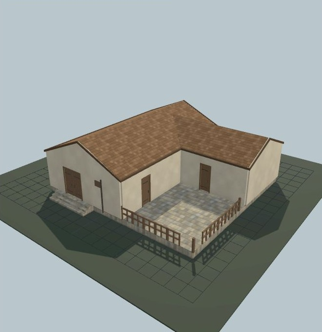

# Bâtiment UO 0140 — comptoir et cour dallée — v1.0.0

Statut expérimental. Consommateur : éditeur d’architecture. Plan vérifié par Zig en local et capture du modèle de revue. Aucune compatibilité avec le serveur de jeu actif n’est certifiée.

[Importer le JSON](../../../../assets/architecture-editor/uo-0140/v1.0.0/blueprint.json)

