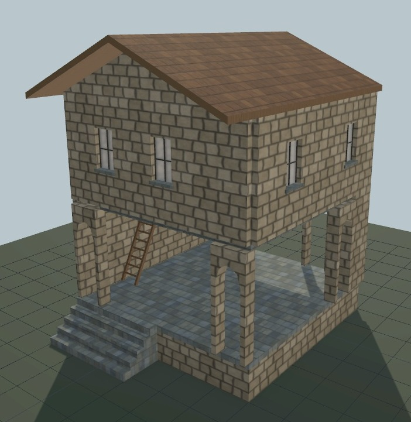

# Maison UO 0160 — galerie de pierre et ardoise — v1.0.0

Statut expérimental. Consommateur : éditeur d’architecture. Plan vérifié par Zig en local et capture du modèle de revue. Aucune compatibilité avec le serveur de jeu actif n’est certifiée.

[Importer le JSON](../../../../assets/architecture-editor/uo-0160/v1.0.0/blueprint.json)

Le modèle de revue utilise une maçonnerie PBR raccordable et un parallaxe de
proximité dans l’adaptateur local de l’éditeur. Le JSON décrit le plan et ses
pièces éditables. Le shader et les textures du rendu ne font pas partie du JSON.
