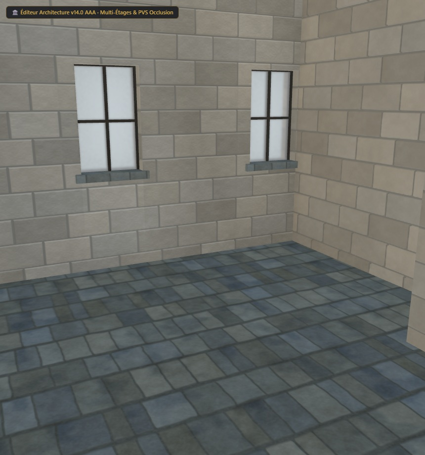

# Maison UO 0160 — galerie de pierre et ardoise — v1.2.0

Statut expérimental. Consommateur : éditeur d’architecture. Plan vérifié par Zig en local et capture du modèle de revue. Aucune compatibilité avec le serveur de jeu actif n’est certifiée.

Cette revue remplace les joints larges et sombres par une pierre calcaire taillée : joints d’environ un centimètre, mortier plus clair et couleur, normales et hauteur issues du même motif. Les 2 336 triangles, les UV, les volumes et le plan sont conservés.

[Importer le plan JSON](../../../../assets/architecture-editor/uo-0160/v1.2.0/blueprint.json)

[Profil de matériau JSON](../../../../assets/architecture-editor/uo-0160/v1.2.0/surface-recipe.json) : paramètres, graine, convention des canaux et empreintes du générateur et des cartes. Ce profil descriptif nécessite le générateur local correspondant. L’import du plan seul n’installe pas le matériau et ne régénère pas le GLB de la capture.

Profil SHA-256 : 106437e1c777c2a75e7035b548b8c9c32243f22441d2bf389c417fdfc19ab89c

