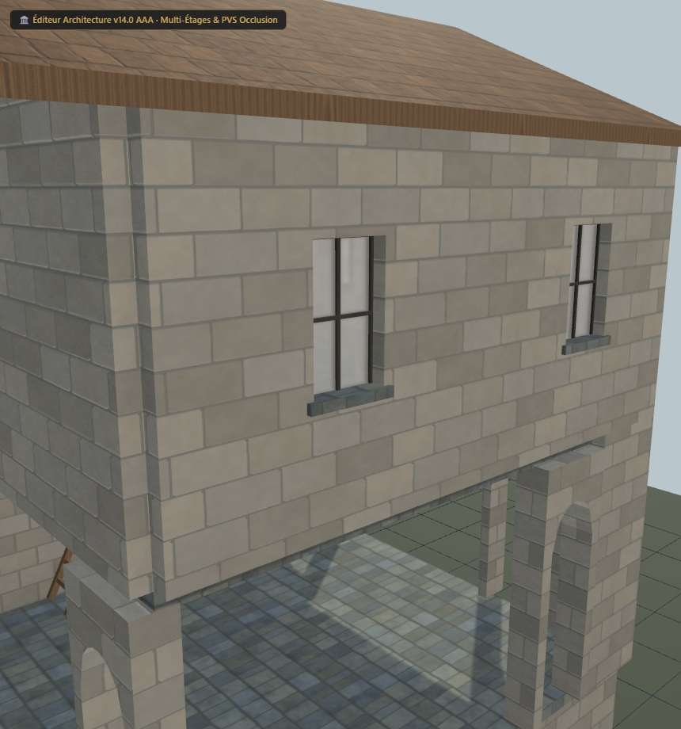

# Maison UO 0160 — galerie de pierre et ardoise — v1.3.0

Statut expérimental. Consommateur : éditeur d’architecture. Plan vérifié par Zig en local et capture du modèle de revue. Aucune compatibilité avec le serveur de jeu actif n’est certifiée.

Cette revue raccorde les UV de pierre autour des murs de l’étage, avec douze répétitions fermant le pourtour. Le maillage de 2 336 triangles, les volumes, les couleurs et les images de la v1.2.0 restent identiques. La règle concerne les façades de l’étage et leurs retours aux coins ; les arcades basses et les tableaux des fenêtres restent hors de ce dépliage.

[Importer le plan JSON](../../../../assets/architecture-editor/uo-0160/v1.3.0/blueprint.json)

[Profil matériau et UV JSON](../../../../assets/architecture-editor/uo-0160/v1.3.0/surface-recipe.json) : paramètres, graine, règle de dépliage et empreintes des générateurs. Ce profil descriptif nécessite les générateurs locaux correspondants. L’import du plan seul n’installe pas le matériau et ne régénère pas le GLB.

Profil SHA-256 : 562f42b6da8b0faecc049effade6ee9d3529e055c8a05a1c45f2827de5427c76

