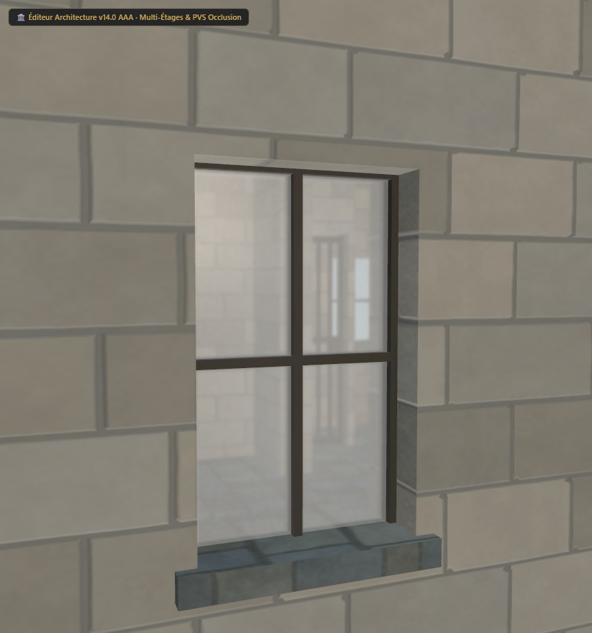

# Maison UO 0160 — galerie de pierre et ardoise — v1.4.0

Statut expérimental. Consommateur : éditeur d’architecture. Plan vérifié par Zig en local et capture du modèle de revue. Aucune compatibilité avec le serveur de jeu actif n’est certifiée.

Cette revue raccorde le motif de pierre aux retours verticaux et au dessous du linteau des huit fenêtres de l’étage. Les UV sont séparés au plan du vitrage pour conserver leur échelle sur la profondeur du mur. Le modèle passe de 2 336 à 2 384 triangles par subdivision de 24 faces planes existantes ; les volumes, les textures PBR, les appuis et le plan restent identiques.

[Importer le plan JSON](../../../../assets/architecture-editor/uo-0160/v1.4.0/blueprint.json)

[Profil matériau et UV JSON](../../../../assets/architecture-editor/uo-0160/v1.4.0/surface-recipe.json) : paramètres de la pierre, dépliage du pourtour, tableaux de fenêtres, budget et empreintes des générateurs. Ce profil descriptif nécessite les générateurs locaux correspondants. L’import du plan seul n’installe pas le matériau et ne régénère pas le GLB.

Profil SHA-256 : 4153959af5ecb45abe425eeaa9747e97e27dad2d079f37e8bb4dbad9ab99b2de

