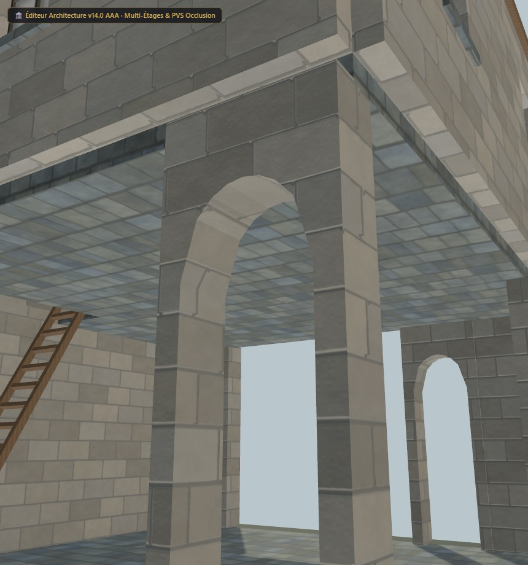

# Maison UO 0160 — galerie de pierre et ardoise — v1.5.0

Statut expérimental. Consommateur : éditeur d’architecture. Plan vérifié par Zig en local et capture du modèle de revue. Aucune compatibilité avec le serveur de jeu actif n’est certifiée.

Cette revue raccorde les UV des faces visibles des cinq arcades et de leur dessous. Elle conserve les UV et l’échelle de pierre côté façade extérieure. Les 32 triangles d’arcade dont les UV étaient dégénérés sont corrigés. Le modèle reste à 2 384 triangles avec les mêmes volumes, couleurs et textures PBR ; les faces masquées au sol et sous le plancher supérieur gardent leur ancien dépliage.

[Importer le plan JSON](../../../../assets/architecture-editor/uo-0160/v1.5.0/blueprint.json)

[Profil matériau et UV JSON](../../../../assets/architecture-editor/uo-0160/v1.5.0/surface-recipe.json) : pierre, dépliage du pourtour, tableaux de fenêtres et projection des arcades. Ce profil descriptif nécessite les générateurs locaux correspondants. L’import du plan seul n’installe pas le matériau et ne régénère pas le GLB.

Profil SHA-256 : 311d910db679a116dd3323b1062e9095ce80e04f94aba1b81dfab6e8b98bb87e

