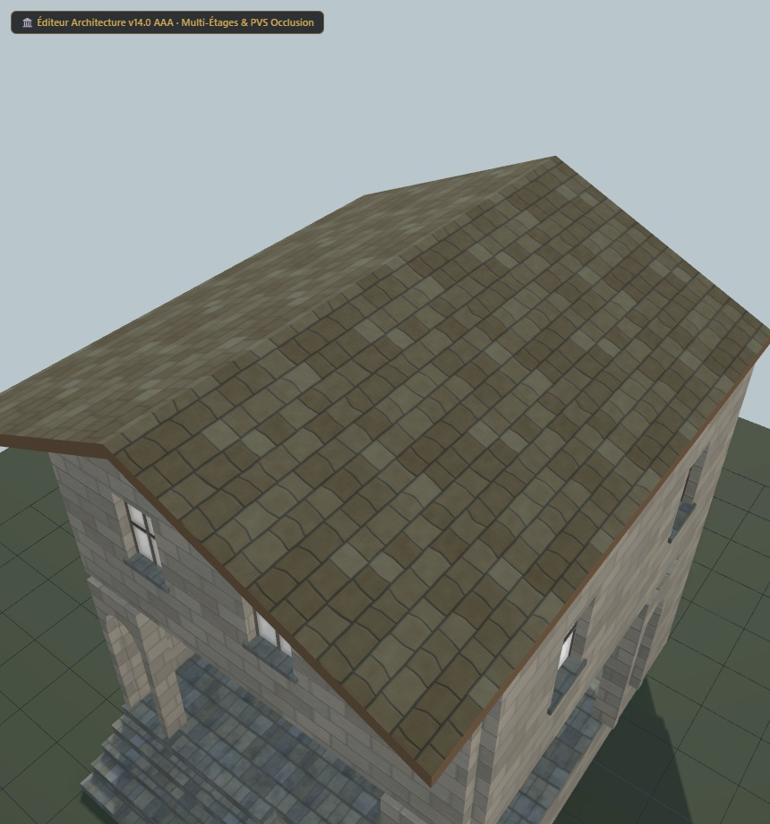

# Maison UO 0160 — galerie de pierre et ardoise — v1.6.0

Statut expérimental. Consommateur : éditeur d’architecture. Plan vérifié par Zig en local et capture du modèle de revue. Aucune compatibilité avec le serveur de jeu actif n’est certifiée.

Cette revue donne la même échelle aux bardeaux des deux pans et oriente leurs rangées du faîtage vers les égouts. Le grain du bois suit les rives et les faces longitudinales de l’échelle. Le ton du toit est moins orangé. Le modèle reste à 2 384 triangles avec les mêmes positions, volumes, couleurs de sommets et images PBR ; seuls les UV concernés et le facteur de couleur du toit changent. Les bouts des bois de l’échelle conservent leur ancien dépliage.

[Importer le plan JSON](../../../../assets/architecture-editor/uo-0160/v1.6.0/blueprint.json)

[Profil matériau et UV JSON](../../../../assets/architecture-editor/uo-0160/v1.6.0/surface-recipe.json) : paramètres de pierre, arcs, fenêtres, toiture et grain du bois. Ce profil descriptif nécessite les générateurs locaux correspondants. L’import du plan seul n’installe pas le matériau et ne régénère pas le GLB ; le chargement du profil dans l’éditeur reste une étape distincte.

Profil SHA-256 : fe93a9f0fc44090c8c97ef132fdb7b4f8dd8746568fe801ce30669f9a76de26f

