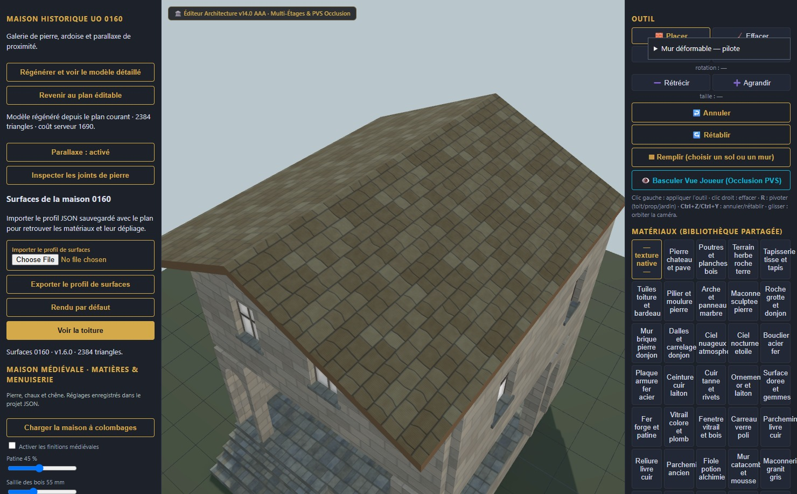

# Maison UO 0160 — galerie de pierre et ardoise — v1.6.1

Statut expérimental. Consommateur : éditeur d’architecture. Plan vérifié par Zig en local et capture du modèle de revue. Aucune compatibilité avec le serveur de jeu actif n’est certifiée.

Cette version documente le chargement du profil de surfaces dans la revue locale 0160 mise à jour. Le plan et les paramètres de rendu sont ceux de la v1.6.0 : même modèle à 2 384 triangles, mêmes textures. Le profil fourni ici a été exporté depuis l’interface puis réimporté avec succès.

1. [Importer le plan natif](../../../../assets/architecture-editor/uo-0160/v1.6.1/blueprint.json) dans l’éditeur.
2. Dans **Surfaces de la maison 0160**, choisir **Importer le profil de surfaces**, puis sélectionner le [profil JSON](../../../../assets/architecture-editor/uo-0160/v1.6.1/surface-recipe.json).
3. Attendre la vérification et la reconstruction locale ; le modèle détaillé s’affiche automatiquement.
4. Pour modifier une fenêtre, revenir au plan éditable, conserver les dispositions autorisées, puis régénérer.
5. Sauvegarder le plan natif et utiliser **Exporter le profil de surfaces**. Réimporter les deux JSON pour rouvrir la réalisation.

La revue reconnaît les profils archivés de la maison 0160 v1.2.0 à v1.6.0. Les paramètres des profils reconnus sont immuables ; un profil modifié est refusé en conservant le précédent. **Rendu par défaut** désactive le profil choisi. Les générateurs et ressources d’origine restent nécessaires localement. Le profil n’est pas un paquet d’assets autonome et ce registre ne distribue pas le GLB ni le code des générateurs.

La reconstruction depuis un cache vide reproduit exactement le modèle de référence. L’export du plan après déplacement d’une fenêtre et la réouverture avec le profil dans un nouveau contexte de navigateur reproduisent aussi le modèle édité. Ces preuves couvrent la revue locale et les validations Zig ; elles n’ajoutent aucune certification du serveur actif, des performances ou du photoréalisme global.

Profil exporté SHA-256 : a7ecd075379386ac34029a1793902c0a1eafdb5ce29a4f5197f375bbbef01db7

