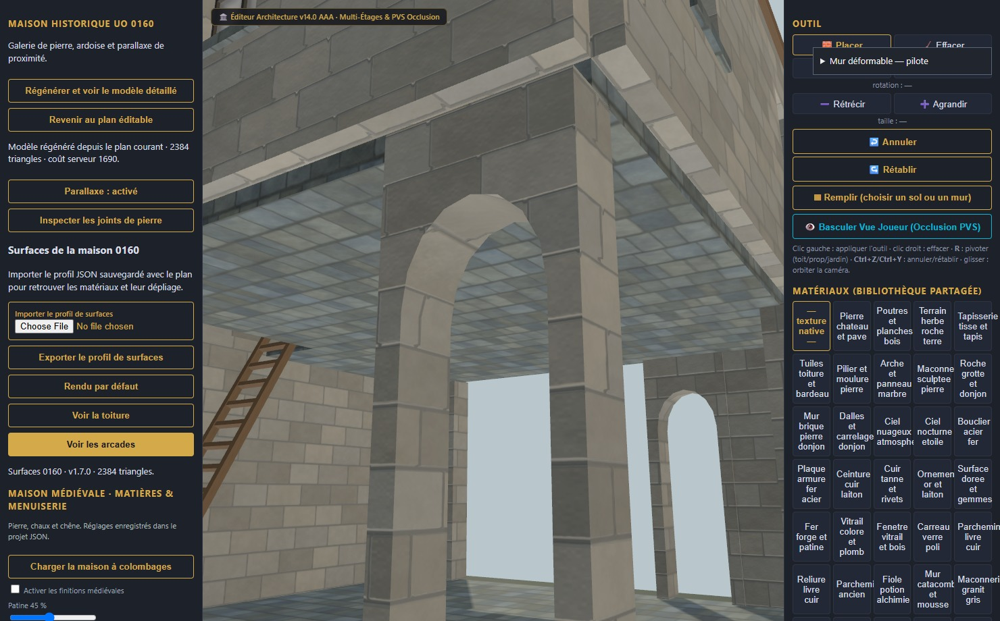
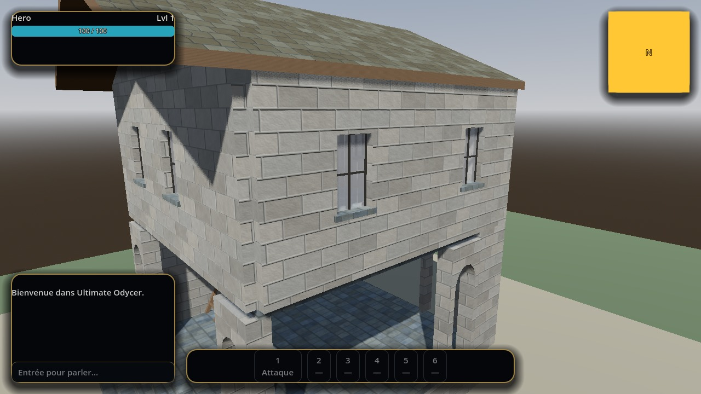
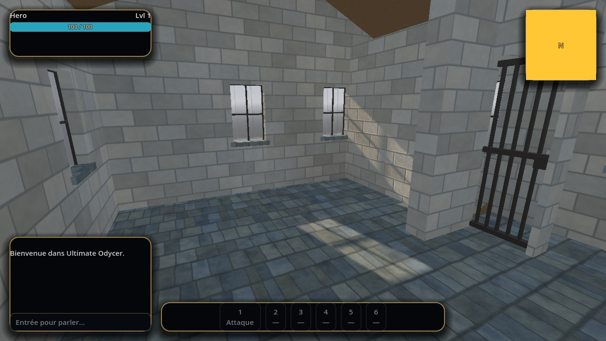

# Maison UO 0160 — galerie de pierre et ardoise — v1.7.0

Statut expérimental. Consommateur : éditeur d’architecture. Plan vérifié par Zig en local et capture du modèle de revue. Aucune compatibilité avec le serveur de jeu actif n’est certifiée.

Cette revue répartit les sommets existants des cinq arcs selon des angles réguliers et lisse les normales de leur dessous d’après l’ellipse prévue. Le modèle reste à **2 384 triangles**, avec huit segments par arc et les mêmes images PBR. L’écart maximal échantillonné entre la courbe prévue et le contour exporté passe d’environ 23,8 à 8,7 mm. Le plan, l’encombrement général et les dimensions des ouvertures sont conservés ; le maillage et sa collision suivent le nouveau contour.

1. [Importer le plan natif](../../../../assets/architecture-editor/uo-0160/v1.7.0/blueprint.json) dans la revue locale 0160 mise à jour.
2. Choisir **Importer le profil de surfaces**, puis sélectionner le [profil JSON](../../../../assets/architecture-editor/uo-0160/v1.7.0/surface-recipe.json).
3. Utiliser **Voir les arcades** pour examiner le contour et le dessous.
4. Sauvegarder le plan et utiliser **Exporter le profil de surfaces** pour rouvrir ensuite la réalisation avec les deux JSON.

Les profils archivés restent reconnus ; les contrôles de régression reproduisent leurs anciens modèles et variantes éditées par empreinte. Les paramètres des profils reconnus sont immuables et les générateurs locaux restent nécessaires. Ce registre distribue les recettes et captures, sans GLB ni code de générateur.

Contrôles locaux : contour de chaque arc, absence de triangle dégénéré ou retourné, import/export/réouverture après déplacement d’une fenêtre, 60 balayages de capsule Godot/Jolt comparés au module serveur et 35 rayons sur le nouveau dessous. Le modèle est aussi observé dans Trammel privé. Le serveur conserve son enveloppe d’ornement : ces contrôles ne certifient pas une collision serveur elliptique exacte, tous les sauts, la VR ni le photoréalisme global.

Profil exporté SHA-256 : 3bdb6230af4423d958d777df05bb1358a415cc148160f48b8f191904f959bb47

Revue complémentaire dans **Trammel privé** : les textures et le modèle v1.7.0 sont inchangés. Le client de revue isole désormais le monde 3D de l’aperçu des reliques : sa lumière ne pollue plus les murs du jeu. Les normales restent actives ; le parallax de proximité et son repli à distance ont été revérifiés. Cette correction de client reste locale et ne modifie pas l’installation active.

La vue intérieure utilise le profil temporaire de lumière de revue. Ces captures complètent la preuve de l’éditeur ; elles ne certifient ni le photoréalisme global ni une mise en production. Les JSON versionnés et la capture originale de l’éditeur sont conservés.
