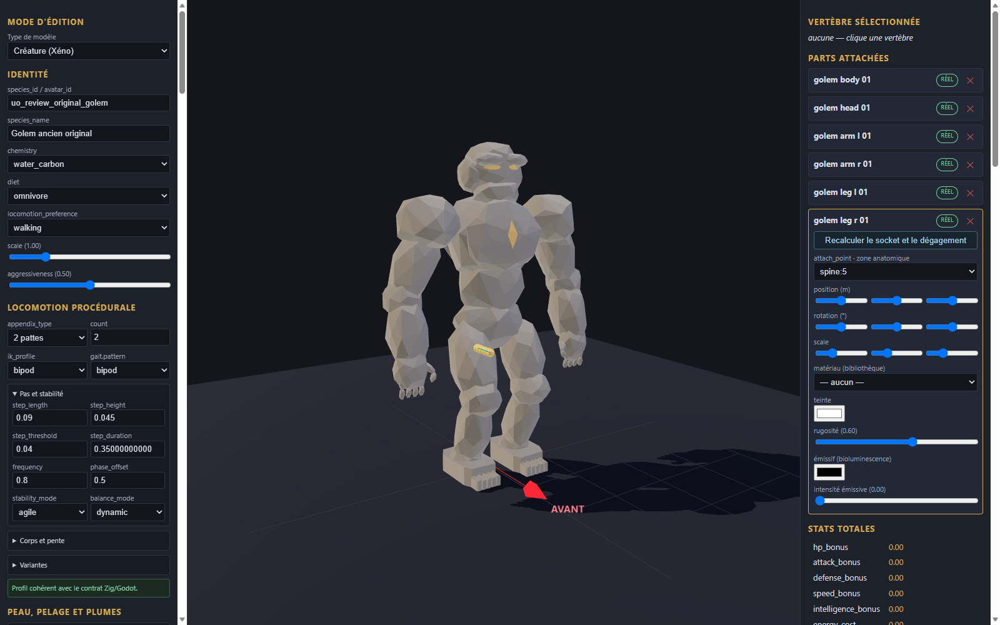

# Golem ancien original v0.1.0

Génome expérimental de revue, six pièces originales et fragment de configuration à intégrer dans une copie de l’éditeur. Les éléments proviennent de la géométrie procédurale locale du golem ancien original ; aucune image ou géométrie historique n’est incluse. Les couleurs unies sont nouvelles.

Import, export et rechargement vérifiés dans l’éditeur en configuration isolée ; import statique dans Godot. Le corps, la tête, les deux bras et les deux jambes sont des pièces statiques sans rig. La catégorie armor est utilisée pour les bras comme choix technique de revue. Aucun mouvement, gameplay, collision complète, serveur, VR ou approbation artistique n’est certifié.

[Entrée](template.json) · [Génome](../../../../assets/xeno-editor/ancient-golem-original/v0.1.0/genome.json) · [Recette source](../../../../assets/xeno-editor/ancient-golem-original/v0.1.0/source-recipe.json) · [Configuration](../../../../assets/xeno-editor/ancient-golem-original/v0.1.0/registration.json)

[Capture statique Godot](../../../../assets/xeno-editor/ancient-golem-original/v0.1.0/godot-preview.png)

Source géométrique : modèle procédural original golem build-03, SHA-256 `615d5457cdb17b95090e84b9fe148dc8009458c7d8bd6d20d730d9ae48d64d3e`. La texture, le squelette et l’animation source ne sont pas repris.
