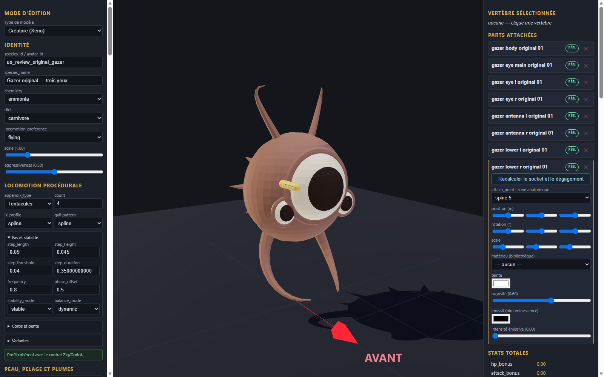

# Gazer original — trois yeux v0.1.0

Génome expérimental de revue, huit pièces originales et fragment de configuration à intégrer dans une copie de l’éditeur. Les éléments proviennent de la géométrie procédurale locale du gazer original ; aucune image ou géométrie historique n’est incluse. Les couleurs unies sont nouvelles.

Import, export et rechargement vérifiés dans l’éditeur en configuration isolée ; import statique dans Godot. Le profil tentacules est une configuration de revue ; aucun mouvement, gameplay, collision complète, serveur, VR ou approbation artistique n’est certifié.

[Entrée](template.json) · [Génome](../../../../assets/xeno-editor/gazer-original-three-eyes/v0.1.0/genome.json) · [Recette source](../../../../assets/xeno-editor/gazer-original-three-eyes/v0.1.0/source-recipe.json) · [Configuration](../../../../assets/xeno-editor/gazer-original-three-eyes/v0.1.0/registration.json)

[Capture statique Godot](../../../../assets/xeno-editor/gazer-original-three-eyes/v0.1.0/godot-preview.png)
