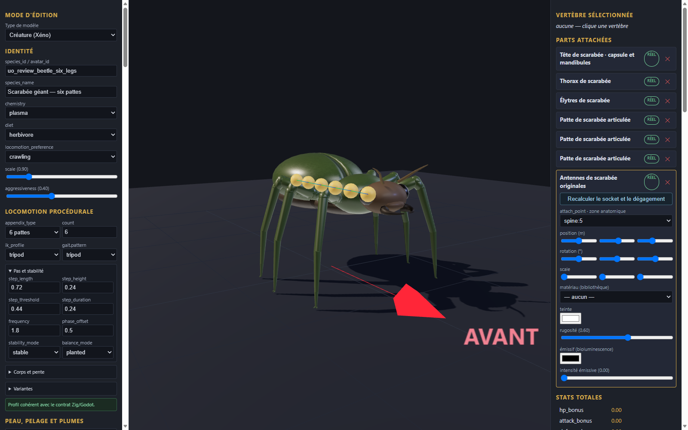

# Scarabée géant à six pattes v0.1.0

Génome expérimental de revue et capture du véritable éditeur dans une configuration isolée. L’antenne est une nouvelle pièce procédurale originale ; elle remplace la pièce historique dans ce génome, sans modifier l’installation partagée. Le fragment de catalogue de revue et le GLB associé sont fournis ; leur enregistrement dans un autre éditeur demande une intégration explicite. Les autres pièces du modèle ne sont pas distribuées ici.

La capture montre un export statique. La marche, les collisions complètes, le serveur, Godot, la VR et la validation artistique de ce candidat ne sont pas qualifiés.

[Entrée](template.json) · [Génome](../../../../assets/xeno-editor/giant-beetle-six-legs/v0.1.0/genome.json) · [Recette d’origine](../../../../assets/xeno-editor/giant-beetle-six-legs/v0.1.0/source-recipe.json) · [Antenne GLB](../../../../assets/xeno-editor/giant-beetle-six-legs/v0.1.0/antenna.glb) · [Fragment de catalogue](../../../../assets/xeno-editor/giant-beetle-six-legs/v0.1.0/registration.json)

