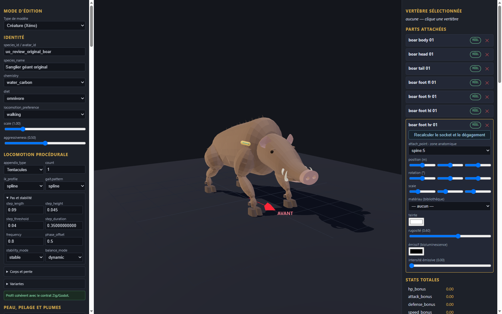

# Sanglier géant original v0.1.0

Génome expérimental de revue, sept pièces originales et fragment de configuration à intégrer dans une copie de l’éditeur. Les éléments proviennent de la géométrie procédurale locale du sanglier géant original ; aucune image ou géométrie historique n’est incluse. Les couleurs unies sont nouvelles.

Import, export et rechargement vérifiés dans l’éditeur en configuration isolée ; import statique dans Godot. Le corps inclut les membres supérieurs ; tête, queue et quatre sabots sont séparés. La catégorie armor et le profil tentacule sont des choix techniques de revue, sans portée anatomique ni preuve de marche. Aucun mouvement, gameplay, collision complète, serveur, VR ou approbation artistique n’est certifié.

[Entrée](template.json) · [Génome](../../../../assets/xeno-editor/giant-boar-original/v0.1.0/genome.json) · [Recette source](../../../../assets/xeno-editor/giant-boar-original/v0.1.0/source-recipe.json) · [Configuration](../../../../assets/xeno-editor/giant-boar-original/v0.1.0/registration.json)

[Capture statique Godot](../../../../assets/xeno-editor/giant-boar-original/v0.1.0/godot-preview.png)

Source géométrique : sanglier procédural original build-09, SHA-256 `6bf2329359c043681135d4cfdfb878009af2a64874be4fca459b7d7b7217860b`. La recette reprend les paramètres du projet source ; textures, squelette et animation ne sont pas inclus.
