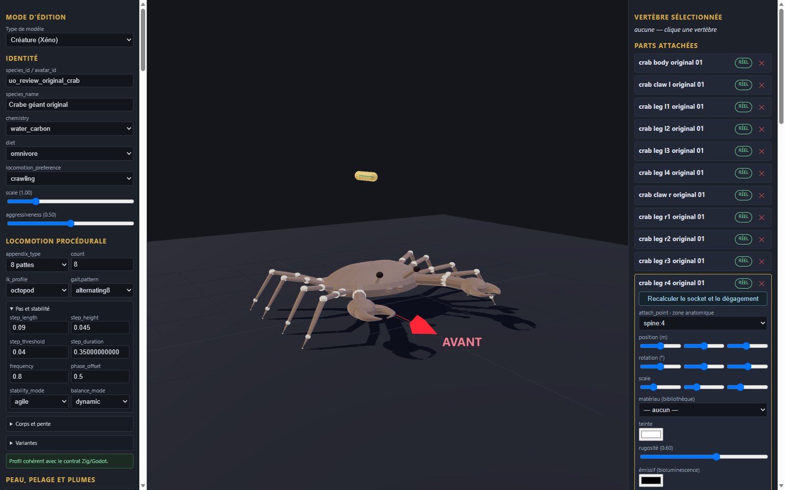

# Crabe géant original v0.1.0

Génome expérimental de revue, onze pièces originales et fragment de configuration à intégrer dans une copie de l’éditeur. Les éléments proviennent de la géométrie procédurale locale du crabe géant original ; aucune image ou géométrie historique n’est incluse. Les couleurs unies sont nouvelles.

Import, export et rechargement vérifiés dans l’éditeur en configuration isolée ; import statique dans Godot. Les huit pattes et les deux pinces sont des pièces statiques sans rig. Aucun mouvement, gameplay, collision complète, serveur, VR ou approbation artistique n’est certifié.

[Entrée](template.json) · [Génome](../../../../assets/xeno-editor/giant-crab-original/v0.1.0/genome.json) · [Recette source](../../../../assets/xeno-editor/giant-crab-original/v0.1.0/source-recipe.json) · [Configuration](../../../../assets/xeno-editor/giant-crab-original/v0.1.0/registration.json)

[Capture statique Godot](../../../../assets/xeno-editor/giant-crab-original/v0.1.0/godot-preview.png)

Source géométrique : modèle procédural original crabe build-04, SHA-256 `88bfe0e18f2d63d542de2fcd8542e14b2a827974a9440928dcb1a4baa4d4a218`. Les pièces sont reconstruites à partir de ses plages de géométrie documentées ; sa texture n’est pas incluse. Le squelette et l’animation ne sont pas repris.
