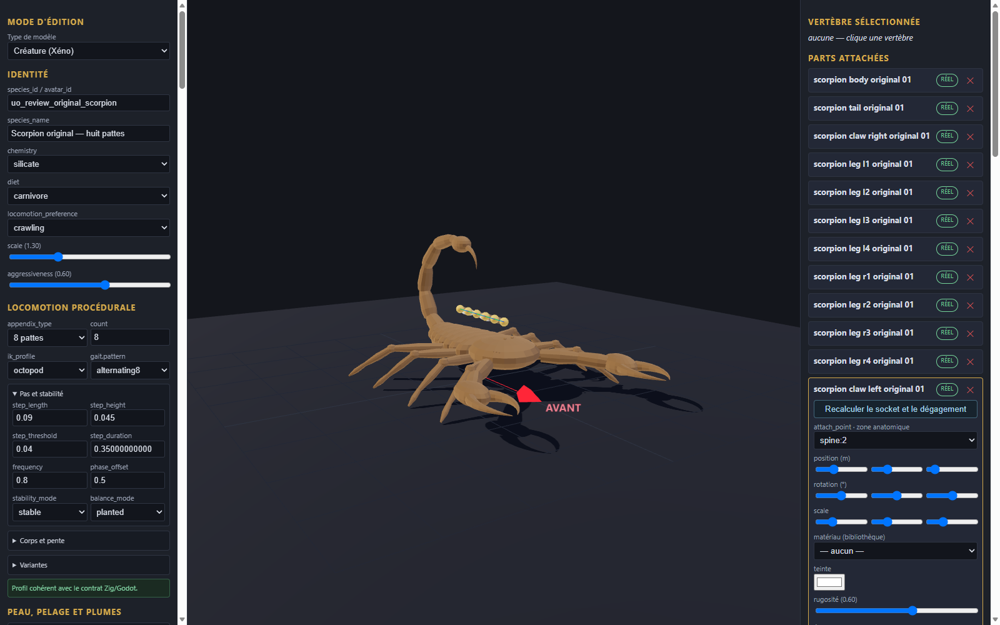

# Scorpion original — huit pattes v0.1.0

Génome expérimental de revue, 12 pièces originales et fragment de configuration à intégrer dans une copie de l’éditeur. Les éléments proviennent de la géométrie procédurale locale du scorpion original ; les textures et géométries historiques ne sont pas utilisées. Le génome et le fragment restent review-only.

Import, export et rechargement ont été vérifiés dans l’éditeur en configuration isolée ; l’export a ensuite été importé dans Godot pour une capture statique. Le diagnostic de contact était inactif : aucune marche, collision complète, intégration serveur, VR ou approbation artistique n’est certifiée.

[Entrée](template.json) · [Génome](../../../../assets/xeno-editor/giant-scorpion-original/v0.1.0/genome.json) · [Recette source](../../../../assets/xeno-editor/giant-scorpion-original/v0.1.0/source-recipe.json) · [Configuration](../../../../assets/xeno-editor/giant-scorpion-original/v0.1.0/registration.json)

[Capture statique Godot](../../../../assets/xeno-editor/giant-scorpion-original/v0.1.0/godot-preview.png)
