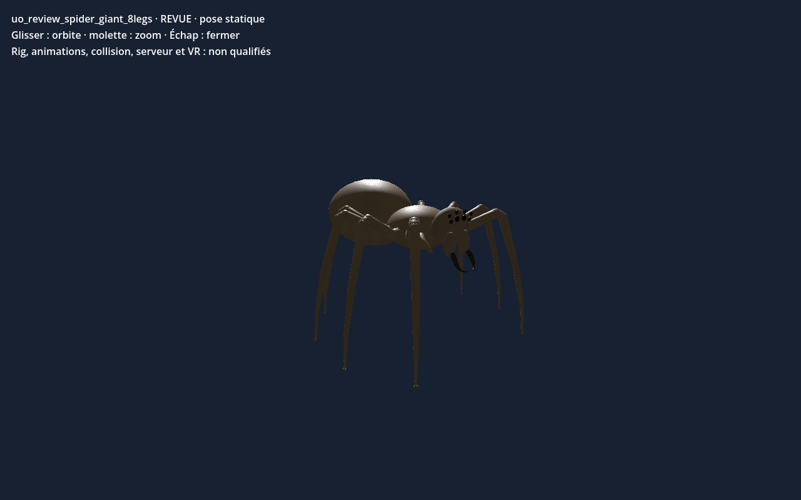

# Araignée géante — huit pattes v0.1.0

Génome éditable de revue et recette d’origine, vérifiés par empreinte. La capture correspond à l’export de l’éditeur importé dans Godot en scène isolée. Pièces et générateurs ne sont pas distribués : les JSON seuls ne suffisent pas à reconstruire la géométrie. Le modèle est statique et la marche huit pattes, le gameplay, le serveur et la VR restent non qualifiés.

[Modèle du catalogue](template.json) · [Génome](../../../../assets/xeno-editor/giant-spider-eight-legs/v0.1.0/genome.json) · [Recette d’origine](../../../../assets/xeno-editor/giant-spider-eight-legs/v0.1.0/source-recipe.json)

