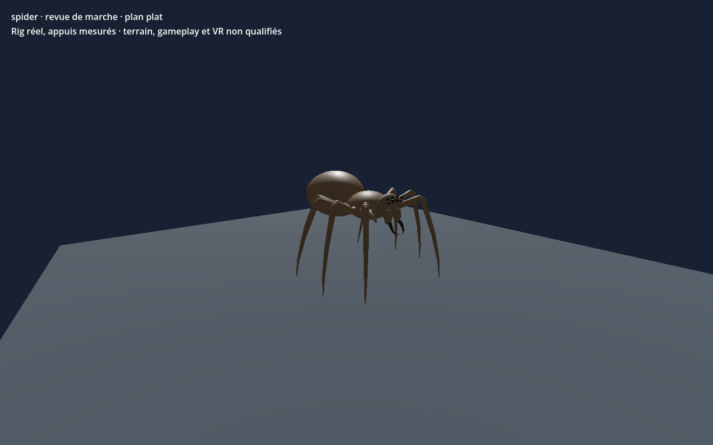

# Araignée géante — huit pattes v0.2.0

Génome de revue avec profil explicite huit pattes. Capture d’une pose de marche importée dans Godot sur terrain plat. Le contrôle historique porte sur un clip local et des appuis mesurés ; il ne qualifie pas les pentes, le contrôleur de jeu, le serveur, la VR ni la finition artistique. Le génome reste en revue, sans autorité serveur. Générateurs et pièces ne sont pas distribués ; les JSON seuls ne suffisent pas à reconstruire le modèle.

[Modèle du catalogue](template.json) · [Génome](../../../../assets/xeno-editor/giant-spider-eight-legs/v0.2.0/genome.json) · [Recette d’origine](../../../../assets/xeno-editor/giant-spider-eight-legs/v0.2.0/source-recipe.json)

