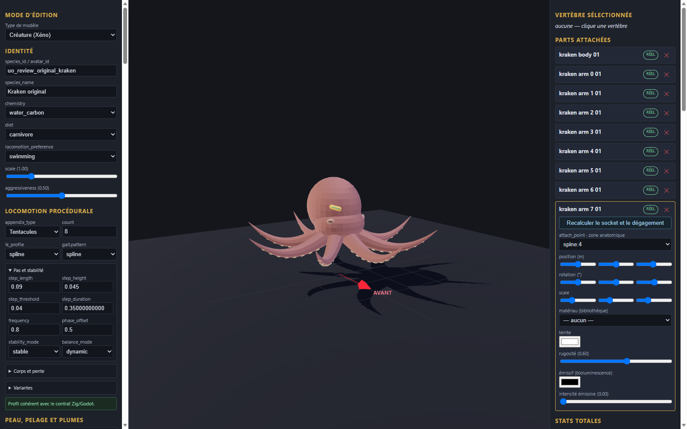

# Kraken original v0.1.0

Génome expérimental de revue, neuf pièces originales et fragment de configuration à intégrer dans une copie de l’éditeur. Les éléments proviennent de la géométrie procédurale locale du kraken original ; aucune image ou géométrie historique n’est incluse. Les couleurs unies sont nouvelles.

Import, export et rechargement vérifiés dans l’éditeur en configuration isolée ; import statique dans Godot. Le corps et les huit bras sont des pièces séparées. La catégorie armor et le profil tentacule sont des choix techniques de revue, sans portée anatomique ni preuve de marche. Aucun mouvement, gameplay, collision complète, serveur, VR ou approbation artistique n’est certifié.

[Entrée](template.json) · [Génome](../../../../assets/xeno-editor/kraken-original/v0.1.0/genome.json) · [Recette source](../../../../assets/xeno-editor/kraken-original/v0.1.0/source-recipe.json) · [Configuration](../../../../assets/xeno-editor/kraken-original/v0.1.0/registration.json)

[Capture statique Godot](../../../../assets/xeno-editor/kraken-original/v0.1.0/godot-preview.png)

Source : modèle procédural original kraken build-03, SHA-256 `8f39efa813232317998e72e2833269673d862514cf2255698ee3bb6a0b00d200`. Texture, squelette et animation source exclus ; la nage et les ventouses fonctionnelles ne sont pas validées.
