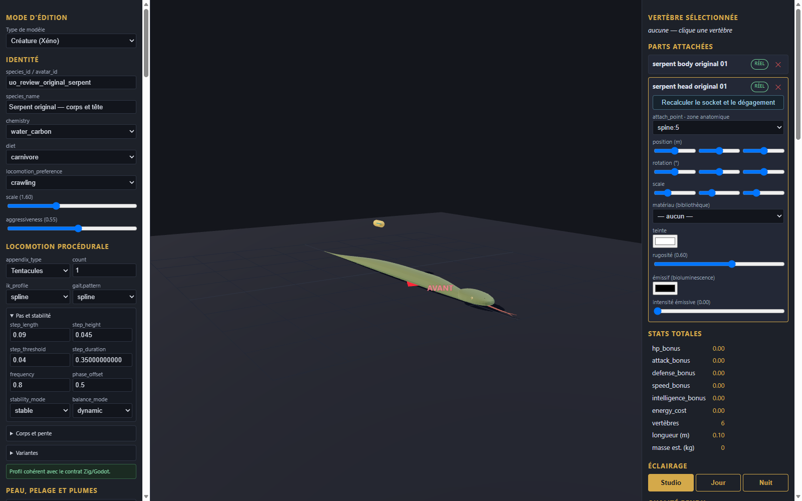

# Serpent original — corps et tête v0.1.0

Génome expérimental de revue, deux pièces originales et fragment de configuration à intégrer dans une copie de l’éditeur. Les éléments proviennent de la géométrie procédurale locale du serpent original ; aucune image ou géométrie historique n’est incluse. Les couleurs unies sont nouvelles.

Import, export et rechargement vérifiés dans l’éditeur en configuration isolée ; import statique dans Godot. Le profil technique tentacules ne décrit pas l’anatomie du serpent et ne qualifie aucune locomotion. Aucun mouvement, gameplay, collision complète, serveur, VR ou approbation artistique n’est certifié.

[Entrée](template.json) · [Génome](../../../../assets/xeno-editor/serpent-original/v0.1.0/genome.json) · [Recette source](../../../../assets/xeno-editor/serpent-original/v0.1.0/source-recipe.json) · [Configuration](../../../../assets/xeno-editor/serpent-original/v0.1.0/registration.json)

[Capture statique Godot](../../../../assets/xeno-editor/serpent-original/v0.1.0/godot-preview.png)
