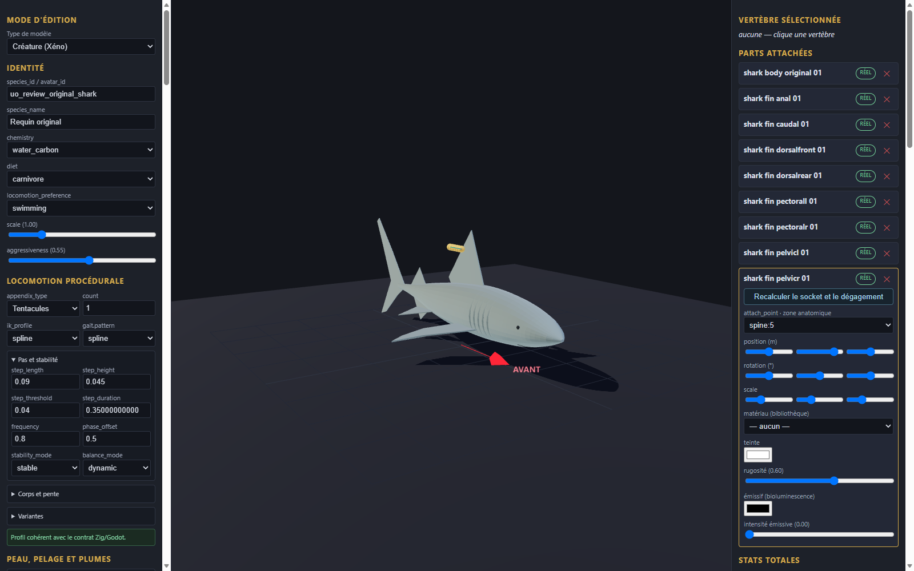

# Requin original v0.1.0

Génome expérimental de revue, neuf pièces originales et fragment de configuration à intégrer dans une copie de l’éditeur. Les éléments proviennent de la géométrie procédurale locale du requin original ; aucune image ou géométrie historique n’est incluse. Les couleurs unies sont nouvelles.

Import, export et rechargement vérifiés dans l’éditeur en configuration isolée ; import statique dans Godot. Le corps et les huit nageoires sont des pièces statiques sans rig. Le profil tentacule et la catégorie armor sont des choix techniques de revue, sans portée anatomique ni preuve de nage. Aucun mouvement, gameplay, collision complète, serveur, VR ou approbation artistique n’est certifié.

[Entrée](template.json) · [Génome](../../../../assets/xeno-editor/shark-original/v0.1.0/genome.json) · [Recette source](../../../../assets/xeno-editor/shark-original/v0.1.0/source-recipe.json) · [Configuration](../../../../assets/xeno-editor/shark-original/v0.1.0/registration.json)

[Capture statique Godot](../../../../assets/xeno-editor/shark-original/v0.1.0/godot-preview.png)

Source géométrique : modèle procédural original requin build-04, SHA-256 `dfa90cf3c512411a1ca1c9b3df152d4ae1fa10aea559560d8ee8623052a964bc`. Les textures, le squelette et l’animation source ne sont pas repris.
