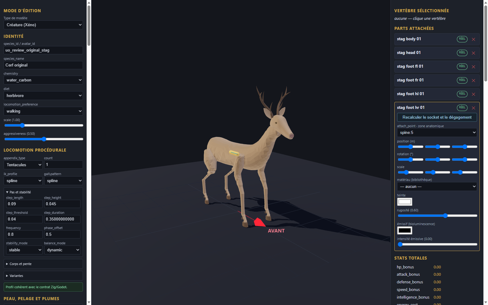

# Cerf original v0.1.0

Génome expérimental de revue, six pièces originales et fragment de configuration à intégrer dans une copie de l’éditeur. Les éléments proviennent de la géométrie procédurale locale du cerf original ; aucune image ou géométrie historique n’est incluse. Les couleurs unies sont nouvelles.

Import, export et rechargement vérifiés dans l’éditeur en configuration isolée ; import statique dans Godot. Le corps inclut la queue et les segments supérieurs des membres ; tête et quatre pieds sont séparés. La catégorie armor et le profil tentacule sont des choix techniques de revue, sans portée anatomique ni preuve de marche. Aucun mouvement, gameplay, collision complète, serveur, VR ou approbation artistique n’est certifié.

[Entrée](template.json) · [Génome](../../../../assets/xeno-editor/stag-original/v0.1.0/genome.json) · [Recette source](../../../../assets/xeno-editor/stag-original/v0.1.0/source-recipe.json) · [Configuration](../../../../assets/xeno-editor/stag-original/v0.1.0/registration.json)

[Capture statique Godot](../../../../assets/xeno-editor/stag-original/v0.1.0/godot-preview.png)

Source : modèle procédural original cerf build-06, SHA-256 `bf145c5f1603a77c73ea802c85ec97a4007dbe4557ca76f19d8dd1a211770403`. Les bois sont inclus dans la tête ; texture, squelette et animation source ne sont pas inclus. Les identités serveur distinctes ne sont pas qualifiées.
